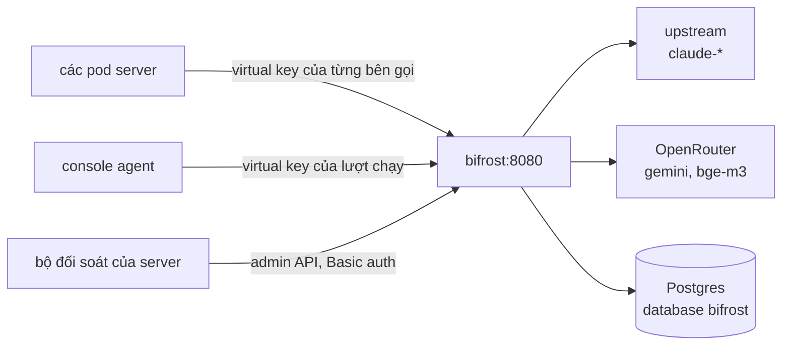

Tìm kiếm hỏi một mô hình ngôn ngữ xem câu truy vấn có nghĩa gì, một lượt đọc tin biến video hay ảnh của người bán thành bản nháp, một lượt kiểm tra lừa đảo đọc một cuộc trò chuyện, và console agent trả lời điều phối viên. Không bên nào tự gọi nhà cung cấp mô hình. Mỗi stack chạy Bifrost (`maximhq/bifrost:v2.6.0`), một cổng có API tương thích OpenAI, dưới dạng Service `bifrost` ở cổng 8080.

Bifrost là một file chạy Go duy nhất: nó dùng khoảng 260 tới 440 MiB và khởi động trong 1 tới 2 giây, hoặc khoảng 20 giây trên database rỗng khi đang chạy migration.

Chuyển giọng nói thành văn bản, vector ảnh và khung hình video không đi qua Bifrost. Đó là phân hệ ai của server, chạy trong `server-ai` và được gọi qua Restate.

## Agent

Một agent là một mục đích gọi mô hình. Bảng `ai_agents` của server giữ chúng, và một migration của server tạo sẵn các agent sau:

| Agent | Mô hình | Bên gọi | Dùng cho |
|---|---|---|---|
| `console-agent` | `upstream/claude-sonnet-5-5` | `console-agent` | console agent |
| `scam-check` | `upstream/claude-haiku-5-5` | `server-trust` | kiểm tra một khung chat xem có lừa đảo không |
| `listing-read` | `upstream/claude-haiku-5-5` | `server-assist` | đọc video, ảnh hoặc tin Chợ Tốt của người bán thành bản nháp |
| `search` | `openrouter/google/gemini-2.5-flash` | `server-search` | đọc câu truy vấn tìm kiếm |
| `embed-text` | `openrouter/baai/bge-m3`, chỉ DeepInfra | `server-embed-index`, `server-embed-search` | vector chữ của tin đăng và câu truy vấn |

Mô hình luôn viết là `provider/model`. Một tên mô hình trần sẽ mơ hồ khi hai nhà cung cấp cùng có nó, nên bên gọi không bao giờ gửi tên trần, và alias của Bifrost không được dùng. Mỗi agent còn có các mô hình dự phòng (thêm các mục `provider/model`, chưa tạo sẵn mục nào), một ngân sách theo tháng bằng USD (100 cho `console-agent`, 30 cho các agent khác) và một giới hạn tốc độ cho mỗi bên gọi.

## Ai sở hữu gì

| Thứ gì | Chủ | Ở đâu |
|---|---|---|
| Nhà cung cấp: base URL, API key, số lần thử lại, thời gian chờ | infra | `infra/stack/bifrost/config.json`; key nằm trong Secret `bifrost-secrets` |
| Agent: mô hình, mô hình dự phòng, giá mỗi mô hình, ngân sách tháng, bên gọi và giới hạn tốc độ của chúng | server | database của server, tạo sẵn bằng migration và sửa trong console |
| Team, virtual key, ngân sách, giới hạn tốc độ và giá ghi đè trong Bifrost | server | do bộ đối soát của server ghi; không ai khác ghi |
| Mức chi đo được, log, metric | Bifrost | kho log của Bifrost, server đọc từ đó; `/metrics` cho Prometheus |

Trang Providers của console chỉ để xem. Thêm một nhà cung cấp hay một key của nhà cung cấp là việc của infra. Mọi thứ của một agent được sửa trong console, và server ghi nó vào Bifrost.

## Triển khai

`infra/stack/templates/bifrost.yaml` render ConfigMap `bifrost-config` từ `bifrost/config.json` và `bifrost/start.sh`, một Deployment `bifrost` một replica ở sync wave 2, và Service `bifrost`. Các probe gọi `/health`. Pod xin 64Mi và bị giới hạn ở 512Mi. Startup probe cho phép hai phút, vì database rỗng mất khoảng 20 giây chạy migration.



Annotation của pod mang checksum của `config.json`, `start.sh`, `env/bifrost.env` và các secret đã seal của stack, nên đổi bất kỳ thứ nào trong đó sẽ khởi động lại Bifrost. Prometheus scrape `/metrics` ở cổng 8080.

## File cấu hình

`config.json` chỉ chứa `client`, `governance.auth_config`, hai kho dữ liệu, `encryption_key` và `providers`. Nó đặt `source_of_truth: "config.json"`, và Bifrost áp dụng điều đó theo từng phần: mỗi lần khởi động, nó đặt lại các nhà cung cấp theo file và giữ nguyên virtual key, team, ngân sách và giá ghi đè mà server đã tạo qua API. Một phần `governance` khác `auth_config` trong file sẽ xóa những gì server đã tạo, nên `infra/check.sh` báo lỗi khi gặp.

```json title="infra/stack/bifrost/config.json, các nhà cung cấp"
"upstream": {
  "keys": [{ "name": "upstream", "value": "env.LLM_UPSTREAM_API_KEY", "models": ["*"], "weight": 1 }],
  "network_config": {
    "base_url": "${LLM_UPSTREAM_BASE_URL}",
    "allow_private_network": true,
    "default_request_timeout_in_seconds": 120,
    "max_retries": 2
  },
  "custom_provider_config": { "base_provider_type": "openai", "allowed_requests": { "list_models": true, "chat_completion": true, "chat_completion_stream": true } }
},
"openrouter": {
  "keys": [{ "name": "openrouter", "value": "env.OPENROUTER_API_KEY", "models": ["*"], "weight": 1 }],
  "network_config": { "base_url": "https://openrouter.ai/api", "default_request_timeout_in_seconds": 60, "max_retries": 2 },
  "ignore_provider_cost": true
}
```

- `upstream` là một nhà cung cấp tự khai báo, nói API của OpenAI. URL của nó là `LLM_UPSTREAM_BASE_URL` trong `infra/stack/env/bifrost.env`, không có `/v1`. `allow_private_network` cho Bifrost gọi nó ở một địa chỉ nội bộ.
- `base_url` không nhận tham chiếu `env.`, nên file giữ chỗ trống `${LLM_UPSTREAM_BASE_URL}`. `start.sh` điền giá trị vào rồi ghi kết quả vào thư mục dữ liệu của Bifrost trước khi khởi động Bifrost. Chart và compose đều chạy `start.sh`.
- `openrouter` là nhà cung cấp có sẵn của Bifrost. `ignore_provider_cost` khiến Bifrost ghi chi phí theo giá của server, không theo giá của OpenRouter.
- `client` bật xác thực cho các lời gọi mô hình (`enforce_auth_on_inference`), chỉ để mở `/metrics` (`whitelisted_routes`), và đặt thông tin định tuyến của Bifrost vào header của response (`extra_fields_placement: "headers"`).
- Log không giữ body của request hay response (`disable_content_logging`), vì ảnh của tìm bằng ảnh đi qua đây, và được giữ 30 ngày.
- `auth_config` bảo vệ admin API và UI bằng user `BIFROST_ADMIN_USERNAME` (`admin`, trong `env/bifrost.env`) và `BIFROST_ADMIN_PASSWORD`.

## Key và ngân sách

Bộ đối soát của server ghi các đối tượng quản trị của Bifrost. Nó chạy khi server khởi động (thử lại tới khi thành công), sau mỗi lần ghi cài đặt AI, mỗi 5 phút, và khi một bên gọi không tìm thấy key của mình. Nó giữ một advisory lock của Postgres, nên hai replica không bao giờ cùng tạo một key hai lần. Thiết kế nằm ở trang [Lớp AI](/vi/architecture/ai).

<Steps>
<Step title="Liệt kê những gì server sở hữu">
Nó liệt kê các team, các virtual key mang `metadata.owner = "server"` và các giá ghi đè tên `server:<provider>/<model>`.
</Step>
<Step title="Ghi từng agent">
Mỗi agent một team, đặt tên theo slug của agent, mang ngân sách tháng. Mỗi bên gọi một virtual key, nằm dưới team của agent, mang giới hạn tốc độ của bên gọi và `allowed_models`: đúng mô hình và các mô hình dự phòng của agent. Một key bị lộ không gọi được gì khác.
</Step>
<Step title="Ghi giá">
Mỗi dòng của `ai_model_prices` thành một giá ghi đè cho nhà cung cấp và mô hình của nó.
</Step>
<Step title="Dọn dẹp">
Nó xóa các key và giá ghi đè của server mà không bên gọi hay giá nào còn nêu, và tắt key của các agent đang tắt. Team không bao giờ bị xóa, cũng như agent.
</Step>
<Step title="Nạp key">
Nó đọc giá trị của mọi key thuộc server vào bộ nhớ của server.
</Step>
</Steps>

Bifrost sinh giá trị key. Không key nào của bên gọi được lưu trong git, trong Secret hay trong database của server. Server đưa key cho các module của nó từ bộ nhớ. Khi Bifrost từ chối một key vì không biết, đã tắt hoặc không được dùng mô hình đó, server đọc lại các key (nhiều nhất mỗi 10 s) và thử lại một lần nếu key đã đổi. 401 hay 403 của chính nhà cung cấp thì được trả thẳng ra. Console agent nhận key, mô hình, mô hình dự phòng và giá trong mỗi request chạy; xem [Agent và cấu hình](/vi/agent/setup).

UI của Bifrost hiện team và key của server. Một chỉnh sửa làm ở đó bị ghi đè ở lần đối soát tiếp theo.

## Giá và mức chi

`ai_model_prices` giữ giá của mọi mô hình mà agent dùng, bằng USD cho mỗi token vào, ra, đọc cache và ghi cache, tạo sẵn theo giá niêm yết, nên ngân sách tính bằng đô la. Bộ chọn mô hình trong console điền sẵn giá từ danh mục của Bifrost. Bifrost tính chi phí mỗi lời gọi theo các giá này và trừ vào team của bên gọi.

Console đọc mức chi theo agent và theo ngày từ log của Bifrost và hiện nó ở trang Overview. Số tổng của Bifrost chậm hơn thời gian thực tối đa một phút. Ngân sách của mỗi agent nằm trên trang của chính agent đó.

## Khi hết ngân sách hay vượt giới hạn

- Hết ngân sách tháng: Bifrost trả 402 với `X-Bifrost-Error-Type: policy_budget_exceeded`. Console agent kết thúc đoạn chạy với `agent_budget` ([Giới hạn và lỗi](/vi/agent/limits)).
- Một bên gọi vượt giới hạn tốc độ: Bifrost trả 429 với `policy_rate_limited` và không gửi Retry-After. Console agent chờ hết khung thời gian ghi trong thông báo, hoặc 60 giây.
- Hết credit OpenRouter: mã 402 của upstream được chuyển nguyên.

Tìm kiếm của server không hỏng khi mô hình hỏng. `Search` trong `server/internal/discovery/service/search.go` cho mô hình 4 giây. Gặp bất kỳ lỗi nào, nó ghi log mức warn `the model did not read the query` kèm lỗi, rồi tìm bằng đúng những từ người dùng gõ. Trang kết quả khi đó không có chip và không được ưu tiên theo danh mục, giá, nơi bán hay độ mới. Câu truy vấn mô hình đã đọc trong 7 ngày qua lấy từ cache của server và giữ nguyên cách hiểu.

## OpenRouter và vector chữ

`search` và `embed-text` đi tới OpenRouter bằng `OPENROUTER_API_KEY` của stack, mỗi stack một key. Hãy đặt cho key đó một hạn mức credit theo ngày trên OpenRouter; đó là chốt chặn cuối sau ngân sách của các agent.

OpenRouter phục vụ `baai/bge-m3` từ hai nhà cung cấp. DeepInfra (fp32) cho các vector của TEI mà các stack từng chạy với cosine 0,999999 trên mọi văn bản tham chiếu dưới 2048 token; Parasail cho 0,996. `embed-text` ghim DeepInfra và không cho dự phòng, nên vector đã lưu và vector mới nằm trong cùng một không gian.

Server lưu `EMBED_TEXT_VERSION` và `EMBED_IMAGE_VERSION` cùng mỗi vector. Cả hai nằm trong `infra/stack/env/server.env`. Một mô hình mới cần một version mới trong cùng thay đổi: server khi đó coi các vector đã lưu là chưa có, và `go run ./cmd/search-reindex -every 2s` trong server embed lại mọi tin đăng. `EMBED_TEXT_MODEL` chỉ còn là công tắc bật tắt vector chữ: `server.embed.text` trong values của stack đặt nó.

## Database

Bifrost giữ kho cấu hình và log của nó trong database `bifrost` trên cluster CNPG `postgres` của stack. `templates/postgres.yaml` khai báo managed role `bifrost`, lấy mật khẩu từ Secret basic-auth `bifrost-db` (`username` và `password`), và một `Database` của CNPG tên `bifrost` do role đó sở hữu, ở wave 1.

Chart cho Bifrost `BIFROST_DB_HOST=postgres-rw`, `BIFROST_DB_USER=bifrost` và `BIFROST_DB_PASSWORD` từ `bifrost-db`. Lịch sử mức chi của LiteLLM không được chuyển sang. CNPG không xóa database hay role mà chart thôi khai báo, nên database và role `litellm` cũ phải được xóa bằng tay một lần; xem [Runbook](/vi/operations/cluster/runbook#sau-khi-chuyển-sang-bifrost).

## Secret

`go -C infra run ./cmd/seal <stack>` sinh ba giá trị Bifrost dưới đây vào `infra/stack/secrets/<stack>.env`. Bạn tự ghi hai key của nhà cung cấp.

| Giá trị trong `<stack>.env` | Seal vào | Ai đọc |
|---|---|---|
| `BIFROST_ADMIN_PASSWORD` | `bifrost-secrets` | Bifrost; server dưới tên `GATEWAY_ADMIN_PASSWORD`; bạn trong UI |
| `BIFROST_ENCRYPTION_KEY` | `bifrost-secrets` | Bifrost, dùng nó để mã hóa những gì nó lưu |
| `LLM_UPSTREAM_API_KEY` | `bifrost-secrets` | Bifrost, cho nhà cung cấp `upstream` |
| `OPENROUTER_API_KEY` | `bifrost-secrets` | Bifrost, cho nhà cung cấp `openrouter` |
| `BIFROST_DB_PASSWORD` | `bifrost-db`, kèm `username: bifrost` | CNPG cho role, Bifrost |

<Callout type="danger" title="Không bao giờ đổi khóa mã hóa">
Một `BIFROST_ENCRYPTION_KEY` mới khiến mọi thứ Bifrost đã lưu không đọc được nữa. Trên dev, nó được seal trên máy chủ của cluster. Hãy chép nó và `BIFROST_ADMIN_PASSWORD` vào `dev.env` của bạn trước mọi lần chạy đầy đủ `seal dev`; [Runbook](/vi/operations/cluster/runbook#khóa-mã-hóa-của-bifrost) có các lệnh.
</Callout>

Server đọc `GATEWAY_URL=http://bifrost:8080` và `GATEWAY_ADMIN_USERNAME=admin` từ `infra/stack/env/server.env`. Agent đọc `GATEWAY_BASE_URL=http://bifrost:8080/v1` từ `infra/stack/env/agent.env`. Các key bên gọi thời LiteLLM (`LLM_API_KEY`, `ASSIST_LLM_API_KEY`, `TRUST_LLM_API_KEY`, `EMBED_*_API_KEY`, `AGENT_LLM_API_KEY`) đã bỏ khỏi `server-secrets` và `agent-secrets`.

## Mạng

`default-deny-ingress` cũng áp cho Bifrost, và `from-stack` không gồm nó. Hai policy trong `infra/stack/templates/networkpolicy.yaml` nêu nó:

| Policy | Cho phép |
|---|---|
| `to-bifrost` | cổng 8080 từ server, console agent và Prometheus của cluster |
| `bifrost-egress` | DNS; Postgres ở 5432; cổng của upstream ở mọi địa chỉ; 443 chỉ tới địa chỉ công khai (OpenRouter, và `getbifrost.ai` cho bảng giá) |

NetworkPolicy không nêu được tên máy, nên chart đọc cổng của upstream từ `LLM_UPSTREAM_BASE_URL` và mở cổng đó. `from-traefik` cho Traefik vào để phục vụ host dashboard. Bifrost tải bảng giá khi khởi động và vẫn khởi động khi không tải được; giá của server đã phủ mọi mô hình đang dùng.

## Metric và cảnh báo

Dashboard platform của Grafana và các cảnh báo của cluster đọc metric của Bifrost: `bifrost_success_requests_total`, `bifrost_error_requests_total`, `bifrost_upstream_latency_seconds`, `bifrost_cost_total` và `bifrost_provider_key_up`, gắn nhãn `team_name`, tức agent. Hai cảnh báo theo dõi chúng: `sn-bifrost-failing`, tỉ lệ lời gọi thất bại trong 10 phút, và `sn-bifrost-key-down`, một key của nhà cung cấp có lần gọi gần nhất thất bại suốt 10 phút.

## Dashboard

Host dashboard `bifrost.<domain>` của stack, nằm sau phần đăng nhập của console, dẫn tới `bifrost:8080`. Đăng nhập UI của Bifrost với user `admin` và `BIFROST_ADMIN_PASSWORD`:

```bash
kubectl -n shopnexus-dev get secret bifrost-secrets -o jsonpath='{.data.BIFROST_ADMIN_PASSWORD}' | base64 -d; echo
```

Dùng UI để đọc log và mức chi của từng team. Mọi thay đổi làm trong console.

## Stack cục bộ

`docker-compose.yml` ở gốc chạy `bifrost-dev` và `bifrost-prod` với cùng image, `config.json`, `start.sh` và `env/bifrost.env`, trả lời dưới tên `bifrost` trong stack của chúng. Chúng không có host: chỉ server và agent gọi chúng. `bifrost-keys-<stack>` thêm `BIFROST_ADMIN_PASSWORD`, `BIFROST_ENCRYPTION_KEY` và `GATEWAY_ADMIN_PASSWORD` vào volume key khi còn thiếu, và `bifrost-db-<stack>` tạo database `bifrost`. Key của nhà cung cấp lấy từ `infra/stack/secrets/compose.env`. Các khối `x-bifrost-env-<stack>` của compose đặt `BIFROST_DB_HOST`, `BIFROST_DB_USER` và `BIFROST_DB_PASSWORD`.

## Đổi mô hình hoặc ngân sách

<Steps>
<Step title="Mở agent trong console">
Trong **Settings**, mở agent. Chọn nhà cung cấp và mô hình, thêm mô hình dự phòng nếu cần, rồi đặt ngân sách tháng và giới hạn tốc độ của các bên gọi.
</Step>
<Step title="Kiểm tra giá">
Mô hình cần có giá. Bộ chọn mô hình điền sẵn giá trong danh mục của Bifrost; sửa nó trên mô hình nếu giá niêm yết khác.
</Step>
<Step title="Lưu">
Server đối soát Bifrost ngay. Không cần khởi động lại và không cần image mới.
</Step>
</Steps>

Server yêu cầu response format `json_schema` chặt. Mô hình bỏ qua nó sẽ trả văn bản server không giải mã được, và tìm kiếm quay về chữ gốc ở mọi câu truy vấn. Một mô hình `embed-text` mới còn cần `EMBED_TEXT_VERSION` mới và một lần index lại.

## Thêm nhà cung cấp hoặc key của nhà cung cấp

<Steps>
<Step title="Sửa cấu hình">
Thêm nhà cung cấp vào `providers` trong `infra/stack/bifrost/config.json`, với key là `env.<NAME>`.
</Step>
<Step title="Seal key">
Thêm `<NAME>` vào `bifrost-secrets` trong `infra/cmd/seal/main.go`, vào danh sách env trong `templates/bifrost.yaml` và vào `infra/stack/secrets/example.env`; ghi giá trị vào `<stack>.env` và `compose.env`, rồi seal từng stack.
</Step>
<Step title="Mở mạng">
Nếu nhà cung cấp không ở cổng 443 trên địa chỉ công khai, nới `bifrost-egress`.
</Step>
<Step title="Kiểm tra và push">
Chạy `infra/check.sh` và `helm unittest stack` trong `infra/`, rồi commit và push. Bifrost khởi động lại với cấu hình mới, và nhà cung cấp hiện trên trang Providers của console.
</Step>
</Steps>

<KeyRules>
- Bên gọi luôn gửi `provider/model`; alias của Bifrost không được dùng.
- Server là bên duy nhất ghi team, virtual key, ngân sách và giá ghi đè; `config.json` giữ các nhà cung cấp.
- `config.json` không có phần `governance` nào khác `auth_config`.
- Ngân sách tính theo tháng cho mỗi agent, bằng USD; giới hạn tốc độ tính cho mỗi bên gọi.
- `BIFROST_ENCRYPTION_KEY` không bao giờ đổi khi stack đã có dữ liệu.
- `embed-text` giữ ghim DeepInfra chừng nào `EMBED_TEXT_VERSION` còn ghi bge-m3.
</KeyRules>
