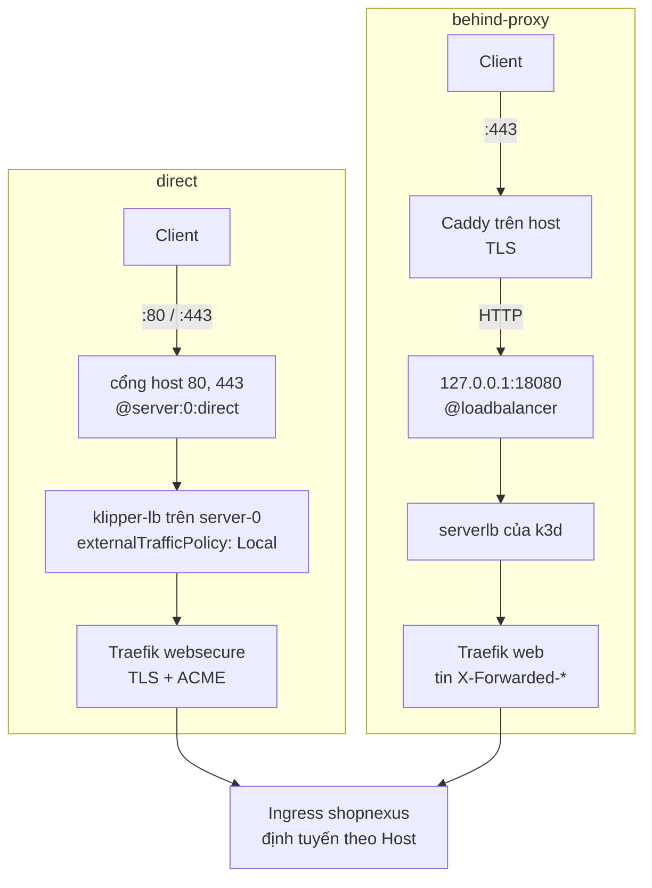
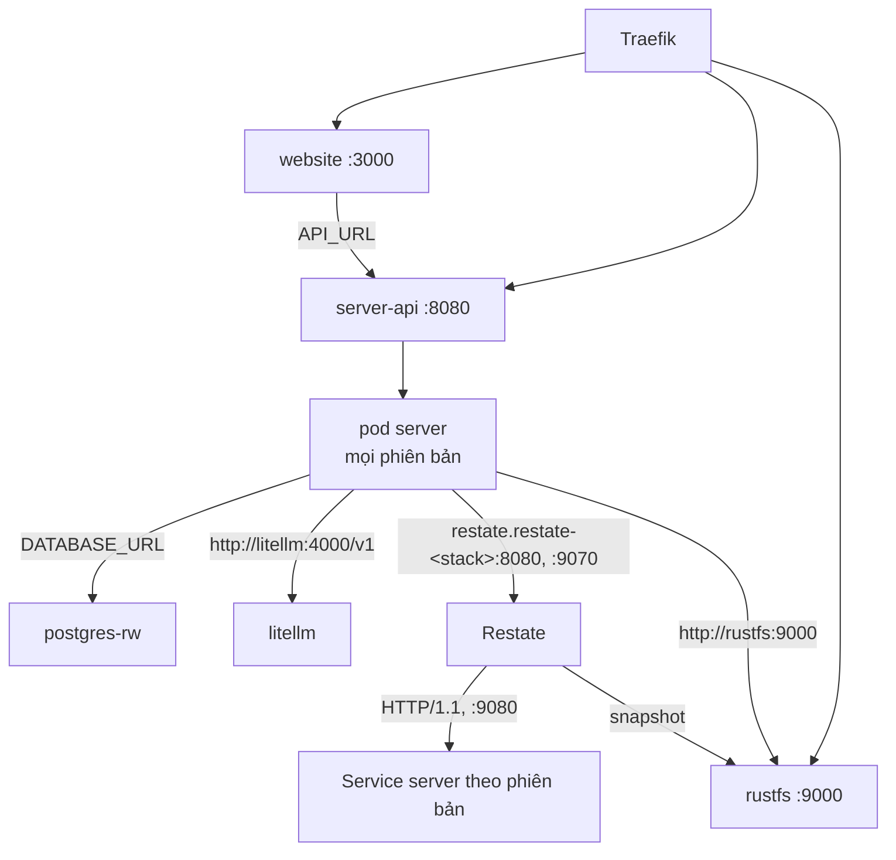
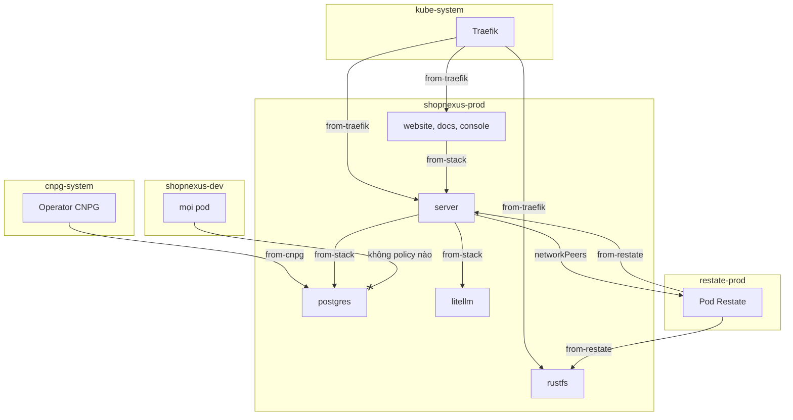

Mỗi stack là một namespace, `shopnexus-dev` hoặc `shopnexus-prod`, và các host của stack đều suy ra từ giá trị `domain` của nó. Traefik, ingress controller đi kèm k3s, nhận mọi request và định tuyến theo header `Host`. Request tới Traefik bằng đường nào thì tùy chế độ biên (edge mode) truyền cho `infra/cluster/up.sh`.

## Chế độ biên

Khi tạo cluster, `up.sh direct` hoặc `up.sh behind-proxy` chọn hai thứ: cách k3d map cổng, và `HelmChartConfig` của Traefik lấy từ `infra/cluster/edge-direct.yaml` hoặc `infra/cluster/edge-behind-proxy.yaml`. Ở cả hai chế độ, Traefik chạy một replica, gắn cố định vào node control-plane `server-0`.



<Tabs labels={["direct", "behind-proxy"]}>
<Tab>
Dùng `direct` trên máy mà cổng 80 và 443 chưa có ai giữ. `up.sh` không chạy nếu thiếu `ACME_EMAIL`.

```bash
ACME_EMAIL=you@example.com infra/cluster/up.sh direct
```

- `up.sh` map `--port 80:80@server:0:direct` và `--port 443:443@server:0:direct`. Hai cổng đi thẳng vào `server-0`, nơi Traefik chạy, và bỏ qua serverlb của k3d, một stream proxy nginx thay địa chỉ của client bằng địa chỉ của chính nó.
- Service của Traefik đặt `externalTrafficPolicy: Local`, nên klipper-lb chuyển kết nối cho pod Traefik trên cùng node và giữ nguyên địa chỉ nguồn.
- Resolver `le` lấy chứng chỉ từ Let's Encrypt bằng challenge TLS-ALPN-01 (`tlsChallenge: true`), challenge này trả lời ngay trên cổng 443. Chứng chỉ nằm ở `/data/acme.json` trên một volume 128Mi. Volume đó chỉ một pod giữ được, nên Deployment dùng `updateStrategy: Recreate`.
- `ACME_SERVER` mặc định là thư mục staging của Let's Encrypt, `https://acme-staging-v02.api.letsencrypt.org/directory`, và trình duyệt không chấp nhận chứng chỉ staging. Khi staging đã chạy ổn, đặt `ACME_SERVER=https://acme-v02.api.letsencrypt.org/directory` để lấy chứng chỉ thật.
- Entrypoint `web` chuyển hướng sang `websecure` với `permanent: true`. HTTP thường nhận về 301.
- Access log được bật (`accessLog.enabled: true`).
</Tab>
<Tab>
Dùng `behind-proxy` khi trên host đã có một proxy giữ cổng 80 và 443. Server của tác giả chạy chế độ này, sau một Caddy dùng chung với các dự án khác.

```bash
infra/cluster/up.sh behind-proxy
```

- `up.sh` map `--port 127.0.0.1:18080:80@loadbalancer`. Chỉ chính host mới gọi được cổng 18080.
- Proxy bên ngoài kết thúc TLS, chuyển hướng HTTP thường (Caddy trả 308) và gửi HTTP tới `127.0.0.1:18080`. Trên server của tác giả, cấu hình proxy đó là `conf.d/shopnexus.caddy`, liệt kê các host của cả hai stack.
- Entrypoint `web` của Traefik tin header `X-Forwarded-*` từ `10.0.0.0/8`, `172.16.0.0/12` và `192.168.0.0/16`, dải này bao cả mạng Docker của k3d. Traefik chuyển tiếp địa chỉ client lấy từ `X-Forwarded-For` của proxy bên ngoài xuống các pod.
- Ở chế độ này Traefik không làm TLS và không chuyển hướng.
</Tab>
</Tabs>

### Manifest Ingress ở cả hai chế độ

Ingress của chart, `shopnexus` trong `infra/stack/templates/ingress.yaml`, chỉ ghi host và Service, không có mục `tls`. Ở `direct`, TLS đặt trên entrypoint `websecure` của Traefik (`tls.enabled: true`, `certResolver: le`), nên mọi route trên entrypoint đó đều có chứng chỉ cho host của mình. Ở `behind-proxy`, TLS kết thúc trước khi vào cluster. Chart render ra cùng một bộ manifest cho cả hai chế độ, và `infra/check.sh` báo lỗi nếu Ingress có thêm khóa `tls`.

Server tin `X-Forwarded-For` từ `TRUSTED_PROXIES`, đặt bằng mạng pod `10.42.0.0/16`, là nơi request của Traefik đi ra.

## Host

Helper `sn.host` dựng mọi host từ `domain`: tiền tố rỗng cho ra chính domain, có tiền tố thì cho ra `<tiền tố>.<domain>`. Route của console có khi `console.enabled` là true, và đó là giá trị mặc định.

| Host | Service | Cổng | prod | dev |
|---|---|---|---|---|
| `<domain>` | `website` | 3000 | `shopnexus.id.vn` | `dev.shopnexus.id.vn` |
| `api.<domain>` | `server-api` | 8080 | `api.shopnexus.id.vn` | `api.dev.shopnexus.id.vn` |
| `media.<domain>` | `rustfs` | 9000 | `media.shopnexus.id.vn` | `media.dev.shopnexus.id.vn` |
| `docs.<domain>` | `docs` | 80 | `docs.shopnexus.id.vn` | `docs.dev.shopnexus.id.vn` |
| `console.<domain>` | `console` | 80 | `console.shopnexus.id.vn` | `console.dev.shopnexus.id.vn` |

Mọi đường dẫn của một host (`/`, `pathType: Prefix`) đều tới đúng một Service. `infra/check.sh` so danh sách host render ra của cả hai stack với các giá trị này.

## Chart Traefik 41

k3s `v1.37.1-k3s1`, image ghi trong `infra/cluster/k3d.yaml`, đi kèm chart Traefik 41.4.0. Schema values của chart này từ chối mọi khóa nó không biết. Bản nháp đầu của `edge-direct.yaml` dùng khóa cũ (`ports.web.redirections`, `ports.websecure.tls`, `logs`). Chart từ chối chúng, và k3s chạy Traefik với values mặc định (không ACME, không chuyển hướng, không access log) mà không resource nào báo lỗi.

Các khóa đang dùng là `ports.web.http.redirections`, `ports.websecure.http.tls`, `accessLog.enabled` và `certificatesResolvers.le.acme.tlsChallenge`. `infra/check.sh` render cả hai file biên bằng `helm template` với chart 41.4.0 rồi tìm các tham số Traefik tương ứng:

- direct: `externalTrafficPolicy: Local`, `--entryPoints.websecure.http.tls.certResolver=le`, `--entryPoints.web.http.redirections.entryPoint.to=:443`, `--certificatesresolvers.le.acme.tlsChallenge=true`, `--accesslog=true`;
- behind-proxy: `--entryPoints.web.forwardedHeaders.trustedIPs=10.0.0.0/8,172.16.0.0/12,192.168.0.0/16`, và không có chuyển hướng.

Script cũng ghim image k3s ở `rancher/k3s:v1.37.1-k3s1`. Nâng k3s lên bản mang chart Traefik khác thì check sẽ fail cho tới khi các file biên được render lại với chart mới.

<Callout type="warning" title="Địa chỉ client ở chế độ direct">
Trên cluster k3d cục bộ, đường qua serverlb cho Traefik thấy địa chỉ pod (`10.42.x`), sau đó là địa chỉ của chính serverlb (`172.24.0.6`). Với `@server:0:direct` và `externalTrafficPolicy: Local`, request từ cùng máy vẫn hiện địa chỉ gateway của Docker, vì userland proxy của Docker xử lý nó. Request từ máy khác chưa thử được, vì tường lửa của laptop chặn. Chế độ `direct` có giữ được địa chỉ của client bên ngoài hay không sẽ được kiểm tra ở lần triển khai `direct` đầu tiên; tới lúc đó, log có thể ghi địa chỉ gateway. `behind-proxy` không bị ảnh hưởng, vì Caddy đặt `X-Forwarded-For`.
</Callout>

## Lưu lượng trong cluster

Mỗi chặng trong cluster đều đi tới một Service của Kubernetes, Service này cân bằng kết nối ở tầng L4 qua các pod sẵn sàng phía sau, trên bất kỳ node nào. Cluster có một node server và ba agent. Các app ưu tiên `agent-1` và `agent-2` (nhãn `role=app`), nên một Service thường trải pod của stack ra hai node.



- `RestateDeployment` của server cho mỗi pod template một ReplicaSet và một Service riêng, rồi đăng ký Service đó với Restate. Đổi config hoặc seal lại secret làm đổi checksum trong template, nên tạo ra một phiên bản mới. Operator giữ phiên bản cũ tới khi các invocation của nó chạy xong.
- Restate gọi server qua Service của từng phiên bản, cổng 9080 (`restate`). Invocation bắt đầu trên phiên bản nào thì ở lại phiên bản đó.
- `server-api` chọn `app.kubernetes.io/name: server`, nên bao mọi phiên bản. Lưu lượng API công khai tới bất kỳ pod server nào đang sẵn sàng.
- Server gọi ingress của Restate ở `http://restate.restate-<stack>:8080` và admin API ở `:9070`. `RestateCluster` nằm trong namespace riêng, `restate-dev` hoặc `restate-prod`.

`useHttp11: true` khiến Restate gọi endpoint bằng HTTP/1.1. Với HTTP/2, Restate giữ một kết nối dài và ghép nhiều invocation trên đó, mà Service L4 cân bằng theo kết nối, nên mọi invocation có thể rơi vào cùng một pod. Với HTTP/1.1, mỗi invocation là một request riêng và được chia đều qua các pod.

## NetworkPolicy

`infra/stack/templates/networkpolicy.yaml` đặt năm policy trong mỗi namespace của stack. `default-deny-ingress` chọn mọi pod và không cho gì vào, còn mỗi policy trong bốn cái kia mở cho một nguồn.

| Policy | Pod được chọn | Cho phép lưu lượng từ |
|---|---|---|
| `default-deny-ingress` | mọi pod | không gì cả |
| `from-stack` | mọi pod | mọi pod trong cùng namespace |
| `from-traefik` | `website`, `docs`, `console`, `server`, `rustfs` | pod `app.kubernetes.io/name: traefik` trong `kube-system` |
| `from-cnpg` | `cnpg.io/cluster: postgres` | namespace `cnpg-system` (operator CloudNativePG) |
| `from-restate` | `server`, `rustfs` | namespace `restate-<stack>` |



Restate-operator tự viết policy cho namespace của Restate dựa trên `RestateCluster`:

- `spec.security.networkPeers.ingress` và `.admin` chỉ cho pod `app.kubernetes.io/name: server` trong namespace của stack vào cổng ingress và admin của Restate.
- Pod Restate được kết nối tới các pod mang nhãn `allow.restate.dev/restate-<stack>: "true"`. Pod template của server và StatefulSet `rustfs` mang nhãn này, cho invocation và snapshot.

<KeyRules>
- `from-stack` không có `namespaceSelector`, nên chỉ cho pod trong chính namespace của nó.
- Không policy nào mở đường từ `shopnexus-dev` vào `shopnexus-prod` hay theo chiều ngược lại, và `from-restate` của mỗi stack chỉ ghi namespace `restate-<stack>` của chính stack đó.
- Egress để mở. Server gọi Firebase, FCM và upstream của mô hình ngôn ngữ ở ngoài cluster.
- Mọi pod trong stack gọi được `litellm` qua `from-stack`. Chỉ server giữ virtual key của nó.
</KeyRules>

Bài diễn tập trong [Runbook](/vi/operations/cluster/runbook#diễn-tập-failover) kết nối từ một pod trong `shopnexus-dev` tới `postgres-rw.shopnexus-prod`. NetworkPolicy bỏ các gói tin, nên kết nối hết thời gian chờ (timeout). Bài diễn tập được lên kế hoạch cho server thật và chưa chạy.

## Bản ghi DNS

Trỏ các bản ghi A sau về máy chủ. Với prod ở `shopnexus.id.vn`, bốn bản ghi này phủ cả hai stack.

| Tên | Phủ |
|---|---|
| `@` | `shopnexus.id.vn` (website prod) |
| `*` | `api.`, `media.`, `docs.`, `console.` của prod |
| `*.dev` | `api.`, `media.`, `docs.`, `console.` của dev |
| `dev` | `dev.shopnexus.id.vn` (website dev) |

<Callout type="warning" title="Bản ghi dev">
Wildcard `*` chỉ trả lời cho những tên không tồn tại trong zone. Tạo `*.dev` làm `dev` tồn tại thành một node của zone, nên `*` thôi phủ `dev.shopnexus.id.vn` và website dev không phân giải được. Hãy thêm `dev` thành một bản ghi riêng.
</Callout>

## Địa chỉ API của website và console

Website là Astro render phía server, và nó gọi API trong lúc render trang. Nó đọc `API_URL` lúc chạy (`astro:env/server`), và image đặt `API_URL=http://server-api:8080/v1` trong `website/Dockerfile`. Tên Service ngắn được phân giải trong namespace của chính pod, nên cùng một image gọi server dev khi chạy trong `shopnexus-dev` và server prod khi chạy trong `shopnexus-prod`. Lời gọi này ở trong cluster và được `from-stack` cho qua.

Console là app tĩnh, gọi API từ trình duyệt. `console/src/lib/api.ts` lấy host của chính trang, bỏ `console.` ở đầu và thêm `api.` vào trước: trang trên `console.shopnexus.id.vn` gọi `https://api.shopnexus.id.vn/v1`, trang trên `console.dev.shopnexus.id.vn` gọi `https://api.dev.shopnexus.id.vn/v1`. `VITE_API_URL` thay giá trị này khi phát triển cục bộ. Request mang theo cookie (`credentials: 'include'`), và server nhận chúng từ `STAFF_CONSOLE_ORIGIN`, được chart đặt là `https://console.<domain>`.
