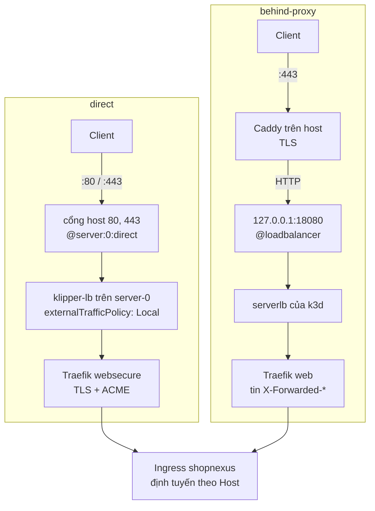
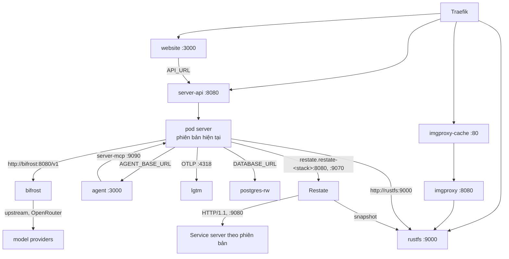
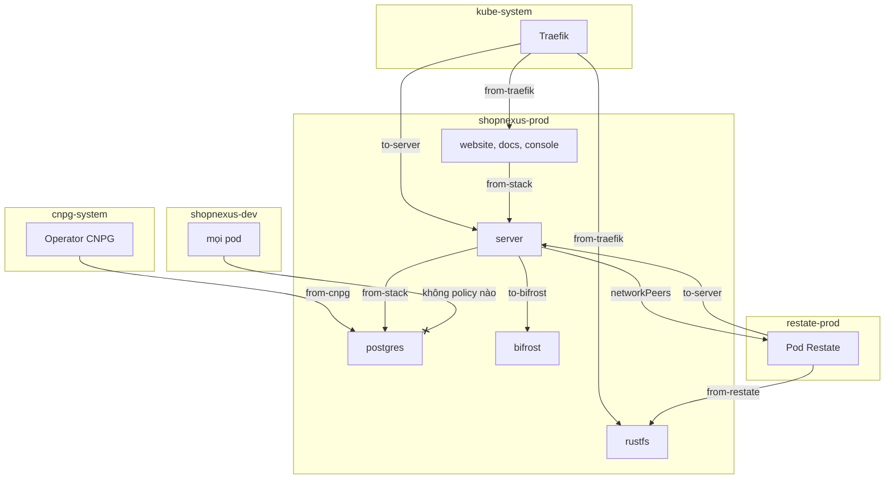

Mỗi stack là một namespace, `shopnexus-dev` hoặc `shopnexus-prod`, và các host của stack đều suy ra từ giá trị `domain` của nó. Traefik, ingress controller đi kèm k3s, nhận mọi request và định tuyến theo header `Host`. Request tới Traefik bằng đường nào thì tùy chế độ biên (edge mode), tức file cấu hình k3d dùng để tạo cluster.

## Chế độ biên

`infra/cluster/k3d-direct.yaml` và `infra/cluster/k3d-behind-proxy.yaml` khác nhau ở hai thứ: cách k3d map cổng, và `HelmChartConfig` của Traefik viết thẳng trong danh sách `files:` của file cấu hình, được k3s áp dụng ở lần khởi động đầu. Ở cả hai chế độ, Traefik chạy một replica, gắn cố định vào node control-plane `server-0`.



<Tabs labels={["direct", "behind-proxy"]}>
<Tab>
Dùng `direct` trên máy mà cổng 80 và 443 chưa có ai giữ. Đặt `ACME_EMAIL`; k3d điền `${ACME_EMAIL}` trong file cấu hình từ biến môi trường.

```bash
ACME_EMAIL=you@example.com k3d cluster create --config infra/cluster/k3d-direct.yaml
```

- File cấu hình map cổng `80:80` và `443:443` với node filter `server:0:direct`. Hai cổng đi thẳng vào `server-0`, nơi Traefik chạy, và bỏ qua serverlb của k3d, một stream proxy nginx thay địa chỉ của client bằng địa chỉ của chính nó.
- Service của Traefik đặt `externalTrafficPolicy: Local`, nên klipper-lb chuyển kết nối cho pod Traefik trên cùng node và giữ nguyên địa chỉ nguồn.
- Resolver `le` lấy chứng chỉ từ Let's Encrypt bằng challenge TLS-ALPN-01 (`tlsChallenge: true`), challenge này trả lời ngay trên cổng 443. Chứng chỉ nằm ở `/data/acme.json` trên một volume 128Mi. Volume đó chỉ một pod giữ được, nên Deployment dùng `updateStrategy: Recreate`.
- Resolver dùng thư mục production của Let's Encrypt. Để thử với thư mục staging, có giới hạn tần suất cao hơn và chứng chỉ mà trình duyệt không chấp nhận, thêm `caServer: https://acme-staging-v02.api.letsencrypt.org/directory` dưới `acme` trong `k3d-direct.yaml` trước khi tạo cluster.
- Entrypoint `web` chuyển hướng sang `websecure` với `permanent: true`. HTTP thường nhận về 301.
- Access log được bật (`accessLog.enabled: true`).
- `providers.kubernetesCRD.allowCrossNamespace: true` cho route của các dashboard tới được giao diện admin của Restate và Argo CD trong namespace riêng của chúng.
</Tab>
<Tab>
Dùng `behind-proxy` khi trên host đã có một proxy giữ cổng 80 và 443. Server của tác giả chạy chế độ này, sau một Caddy dùng chung với các dự án khác.

```bash
k3d cluster create --config infra/cluster/k3d-behind-proxy.yaml
```

- File cấu hình map cổng `127.0.0.1:18080:80` với node filter `loadbalancer`. Chỉ chính host mới gọi được cổng 18080.
- Proxy bên ngoài kết thúc TLS, chuyển hướng HTTP thường (Caddy trả 308) và gửi HTTP tới `127.0.0.1:18080`. Trên server của tác giả, cấu hình proxy đó là `conf.d/shopnexus.caddy`, liệt kê các host của cả hai stack.
- Entrypoint `web` của Traefik tin header `X-Forwarded-*` từ `10.0.0.0/8`, `172.16.0.0/12` và `192.168.0.0/16`, dải này bao cả mạng Docker của k3d. Traefik chuyển tiếp địa chỉ client lấy từ `X-Forwarded-For` của proxy bên ngoài xuống các pod.
- Ở chế độ này Traefik không làm TLS và không chuyển hướng. Access log của nó ở dạng JSON và chỉ giữ các header `User-Agent`, `X-Forwarded-For` và `Referer`, nên cookie và `Authorization` không lọt vào log.
- Tham chiếu chéo namespace được cho phép, giống `direct`.
</Tab>
</Tabs>

### Manifest Ingress ở cả hai chế độ

Các Ingress của chart (`shopnexus` và `private` trong `infra/stack/templates/ingress.yaml`, và `IngressRoute` của các dashboard) chỉ ghi host và Service, không có mục `tls`. Ở `direct`, TLS đặt trên entrypoint `websecure` của Traefik (`tls.enabled: true`, `certResolver: le`), nên mọi route trên entrypoint đó đều có chứng chỉ cho host của mình. Ở `behind-proxy`, TLS kết thúc trước khi vào cluster. Chart render ra cùng một bộ manifest cho cả hai chế độ, và test của chart, do `infra/check.sh` chạy, báo lỗi nếu một Ingress có thêm khóa `tls`.

Server tin `X-Forwarded-For` từ `TRUSTED_PROXIES`, đặt bằng mạng pod `10.42.0.0/16`, là nơi request của Traefik đi ra.

## Host

Helper `sn.host` dựng mọi host từ `domain`: tiền tố rỗng cho ra chính domain, có tiền tố thì cho ra `<tiền tố>.<domain>`. Route của trang điều hành có khi `console.enabled` là true, và đó là giá trị mặc định.

| Host | Service | Cổng | prod | dev |
|---|---|---|---|---|
| `<domain>` | `website`; `/_img` tới `imgproxy-cache` | 3000 | `shopnexus.id.vn` | `dev.shopnexus.id.vn` |
| `api.<domain>` | `server-api` | 8080 | `api.shopnexus.id.vn` | `api.dev.shopnexus.id.vn` |
| `media.<domain>` | `rustfs`, chỉ `/shopnexus/` | 9000 | `media.shopnexus.id.vn` | `media.dev.shopnexus.id.vn` |
| `docs.<domain>` | `docs` | 80 | `docs.shopnexus.id.vn` | `docs.dev.shopnexus.id.vn` |
| `console.<domain>` | `console` | 80 | `console.shopnexus.id.vn` | `console.dev.shopnexus.id.vn` |

API và trang điều hành mang `X-Robots-Tag: noindex`, và mọi host đều mang nó khi `indexed` của stack là false. Host media chỉ gửi đường dẫn của bucket tới RustFS, nên admin API và các bucket khác của nó không ra internet.

Các dashboard nằm trên host riêng, sau bước đăng nhập của trang điều hành: `grafana.`, `restate.`, `bifrost.`, `s3.` (web console của RustFS) và `db.` (pgweb), thêm `argocd.` trên stack có `argocdDashboard: true`, tức prod. Traefik hỏi server (`forwardAuth`) trước mỗi request. Trang [Giám sát](/vi/operations/monitoring) mô tả chúng.

Một tên miền alias trong `aliasDomains` phục vụ lại website, API, media và tài liệu kèm `noindex`, và chuyển hướng host trang điều hành và host dashboard của nó về tên miền chính, vì server chỉ nhận một origin cho trang điều hành. `infra/stack/tests/web_test.yaml` và `aliases_test.yaml`, do `infra/check.sh` chạy, kiểm tra các host render ra của cả hai stack.

## Chart Traefik 41

k3s `v1.37.1-k3s1`, image ghi trong cả hai file cấu hình k3d, đi kèm chart Traefik 41.4.0. Schema values của chart này từ chối mọi khóa nó không biết, và khi đó k3s chạy Traefik với values mặc định (không ACME, không chuyển hướng, không access log) mà không resource nào báo lỗi. Các khóa đang dùng là `ports.web.http.redirections`, `ports.websecure.http.tls`, `accessLog.enabled` và `certificatesResolvers.le.acme.tlsChallenge`.

`infra/check.sh` lấy cấu hình Traefik ra khỏi từng file cấu hình k3d, render nó bằng `helm template` với chart 41.4.0 rồi tìm các tham số Traefik tương ứng:

- direct: `externalTrafficPolicy: Local`, `--entryPoints.websecure.http.tls.certResolver=le`, `--entryPoints.web.http.redirections.entryPoint.to=:443`, `--certificatesresolvers.le.acme.tlsChallenge=true`, `--accesslog=true`;
- behind-proxy: `--entryPoints.web.forwardedHeaders.trustedIPs=10.0.0.0/8,172.16.0.0/12,192.168.0.0/16`, `--accesslog=true`, và không có chuyển hướng;
- cả hai: `--providers.kubernetescrd.allowCrossNamespace=true`.

Script cũng ghim image k3s ở `rancher/k3s:v1.37.1-k3s1`. Nâng k3s lên bản mang chart Traefik khác thì check sẽ fail cho tới khi các cấu hình Traefik được render lại với chart mới.

<Callout type="warning" title="Địa chỉ client ở chế độ direct">
Với `@server:0:direct` và `externalTrafficPolicy: Local`, request từ cùng máy vẫn hiện địa chỉ gateway của Docker, vì userland proxy của Docker xử lý nó. Chế độ `direct` có giữ được địa chỉ của client bên ngoài hay không vẫn chưa được kiểm tra, nên log có thể ghi địa chỉ gateway. `behind-proxy` không bị ảnh hưởng, vì Caddy đặt `X-Forwarded-For`.
</Callout>

## Lưu lượng trong cluster

Mỗi chặng trong cluster đều đi tới một Service của Kubernetes, Service này cân bằng kết nối ở tầng L4 qua các pod sẵn sàng phía sau, trên bất kỳ node nào. Cluster có một node server và ba agent. Các app ưu tiên `agent-1` và `agent-2` (nhãn `role=app`), nên một Service thường trải pod của stack ra hai node.



- `RestateDeployment` của server cho mỗi pod template một ReplicaSet và một Service riêng, rồi đăng ký Service đó với Restate. Đổi config hoặc seal lại secret làm đổi checksum trong template, nên tạo ra một phiên bản mới. Operator giữ phiên bản cũ tới khi các invocation của nó chạy xong.
- Restate gọi server qua Service của từng phiên bản, cổng 9080 (`restate`). Invocation bắt đầu trên phiên bản nào thì ở lại phiên bản đó.
- `server-api` và `server-mcp` chỉ chọn phiên bản hiện tại, theo nhãn `shopnexus.id.vn/version`. Chúng nằm ở sync wave 3, wave này chờ các pod của phiên bản mới sẵn sàng, nên lưu lượng API chuyển trong một bước và phiên bản đang drain chỉ chạy nốt các invocation của nó.
- Các pod khác của server gọi module ai trong `server-ai` qua Restate, không bao giờ gọi thẳng.
- Server gọi ingress của Restate ở `http://restate.restate-<stack>:8080` và admin API ở `:9070`. `RestateCluster` nằm trong namespace riêng, `restate-dev` hoặc `restate-prod`.

`useHttp11: true` khiến Restate gọi endpoint bằng HTTP/1.1. Với HTTP/2, Restate giữ một kết nối dài và ghép nhiều invocation trên đó, mà Service L4 cân bằng theo kết nối, nên mọi invocation có thể rơi vào cùng một pod. Với HTTP/1.1, mỗi invocation là một request riêng và được chia đều qua các pod.

## NetworkPolicy

`infra/stack/templates/networkpolicy.yaml` đặt các policy sau trong mỗi namespace của stack. `default-deny-ingress` chọn mọi pod và không cho gì vào, còn mỗi policy kia mở cho một vài nguồn, riêng `bifrost-egress` giới hạn nơi Bifrost được kết nối tới.

| Policy | Pod được chọn | Cho phép lưu lượng từ |
|---|---|---|
| `default-deny-ingress` | mọi pod | không gì cả |
| `from-stack` | mọi pod trừ `server`, `server-ai`, `agent`, `pgweb`, `imgproxy`, `lgtm` và `bifrost` | mọi pod trong cùng namespace |
| `from-traefik` | `website`, `docs`, `console`, `rustfs`, `lgtm`, `bifrost`, `pgweb`, `imgproxy-cache` | pod `app.kubernetes.io/name: traefik` trong `kube-system` |
| `to-server` | `server` | 8080 từ stack và Traefik; 9080 từ stack và `restate-<stack>`; 9090 chỉ từ `agent` |
| `to-server-ai` | `server-ai` | 9080 từ stack và `restate-<stack>` |
| `to-agent` | `agent` | 3000 chỉ từ `server` |
| `to-lgtm` | `lgtm` | OTLP ở 4318 từ stack; Grafana chỉ qua Traefik |
| `to-imgproxy` | `imgproxy` | 8080 chỉ từ `imgproxy-cache` |
| `from-cnpg` | `cnpg.io/cluster: postgres` | namespace `cnpg-system` (operator CloudNativePG) |
| `from-restate` | `rustfs` | namespace `restate-<stack>`, cho snapshot |
| `from-monitoring` | các pod Postgres | Prometheus của cluster, ở cổng exporter 9187 |
| `to-bifrost` | `bifrost` | server, agent của trang điều hành và Prometheus của cluster, ở cổng 8080 |
| `bifrost-egress` | `bifrost` (egress) | DNS, Postgres, cổng của upstream, và 443 tới địa chỉ công khai |



Restate-operator tự viết policy cho namespace của Restate dựa trên `RestateCluster`:

- `spec.security.networkPeers.ingress` chỉ cho các pod server của stack vào cổng ingress của Restate; `.admin` cho server, `server-ai` và Traefik, phục vụ giao diện admin ở `restate.<domain>`; `.node` cho Prometheus của cluster.
- Pod Restate được kết nối tới các pod mang nhãn `allow.restate.dev/restate-<stack>: "true"`. Server, `server-ai` và `rustfs` mang nhãn này, cho invocation và snapshot.

<KeyRules>
- `from-stack` không có `namespaceSelector`, nên chỉ cho pod trong chính namespace của nó.
- Không policy nào mở đường từ `shopnexus-dev` vào `shopnexus-prod` hay theo chiều ngược lại, và các policy của mỗi stack chỉ ghi namespace `restate-<stack>` của chính stack đó.
- Grafana và pgweb tin cổng chặn của trang điều hành, nên chỉ Traefik tới được chúng.
- Egress để mở, trừ Bifrost. Server gọi Firebase và FCM ở ngoài cluster; Bifrost chỉ tới được upstream và các địa chỉ công khai ở cổng 443 ([Cổng Bifrost](/vi/operations/cluster/llm-gateway#mạng)).
- `from-stack` không gồm Bifrost. Chỉ server và agent của trang điều hành tới được nó, và mọi lời gọi mô hình đều mang virtual key.
</KeyRules>

Bài diễn tập trong [Runbook](/vi/operations/cluster/runbook#diễn-tập-failover) kết nối từ một pod trong `shopnexus-dev` tới `postgres-rw.shopnexus-prod`. NetworkPolicy bỏ các gói tin, nên kết nối hết thời gian chờ (timeout).

## Bản ghi DNS

Trỏ các bản ghi A sau về máy chủ. Với prod ở `shopnexus.id.vn`, bốn bản ghi này phủ cả hai stack.

| Tên | Phủ |
|---|---|
| `@` | `shopnexus.id.vn` (website prod) |
| `*` | mọi host dưới `shopnexus.id.vn`, kể cả các host dashboard |
| `*.dev` | mọi host dưới `dev.shopnexus.id.vn` |
| `dev` | `dev.shopnexus.id.vn` (website dev) |

<Callout type="warning" title="Bản ghi dev">
Wildcard `*` chỉ trả lời cho những tên không tồn tại trong zone. Tạo `*.dev` làm `dev` tồn tại thành một node của zone, nên `*` thôi phủ `dev.shopnexus.id.vn` và website dev không phân giải được. Hãy thêm `dev` thành một bản ghi riêng.
</Callout>

## Địa chỉ API của website và console

Website là Astro render phía server, và nó gọi API trong lúc render trang. Nó đọc `API_URL` lúc chạy, và image của nó đặt `API_URL=http://server-api:8080`. Tên Service ngắn được phân giải trong namespace của chính pod, nên cùng một image gọi server dev khi chạy trong `shopnexus-dev` và server prod khi chạy trong `shopnexus-prod`. Lời gọi này ở trong cluster và được `from-stack` cho qua.

Trang điều hành là ứng dụng tĩnh, gọi API từ trình duyệt. Nó lấy host của chính trang, bỏ `console.` ở đầu và thêm `api.` vào trước: trang trên `console.shopnexus.id.vn` gọi `https://api.shopnexus.id.vn/v1`, trang trên `console.dev.shopnexus.id.vn` gọi `https://api.dev.shopnexus.id.vn/v1`. `VITE_API_URL` thay giá trị này khi phát triển cục bộ. Request mang theo cookie (`credentials: 'include'`), và server nhận chúng từ `CONSOLE_ORIGIN`, được chart đặt là `https://console.<domain>`.
