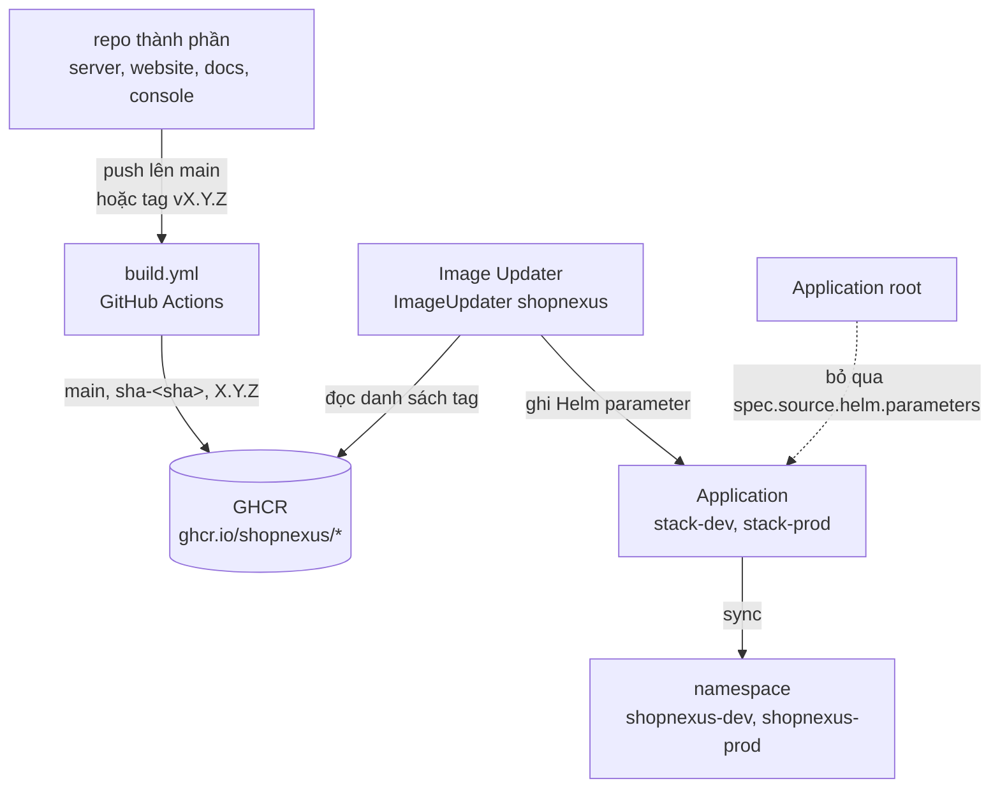
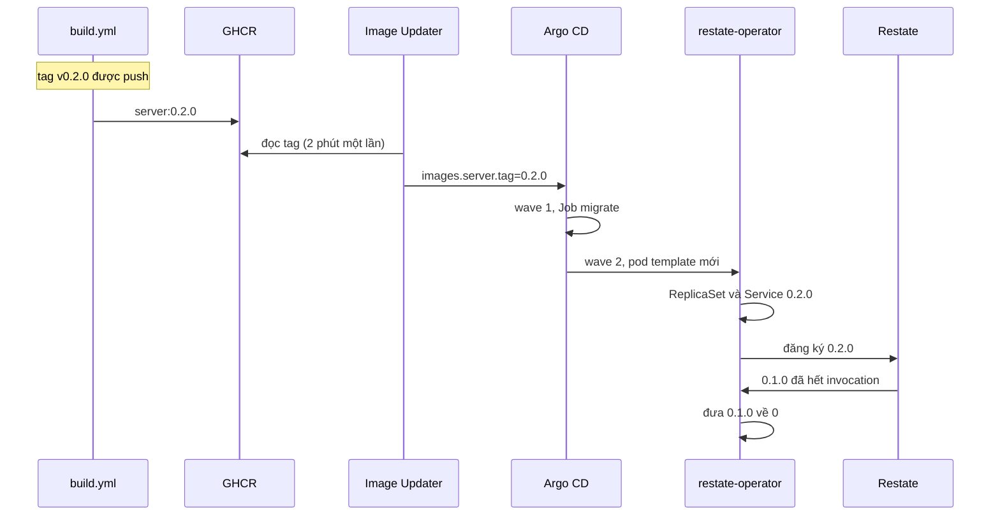

Mỗi stack chạy bốn thành phần từ image do repo riêng của chúng build: `server`, `website`, `docs` và `console`. Một lần push lên `main` trong repo thành phần sẽ tới dev. Một tag `vX.Y.Z` sẽ tới prod. Trong cả hai trường hợp không ai sửa tag image trong `infra/`: Argo CD Image Updater theo dõi GHCR, ghi tag mới vào Application Argo CD của stack, và Argo CD đồng bộ nó.



## Tag image

Mỗi repo thành phần có cùng một file `.github/workflows/build.yml`. Workflow chạy khi có push lên `main`, khi có push một tag khớp `v*`, và khi chạy tay (`workflow_dispatch`). Nó build `Dockerfile` của repo và push `ghcr.io/<owner>/<repo>` với các tag do `docker/metadata-action` sinh ra:

| Sự kiện | Tag được push |
|---|---|
| Push lên `main` | `main` và `sha-<sha đầy đủ của commit>` |
| Tag `v0.2.0` | `0.2.0` |

Tiền tố `v` bị bỏ, nên tag `v0.2.0` cho ra tag image `0.2.0`. Một tag không theo semver thì không cho ra tag phiên bản nào. Các lần build của cùng một ref dùng chung một concurrency group, và lần push mới hơn hủy lần build đang chạy. Cluster pull image không cần credential, nên bốn package trên GHCR phải để public.

## Image Updater

`infra/argocd/stacks.yaml` chứa một resource `ImageUpdater` tên `shopnexus` trong namespace `argocd`, với một mục cho mỗi Application của stack. Chart Image Updater là 1.4.0, do Application `image-updater` trong `infra/platform/image-updater.yaml` cài.

| | dev (`stack-dev`) | prod (`stack-prod`) |
|---|---|---|
| Image được theo dõi | `ghcr.io/shopnexus/<thành phần>:main` | `ghcr.io/shopnexus/<thành phần>` |
| `updateStrategy` | `digest` | `semver` |
| Đổi khi | digest đằng sau `:main` thay đổi | xuất hiện một tag `X.Y.Z` cao hơn |
| Tag được ghi | `main@sha256:…` | `X.Y.Z` |

Với mỗi thành phần trong bốn thành phần, nó ghi hai Helm parameter lên Application: `images.<thành phần>.repository` và `images.<thành phần>.tag`. Các image khác trong `values.yaml` (Postgres, Restate, RustFS, LiteLLM, curl) được ghim ở đó và chỉ đổi qua commit.

`semver` chọn phiên bản cao nhất trong registry, bất kể thứ tự push. Khi đã có `0.2.0`, một tag mới `v0.1.9` sẽ không bao giờ tới prod. Cách Image Updater xử lý tag pre-release như `v0.3.0-rc.1` chưa được kiểm tra, nên hãy phát hành bằng tag `vX.Y.Z` thường.

## Parameter và Application root

Argo CD ưu tiên Helm parameter hơn file values. Khi Image Updater đã ghi `images.server.tag` lên `stack-prod`, các dòng `images.*.tag` trong `values-prod.yaml` (hôm nay là `0.1.0`) không còn quyết định cái gì chạy. Chúng là điểm xuất phát cho một cluster mới, trước khi Image Updater ghi gì.

Bản thân các Application của stack là resource của app-of-apps `root` (`infra/argocd/root.yaml`), vốn đồng bộ `infra/platform` và `infra/argocd` với `selfHeal: true`. Self-heal sẽ đưa mỗi Application về đúng định nghĩa trong git và xóa các parameter. Hai thiết lập trong `root` giữ chúng lại:

```yaml title="infra/argocd/root.yaml"
ignoreDifferences:
  - group: argoproj.io
    kind: Application
    jsonPointers: [/spec/source/helm/parameters]
syncPolicy:
  automated: { prune: true, selfHeal: true }
  syncOptions: [RespectIgnoreDifferences=true]
```

`ignoreDifferences` làm `root` không báo lệch ở đường dẫn đó. `RespectIgnoreDifferences=true` làm một lần sync để nguyên đường dẫn đó như trong cluster. Nếu chỉ có thiết lập đầu, lần sync tiếp theo của `root` vẫn ghi đè các parameter.

## Thiết lập Argo CD

Ở lần khởi động đầu, k3s cài chart `argo-cd` 10.11.7 (Argo CD v3.5.7) từ `infra/cluster/argocd.yaml` và apply `root.yaml` một lần; file cấu hình k3d liệt kê cả hai file. Từ đó Argo CD quản lý `root` từ git. Khi node server khởi động lại, k3s apply lại bản `root.yaml` nó giữ, và self-heal đưa bản trong git trở lại trong vòng vài phút.

| Thiết lập | Ở đâu | Tác dụng |
|---|---|---|
| `automated: { prune: true, selfHeal: true }` | mọi Application | commit được apply mà không cần bấm, resource bị xóa khỏi git thì bị xóa khỏi cluster, và sửa tay trong cluster bị hoàn lại |
| `retry: { limit: -1, backoff: { duration: 30s, factor: 2, maxDuration: 5m } }` | mọi Application | lần sync lỗi được thử lại mãi, lúc đầu cách 30 giây, tối đa cách 5 phút |
| sync wave | Application platform ở wave 0; `stack-dev`, `stack-prod` và `ImageUpdater` ở wave 1 | các stack khởi động sau các operator |
| health check Lua cho `argoproj.io/Application` | phần values trong `argocd.yaml` | `root` đọc health của từng Application con, nên wave 1 chờ các Application platform Healthy |

Argo CD thôi đánh giá health của resource Application từ phiên bản 1.8. Không có check Lua, `root` sẽ coi các Application platform là healthy ngay lập tức, và các stack sẽ khởi động trước khi CloudNativePG, Sealed Secrets và restate-operator có CRD. `ImageUpdater` mang `SkipDryRunOnMissingResource=true`, vì CRD của nó đến cùng Application `image-updater` trong cùng lần sync.

Bên trong một stack, mỗi lần sync chạy lại các wave của chart, kể cả các Job Sync hook `migrate`, `objectstore-init` và `objectstore-init-snapshots` (wave 1) và `litellm-key` (wave 3). Vì thế một image server mới chạy migration của nó trước khi các pod server mới khởi động. Bảng đầy đủ các wave, từ -1 tới 3, nằm ở trang [Postgres, Restate và RustFS](/vi/operations/cluster/data#sync-wave-và-job).

## Đưa lên dev

<Steps>
<Step title="Push lên main">
Merge hoặc push lên `main` trong repo thành phần, ví dụ `server`. `build.yml` build image và push `ghcr.io/shopnexus/server:main` cùng `sha-<sha>`.

```bash title="Terminal"
gh run watch --repo shopnexus/server
```
</Step>

<Step title="Chờ Image Updater">
Mặc định Image Updater kiểm tra registry hai phút một lần. Khi digest đằng sau `:main` đã đổi, nó ghi `images.server.tag` lên `stack-dev` dưới dạng `main@sha256:…`.

```bash title="Terminal"
kubectl -n argocd get application stack-dev \
  -o jsonpath='{range .spec.source.helm.parameters[*]}{.name}={.value}{"\n"}{end}'
```
</Step>

<Step title="Theo dõi rollout">
Argo CD đồng bộ `stack-dev`. `migrate` chạy với image mới, rồi restate-operator khởi động một phiên bản server mới bên cạnh phiên bản cũ, và phiên bản cũ chạy tiếp cho tới khi các invocation Restate của nó xong. Website, docs và console là Deployment thường và thay từng pod một.

```bash title="Terminal"
kubectl -n shopnexus-dev get rs -l app.kubernetes.io/name=server
```

Bạn sẽ thấy một ReplicaSet mới có pod ready, và ReplicaSet cũ về 0 khi các invocation của nó xong. Trang [dữ liệu](/vi/operations/cluster/data) mô tả cách restate-operator rút một phiên bản.
</Step>
</Steps>

## Phát hành lên prod

<Steps>
<Step title="Gắn tag cho commit">
Trong repo thành phần, gắn tag cho commit mà dev đang chạy rồi push tag. Phiên bản phải cao hơn phiên bản prod đang chạy.

```bash title="Terminal"
git switch main && git pull
git tag v0.2.0
git push origin v0.2.0
```

`build.yml` push `ghcr.io/shopnexus/server:0.2.0`.
</Step>

<Step title="Để Image Updater nhận tag">
Ở lần kiểm tra tiếp theo, Image Updater thấy `0.2.0` là phiên bản cao nhất và ghi `images.server.tag=0.2.0` lên `stack-prod`, rồi Argo CD đồng bộ `stack-prod` với giá trị đó.

```bash title="Terminal"
kubectl -n argocd get application stack-prod \
  -o jsonpath='{range .spec.source.helm.parameters[*]}{.name}={.value}{"\n"}{end}'
```
</Step>

<Step title="Kiểm tra phiên bản mới">
```bash title="Terminal"
kubectl -n shopnexus-prod get rs -l app.kubernetes.io/name=server
hurl --test --continue-on-error --variable domain=shopnexus.id.vn infra/smoke.hurl
```

Prod chạy ba pod server cho mỗi phiên bản. Bạn sẽ thấy ReplicaSet mới ở 3/3 và Hurl báo smoke test thành công.
</Step>
</Steps>

Mỗi thành phần được phát hành riêng. Một tag trong `website` chỉ đổi website.



<Callout type="warning" title="Migration chạy trước">
Job `migrate` áp các migration của phiên bản mới trong lúc các pod server cũ vẫn phục vụ request, và rollback không hoàn tác chúng. Một migration phải chạy được với phiên bản đứng trước nó.
</Callout>

## Rollback prod

Vì Image Updater đi theo phiên bản cao nhất, không thể hoàn tác một lần phát hành bằng cách push một tag cũ hơn hay chỉ sửa `values-prod.yaml`.

<Tabs labels={["Phát hành bản sửa", "Ghim một tag"]}>
<Tab>
Phát hành một phiên bản đã sửa, cao hơn phiên bản lỗi. Cách này không cần đổi gì trong `infra/`.

<Steps>
<Step title="Revert trong repo thành phần">
```bash title="Terminal"
git revert <commit lỗi>
git push origin main
```

Dev nhận bản revert trước.
</Step>

<Step title="Gắn tag phiên bản cao hơn">
```bash title="Terminal"
git tag v0.2.1
git push origin v0.2.1
```

Image Updater chuyển prod từ `0.2.0` sang `0.2.1`.
</Step>
</Steps>
</Tab>
<Tab>
Giữ prod ở một phiên bản chạy tốt cho tới khi có bản sửa. Helm parameter thắng file values, nên một tag ghim trong `values-prod.yaml` không đổi được gì khi parameter của Image Updater còn nằm trên `stack-prod`. Các bước dưới đây gỡ chúng; chưa ai chạy các bước này trên cluster.

<Steps>
<Step title="Dừng Image Updater cho prod">
Trong `infra/argocd/stacks.yaml`, xóa mục `stack-prod` dưới `applicationRefs` của `ImageUpdater`, hoặc chỉ xóa image bạn muốn ghim.
</Step>

<Step title="Ghim tag">
Trong `infra/stack/values-prod.yaml`, đặt phiên bản từng chạy tốt:

```yaml title="infra/stack/values-prod.yaml"
images:
  server: { repository: ghcr.io/shopnexus/server, tag: 0.1.0 }
```

Chạy `infra/check.sh`, commit cả hai file và push lên `main` của repo umbrella.
</Step>

<Step title="Xóa các parameter đã ghi">
`root` bỏ qua các parameter, nên git sẽ không xóa chúng. Xóa chúng trên Application:

```bash title="Terminal"
kubectl -n argocd patch application stack-prod --type json \
  -p '[{"op":"remove","path":"/spec/source/helm/parameters"}]'
```

Argo CD đồng bộ `stack-prod` với các tag trong `values-prod.yaml`. Lệnh này xóa parameter của cả bốn thành phần, nên hãy ghim từng thành phần trong `values-prod.yaml` ở phiên bản bạn muốn.
</Step>

<Step title="Chạy lại">
Khi bản sửa đã có tag, đưa mục `stack-prod` trở lại `stacks.yaml`. Image Updater ghi parameter mới ở lần kiểm tra tiếp theo.
</Step>
</Steps>
</Tab>
</Tabs>

## Đổi một giá trị cấu hình

Thiết lập không bí mật nằm trong `infra/stack/values.yaml` và hai file của từng stack. Secret đi qua lệnh seal, `infra/cmd/seal` ([Secret](/vi/operations/cluster/secrets)).

<Steps>
<Step title="Sửa file values">
Đổi giá trị trong `values-dev.yaml` hoặc `values-prod.yaml`, ví dụ `server.logLevel` hoặc `replicas.server`. Một giá trị trong `values.yaml` áp cho cả hai stack, trừ khi file của stack đặt giá trị khác.
</Step>

<Step title="Kiểm tra chart">
```bash title="Terminal"
infra/check.sh
```

Script render chart cho cả hai stack và kiểm tra kết quả. Nó cần `helm`, `yq` và `kubeconform`, và CI chạy nó cho mọi pull request đụng tới `infra/`.
</Step>

<Step title="Push lên umbrella">
Commit và push lên `main`. Argo CD đọc repo hai tới ba phút một lần (`timeout.reconciliation` 120 giây cộng tối đa 60 giây jitter, mặc định của chart). Để đồng bộ ngay:

```bash title="Terminal"
kubectl -n argocd annotate application stack-prod argocd.argoproj.io/refresh=normal
```
</Step>

<Step title="Theo dõi rollout">
Template pod của server mang `checksum/env`, một mã băm của ConfigMap `server-env`, nên một thiết lập của server khởi động một phiên bản server mới. Deployment của LiteLLM mang `checksum/config` cho cấu hình của nó.
</Step>
</Steps>

Một lần `kubectl edit` trên resource của stack chỉ giữ tới lần self-heal tiếp theo, lúc đó resource được đưa về như trong git.

## Xem phiên bản đang chạy

<Tabs labels={["kubectl", "Giao diện Argo CD"]}>
<Tab>
Các tag Image Updater đã ghi:

```bash title="Terminal"
kubectl -n argocd get application stack-prod \
  -o jsonpath='{range .spec.source.helm.parameters[*]}{.name}={.value}{"\n"}{end}'
```

Image và digest mà từng pod chạy:

```bash title="Terminal"
kubectl -n shopnexus-prod get pods \
  -o custom-columns='POD:.metadata.name,IMAGE:.spec.containers[0].image,DIGEST:.status.containerStatuses[0].imageID'
```

Các phiên bản server mà restate-operator giữ, cùng số pod:

```bash title="Terminal"
kubectl -n shopnexus-prod get rs -l app.kubernetes.io/name=server
```
</Tab>
<Tab>
Forward cổng của Argo CD server và đọc mật khẩu admin ban đầu:

```bash title="Terminal"
kubectl -n argocd port-forward svc/argocd-server 8080:443
kubectl -n argocd get secret argocd-initial-admin-secret -o jsonpath='{.data.password}' | base64 -d
```

Mở `https://localhost:8080`, chấp nhận chứng chỉ tự ký, và đăng nhập là `admin` với mật khẩu đó. Mở Application `stack-prod`, rồi <UI>App Details</UI> và tab <UI>Parameters</UI>, nơi liệt kê `images.<thành phần>.tag`. Cây resource hiện từng ReplicaSet cùng các pod của nó.
</Tab>
</Tabs>

<Callout type="note" title="Health của server trong Argo CD">
Argo CD không có health check cho `RestateDeployment`, nên một server bị crash-loop vẫn hiện Healthy trong Argo CD. Sau mỗi lần phát hành, hãy xem pod bằng `kubectl`.
</Callout>

<KeyRules>
- Dev đi theo `:main` bằng digest. Prod đi theo tag `X.Y.Z` cao nhất.
- Tag image của `server`, `website`, `docs` và `console` do Image Updater đặt; các dòng `images.*.tag` trong file values chỉ có tác dụng ở nơi nó chưa ghi gì.
- Một bản phát hành prod mới có phiên bản cao hơn mọi tag đã có trên GHCR.
- Mọi migration chạy được với phiên bản server đứng trước nó.
- Mọi thay đổi cho cluster đi qua git. Sửa tay bị self-heal hoàn lại.
</KeyRules>

## Xử lý sự cố

<AccordionGroup>
<Accordion title="Tag mới không tới prod">
Kiểm tra tag theo semver có tiền tố `v` và lần build đã push `X.Y.Z` lên GHCR. Rồi so với phiên bản prod đang chạy: Image Updater chỉ chuyển sang phiên bản cao hơn. Log của nó ghi từng image đã kiểm tra:

```bash title="Terminal"
kubectl -n argocd logs deploy/image-updater-argocd-image-updater-controller --tail=100
```
</Accordion>

<Accordion title="Parameter biến mất sau một lần sync của root">
`root.yaml` phải giữ cả mục `ignoreDifferences` cho `/spec/source/helm/parameters` lẫn `RespectIgnoreDifferences=true`. `infra/check.sh` báo lỗi khi thiếu mục đầu.
</Accordion>

<Accordion title="Application của stack đứng ở OutOfSync hoặc Unknown">
Đọc condition bằng `kubectl -n argocd get application stack-prod -o jsonpath='{.status.conditions}'`. Một ComparisonError có nhắc `./cmd/seal` nghĩa là `infra/stack/secrets/<stack>/` chưa có SealedSecret nào. Các lỗi khác đến từ chart; tái hiện chúng bằng `infra/check.sh`. Argo CD thử sync lại với backoff tối đa 5 phút, nên bản sửa trong git được nhận mà không cần bấm.
</Accordion>
</AccordionGroup>
