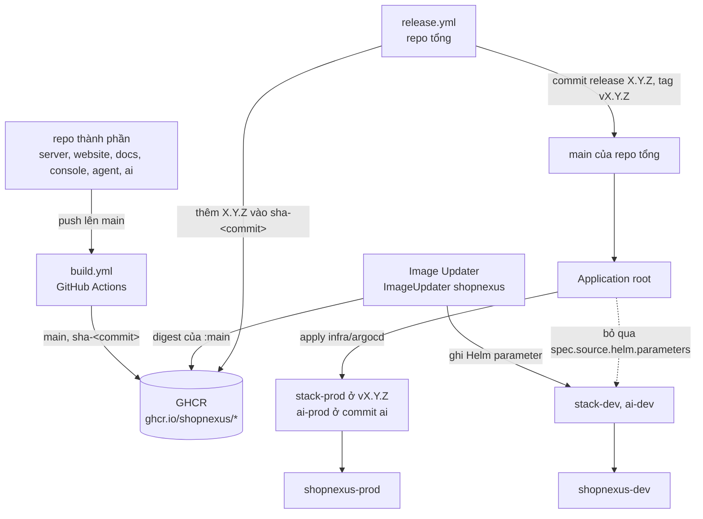
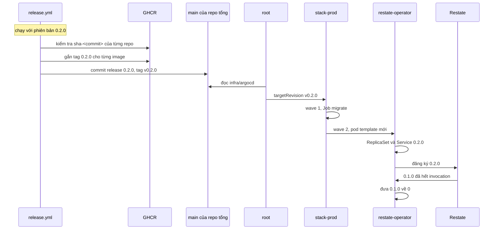

Sáu repo thành phần build image: `server`, `website`, `docs`, `console` và `agent` cho chart của stack, và `ai` cho `ai-models`. Một lần push lên `main` trong repo thành phần sẽ tới dev: Argo CD Image Updater thấy digest mới của `:main` và ghi nó lên `stack-dev` hoặc `ai-dev`. Prod chạy một bản phát hành của repo tổng. Workflow Release (`.github/workflows/release.yml` trong `shopnexus/shopnexus`) lấy các commit mà submodule của repo tổng trỏ tới trên `main`, gắn tag `X.Y.Z` cho image của chúng, ghi bản phát hành vào `infra/`, rồi gắn tag `vX.Y.Z` cho repo tổng. Mọi image trong một bản phát hành prod có cùng một phiên bản.



## Tag image

Mỗi repo thành phần có cùng một file `.github/workflows/build.yml`. Workflow chạy khi có push lên `main` và khi chạy tay (`workflow_dispatch`), build `Dockerfile` của repo một lần, và push `ghcr.io/shopnexus/<repo>` với hai tag. Tag phiên bản chỉ đến từ workflow Release của repo tổng, workflow này thêm tag vào một image CI đã build, không build lại.

| Ai | Khi nào | Tag |
|---|---|---|
| `build.yml` trong repo thành phần | push lên `main` | `main` và `sha-<sha đầy đủ của commit>` |
| `release.yml` trong repo tổng | một lần chạy workflow Release | `X.Y.Z`, trên image `sha-<commit>` của commit mà repo tổng trỏ tới |

Một tag `vX.Y.Z` trong repo thành phần không build gì và không tới prod. Các lần build của cùng một ref dùng chung một concurrency group, và lần push mới hơn hủy lần build đang chạy. Cluster pull image không cần credential, nên các package trên GHCR phải để public.

## Giữ image

`build.yml` có một job `cleanup` chạy sau `build`, dùng `dataaxiom/ghcr-cleanup-action` v1.2.2. Nó giữ `main` và mọi tag `X.Y.Z`, giữ 10 image có tag khác mới nhất (các bản build `sha-<commit>`), và xóa image không có tag và image dở dang.

Mọi image prod từng chạy đều mang một tag `X.Y.Z`, nên cleanup không xóa nó. Với mỗi repo, một bản phát hành phải chọn một commit nằm trong 10 bản build mới nhất của repo đó; với commit cũ hơn, image `sha-<commit>` đã bị xóa và workflow Release dừng lại.

## Image Updater

`infra/argocd/stacks.yaml` chứa một resource `ImageUpdater` tên `shopnexus` trong namespace `argocd`. Nó chỉ có mục cho `stack-dev` và `ai-dev`; prod không có mục nào. Chart Image Updater là 1.4.0, do Application `image-updater` trong `infra/platform/image-updater.yaml` cài.

| Application | Image được theo dõi | `updateStrategy` | Helm parameter được ghi |
|---|---|---|---|
| `stack-dev` | `ghcr.io/shopnexus/<thành phần>:main` cho `server`, `website`, `docs`, `console` và `agent` | `digest` | `images.<thành phần>.repository`, `images.<thành phần>.tag` |
| `ai-dev` | `ghcr.io/shopnexus/ai:main` | `digest` | `images.models.repository`, `images.models.tag` |

Nó đổi khi digest đằng sau `:main` thay đổi và ghi tag dưới dạng `main@sha256:…`. Các image khác trong `values.yaml` (Postgres, Restate, RustFS, Bifrost) được ghim ở đó và chỉ đổi qua commit.

## Parameter và Application root

Argo CD ưu tiên Helm parameter hơn file values. Trên `stack-dev`, khi Image Updater đã ghi `images.server.tag`, các dòng `images.*.tag` trong `values-dev.yaml` không còn quyết định cái gì chạy. Prod không có parameter, nên các tag trong `values-prod.yaml` ở tag phát hành quyết định `stack-prod` chạy gì.

Bản thân các Application của stack là resource của app-of-apps `root` (`infra/argocd/root.yaml`), vốn đồng bộ `infra/platform` và `infra/argocd` từ `main` của repo tổng với `selfHeal: true`. Self-heal sẽ đưa mỗi Application về đúng định nghĩa trong git và xóa các parameter trên `stack-dev` và `ai-dev`. Hai thiết lập trong `root` giữ chúng lại:

```yaml title="infra/argocd/root.yaml"
ignoreDifferences:
  - group: argoproj.io
    kind: Application
    jsonPointers: [/spec/source/helm/parameters]
syncPolicy:
  automated: { prune: true, selfHeal: true }
  syncOptions: [RespectIgnoreDifferences=true]
```

`ignoreDifferences` làm `root` không báo lệch ở đường dẫn đó. `RespectIgnoreDifferences=true` làm một lần sync để nguyên đường dẫn đó như trong cluster. Nếu chỉ có thiết lập đầu, lần sync tiếp theo của `root` vẫn ghi đè các parameter.

## Thiết lập Argo CD

Ở lần khởi động đầu, k3s cài chart `argo-cd` 10.11.7 (Argo CD v3.5.7) từ `infra/cluster/argocd.yaml` và apply `root.yaml` một lần; file cấu hình k3d liệt kê cả hai file. Từ đó Argo CD quản lý `root` từ git. Khi node server khởi động lại, k3s apply lại bản `root.yaml` nó giữ, và self-heal đưa bản trong git trở lại trong vòng vài phút.

| Thiết lập | Ở đâu | Tác dụng |
|---|---|---|
| `automated: { prune: true, selfHeal: true }` | mọi Application | commit được apply mà không cần bấm, resource bị xóa khỏi git thì bị xóa khỏi cluster, và sửa tay trong cluster bị hoàn lại |
| `retry: { limit: -1, backoff: { duration: 30s, factor: 2, maxDuration: 5m } }` | mọi Application | lần sync lỗi được thử lại mãi, lúc đầu cách 30 giây, tối đa cách 5 phút |
| sync wave | Application platform ở wave 0; `stack-dev`, `stack-prod` và `ImageUpdater` ở wave 1 | các stack khởi động sau các operator |
| health check Lua cho `argoproj.io/Application` | phần values trong `argocd.yaml` | `root` đọc health của từng Application con, nên wave 1 chờ các Application platform Healthy |

Argo CD thôi đánh giá health của resource Application từ phiên bản 1.8. Không có check Lua, `root` sẽ coi các Application platform là healthy ngay lập tức, và các stack sẽ khởi động trước khi CloudNativePG, Sealed Secrets và restate-operator có CRD. `ImageUpdater` mang `SkipDryRunOnMissingResource=true`, vì CRD của nó đến cùng Application `image-updater` trong cùng lần sync.

Bên trong một stack, mỗi lần sync chạy lại các wave của chart, kể cả các Job Sync hook `migrate`, `objectstore-init` và `objectstore-init-snapshots` (wave 1). Vì thế một image server mới chạy migration của nó trước khi các pod server mới khởi động. Bảng đầy đủ các wave, từ -1 tới 2, nằm ở trang [Postgres, Restate và RustFS](/vi/operations/cluster/data#sync-wave-và-job).

## Đưa lên dev

<Steps>
<Step title="Push lên main">
Merge hoặc push lên `main` trong repo thành phần, ví dụ `server`. `build.yml` build image và push `ghcr.io/shopnexus/server:main` cùng `sha-<sha>`.

```bash title="Terminal"
gh run watch --repo shopnexus/server
```
</Step>

<Step title="Chờ Image Updater">
Mặc định Image Updater kiểm tra registry hai phút một lần. Khi digest đằng sau `:main` đã đổi, nó ghi `images.server.tag` lên `stack-dev` dưới dạng `main@sha256:…`.

```bash title="Terminal"
kubectl -n argocd get application stack-dev \
  -o jsonpath='{range .spec.source.helm.parameters[*]}{.name}={.value}{"\n"}{end}'
```
</Step>

<Step title="Theo dõi rollout">
Argo CD đồng bộ `stack-dev`. `migrate` chạy với image mới, rồi restate-operator khởi động một phiên bản server mới bên cạnh phiên bản cũ, và phiên bản cũ chạy tiếp cho tới khi các invocation Restate của nó xong. Website, docs và console là Deployment thường và thay từng pod một.

```bash title="Terminal"
kubectl -n shopnexus-dev get rs -l app.kubernetes.io/name=server
```

Bạn sẽ thấy một ReplicaSet mới có pod ready, và ReplicaSet cũ về 0 khi các invocation của nó xong. Trang [dữ liệu](/vi/operations/cluster/data) mô tả cách restate-operator rút một phiên bản.
</Step>
</Steps>

## Phát hành lên prod

Một bản phát hành lấy cả sáu repo cùng lúc, ở các commit mà submodule của repo tổng trỏ tới trên `main`. Phiên bản có dạng `X.Y.Z`, không có `v`, và phải cao hơn tag `vX.Y.Z` cao nhất của repo tổng.

<Steps>
<Step title="Nâng các submodule">
Trong repo tổng, chuyển sáu submodule tới các commit dev đã chạy, tức là đầu nhánh `main` của từng repo khi lần build của repo đó đã xong. Commit và push lên `main` của repo tổng.

```bash title="Terminal"
git switch main && git pull
git submodule update --remote server website docs console agent ai
git add server website docs console agent ai
git commit -m "bump the components for 0.2.0"
git push origin main
```
</Step>

<Step title="Chạy workflow Release">
Chạy nó từ terminal, hoặc từ tab Actions của repo tổng: <UI>Release</UI>, rồi <UI>Run workflow</UI> với phiên bản.

```bash title="Terminal"
gh workflow run release.yml -R shopnexus/shopnexus -f version=0.2.0
gh run watch -R shopnexus/shopnexus
```

Workflow kiểm tra phiên bản có dạng `X.Y.Z`, `v0.2.0` chưa tồn tại và phiên bản cao hơn bản phát hành trước. Sau đó nó kiểm tra `ghcr.io/shopnexus/<repo>:sha-<commit>` có đủ cho cả sáu repo rồi mới gắn tag cho image nào, nên một bản phát hành được gắn tag trọn vẹn hoặc không gắn gì. Nó thêm tag `0.2.0` vào từng image, ghi bản phát hành vào ba file, commit `release 0.2.0` trên `main`, gắn tag `v0.2.0` cho commit đó và push cả hai.

| File | Workflow ghi gì |
|---|---|
| `infra/stack/values-prod.yaml` | `images.<thành phần>.tag: 0.2.0` cho `server`, `website`, `docs`, `console` và `agent` |
| `infra/argocd/stacks.yaml` | `targetRevision: v0.2.0` trên `stack-prod` |
| `infra/argocd/ai.yaml` | `targetRevision: <commit ai>` và `images.models.tag: 0.2.0` trên `ai-prod` |

Chạy `git pull` trong bản checkout repo tổng của bạn sau đó, vì workflow đã commit lên `main`.
</Step>

<Step title="Theo dõi stack-prod và ai-prod sync">
`root` apply `stacks.yaml` và `ai.yaml` mới từ `main`. Sau đó `stack-prod` render `infra/stack` ở tag `v0.2.0`, nên chart và `values-prod.yaml` là của bản phát hành, còn `ai-prod` render `chart/` của repo `ai` ở commit ai của bản phát hành.

```bash title="Terminal"
kubectl -n argocd annotate application root argocd.argoproj.io/refresh=normal
kubectl -n argocd get application stack-prod ai-prod \
  -o custom-columns='NAME:.metadata.name,REVISION:.spec.source.targetRevision,SYNC:.status.sync.status,HEALTH:.status.health.status'
```
</Step>

<Step title="Kiểm tra phiên bản mới">
```bash title="Terminal"
kubectl -n shopnexus-prod get rs -l app.kubernetes.io/name=server
hurl --test --continue-on-error --variable domain=shopnexus.id.vn infra/smoke.hurl
```

Prod chạy ba pod server cho mỗi phiên bản. Bạn sẽ thấy ReplicaSet mới ở 3/3 và Hurl báo smoke test thành công.
</Step>
</Steps>



<Callout type="warning" title="Migration chạy trước">
Job `migrate` áp các migration của phiên bản mới trong lúc các pod server cũ vẫn phục vụ request, và rollback không hoàn tác chúng. Một migration phải chạy được với phiên bản đứng trước nó.
</Callout>

<Callout type="note" title="Bản phát hành đầu tiên">
Trước bản phát hành đầu tiên, các file ghi `0.1.0`, tag `v0.1.0` và một commit ai, và `v0.1.0` chưa tồn tại. `stack-prod` không render được cho tới khi lần chạy đầu của workflow Release tạo ra tag đó.
</Callout>

## Rollback prod

Revert commit phát hành trên `main` của repo tổng. Bản revert đưa `values-prod.yaml`, `stacks.yaml` và `ai.yaml` về bản phát hành trước, nên `stack-prod` quay về `vX.Y.Z` trước đó và `ai-prod` quay về commit ai trước đó. Image `X.Y.Z` của chúng vẫn còn trên GHCR, vì cleanup giữ mọi tag phiên bản.

<Steps>
<Step title="Revert commit phát hành">
```bash title="Terminal"
git switch main && git pull
git log --oneline --grep '^release ' -2
git revert <commit của release 0.2.0>
infra/check.sh
git push origin main
```
</Step>

<Step title="Theo dõi sync">
`root` apply các Application đã revert từ `main`, rồi `stack-prod` và `ai-prod` sync bản phát hành trước. Dùng các lệnh ở bước "Theo dõi stack-prod và ai-prod sync" phía trên.
</Step>
</Steps>

Bản revert giữ nguyên con trỏ submodule và tag `v0.2.0`. Bản phát hành tiếp theo phải cao hơn `0.2.0`, vì workflow so phiên bản với tag `vX.Y.Z` cao nhất.

## Đổi một giá trị cấu hình

Thiết lập không bí mật nằm trong `infra/stack/values.yaml` và hai file của từng stack. Secret đi qua lệnh seal, `infra/cmd/seal` ([Secret](/vi/operations/cluster/secrets)).

`stack-dev` render `infra/stack` ở `main` của repo tổng, nên dev nhận thay đổi khi push. `stack-prod` render nó ở tag phát hành, nên một thay đổi ở `values.yaml`, `values-prod.yaml` hay chart chỉ tới prod cùng bản phát hành tiếp theo. Định nghĩa các Application trong `infra/argocd`, trong đó có `valuesObject` của `ai-prod` trong `ai.yaml`, đến từ `main` qua `root` và tới cả hai stack khi push.

<Steps>
<Step title="Sửa file values">
Đổi giá trị trong `values-dev.yaml` hoặc `values-prod.yaml`, ví dụ `server.logLevel` hoặc `replicas.server`. Một giá trị trong `values.yaml` áp cho cả hai stack, trừ khi file của stack đặt giá trị khác.
</Step>

<Step title="Kiểm tra chart">
```bash title="Terminal"
infra/check.sh
```

Script render chart cho cả hai stack và kiểm tra kết quả. Nó cần `helm`, `yq` và `kubeconform`, và CI chạy nó cho mọi pull request đụng tới `infra/`.
</Step>

<Step title="Push lên repo tổng">
Commit và push lên `main`. Argo CD đọc repo hai tới ba phút một lần (`timeout.reconciliation` 120 giây cộng tối đa 60 giây jitter, mặc định của chart). Để đồng bộ ngay:

```bash title="Terminal"
kubectl -n argocd annotate application stack-dev argocd.argoproj.io/refresh=normal
```

Với prod, [chạy một bản phát hành](#phát-hành-lên-prod) khi thay đổi đã nằm trên `main`.
</Step>

<Step title="Theo dõi rollout">
Template pod của server mang `checksum/env`, một mã băm của ConfigMap `server-env`, nên một thiết lập của server khởi động một phiên bản server mới. Deployment của Bifrost mang `checksum/config` cho `config.json`, `start.sh` và `env/bifrost.env`, và `checksum/secrets` cho các secret đã seal của stack, nên đổi một trong hai sẽ khởi động lại nó.
</Step>
</Steps>

Một lần `kubectl edit` trên resource của stack chỉ giữ tới lần self-heal tiếp theo, lúc đó resource được đưa về như trong git.

## Xem phiên bản đang chạy

<Tabs labels={["kubectl", "Giao diện Argo CD"]}>
<Tab>
Bản phát hành `stack-prod` đang chạy, cùng commit ai và tag `ai-models` của `ai-prod`:

```bash title="Terminal"
kubectl -n argocd get application stack-prod -o jsonpath='{.spec.source.targetRevision}{"\n"}'
kubectl -n argocd get application ai-prod \
  -o jsonpath='{.spec.source.targetRevision} {.spec.source.helm.valuesObject.images.models.tag}{"\n"}'
```

Tag image của bản phát hành đó, đọc từ git:

```bash title="Terminal"
git show v0.2.0:infra/stack/values-prod.yaml | yq '.images'
```

Image và digest mà từng pod chạy:

```bash title="Terminal"
kubectl -n shopnexus-prod get pods \
  -o custom-columns='POD:.metadata.name,IMAGE:.spec.containers[0].image,DIGEST:.status.containerStatuses[0].imageID'
```

Các phiên bản server mà restate-operator giữ, cùng số pod:

```bash title="Terminal"
kubectl -n shopnexus-prod get rs -l app.kubernetes.io/name=server
```
</Tab>
<Tab>
Forward cổng của Argo CD server và đọc mật khẩu admin ban đầu:

```bash title="Terminal"
kubectl -n argocd port-forward svc/argocd-server 8080:443
kubectl -n argocd get secret argocd-initial-admin-secret -o jsonpath='{.data.password}' | base64 -d
```

Mở `https://localhost:8080`, chấp nhận chứng chỉ tự ký, và đăng nhập là `admin` với mật khẩu đó. Mở Application `stack-prod`, rồi <UI>App Details</UI>, nơi hiện target revision `vX.Y.Z`. Cây resource hiện từng ReplicaSet cùng các pod và image của chúng.
</Tab>
</Tabs>

<Callout type="note" title="Health của server trong Argo CD">
Argo CD không có health check cho `RestateDeployment`, nên một server bị crash-loop vẫn hiện Healthy trong Argo CD. Sau mỗi lần phát hành, hãy xem pod bằng `kubectl`.
</Callout>

<KeyRules>
- Dev đi theo `:main` bằng digest. Prod chạy một bản phát hành của repo tổng, `vX.Y.Z`, và mọi image trong đó có tag `X.Y.Z`.
- Một bản phát hành lấy các commit mà submodule của repo tổng trỏ tới trên `main`. Nâng chúng tới những gì dev đã chạy trước khi chạy workflow Release.
- Các dòng prod trong `values-prod.yaml`, `stacks.yaml` và `ai.yaml` chỉ đổi qua một bản phát hành hoặc qua việc revert một bản.
- Một bản phát hành chỉ chọn được commit nằm trong 10 bản build mới nhất của mỗi repo.
- Mọi migration chạy được với phiên bản server đứng trước nó.
- Mọi thay đổi cho cluster đi qua git. Sửa tay bị self-heal hoàn lại.
</KeyRules>

## Xử lý sự cố

<AccordionGroup>
<Accordion title="Workflow Release báo sha-<commit> does not exist">
Submodule trỏ tới một commit chưa có image trên GHCR. Hoặc `build.yml` của repo chưa build commit đó, hoặc cleanup đã xóa image vì nó cũ hơn 10 bản build mới nhất. Chờ lần build, hoặc nâng submodule tới một commit mới hơn, push, rồi chạy lại workflow. Lúc đó chưa image nào bị gắn tag, vì workflow kiểm tra đủ sáu image rồi mới gắn tag cho image nào.
</Accordion>

<Accordion title="Workflow Release không gắn tag được cho image">
`GITHUB_TOKEN` của workflow chỉ ghi được một package khi package đó cấp quyền ghi cho repo tổng. Đây là bước làm một lần trên giao diện GitHub cho từng package trong sáu package `server`, `website`, `docs`, `console`, `agent` và `ai`: mở phần cài đặt của package, rồi <UI>Manage Actions access</UI>, thêm `shopnexus/shopnexus` và cho nó vai trò Write.
</Accordion>

<Accordion title="Workflow Release từ chối phiên bản">
Phiên bản phải có dạng `X.Y.Z` không có `v`, tag `vX.Y.Z` của nó chưa tồn tại, và nó phải cao hơn tag `vX.Y.Z` cao nhất của repo tổng, kể cả một bản phát hành đã bị revert.
</Accordion>

<Accordion title="Prod chạy tag khác với values-prod.yaml">
Kiểm tra `stack-prod` có Helm parameter không, vì parameter thắng file values. Một cluster từng chạy cách cũ, khi Image Updater ghi tag cho prod, có thể vẫn giữ chúng, và `root` không xóa chúng. Xóa chúng:

```bash title="Terminal"
kubectl -n argocd patch application stack-prod --type json \
  -p '[{"op":"remove","path":"/spec/source/helm/parameters"}]'
```
</Accordion>

<Accordion title="Parameter biến mất sau một lần sync của root">
`root.yaml` phải giữ cả mục `ignoreDifferences` cho `/spec/source/helm/parameters` lẫn `RespectIgnoreDifferences=true`. `infra/check.sh` báo lỗi khi thiếu mục đầu.
</Accordion>

<Accordion title="Application của stack đứng ở OutOfSync hoặc Unknown">
Đọc condition bằng `kubectl -n argocd get application stack-prod -o jsonpath='{.status.conditions}'`. Một ComparisonError có nhắc `./cmd/seal` nghĩa là `infra/stack/secrets/<stack>/` chưa có SealedSecret nào. Trước bản phát hành đầu tiên, `stack-prod` không tìm được `v0.1.0`. Các lỗi khác đến từ chart; tái hiện chúng bằng `infra/check.sh`. Argo CD thử sync lại với backoff tối đa 5 phút, nên bản sửa trong git được nhận mà không cần bấm.
</Accordion>
</AccordionGroup>
