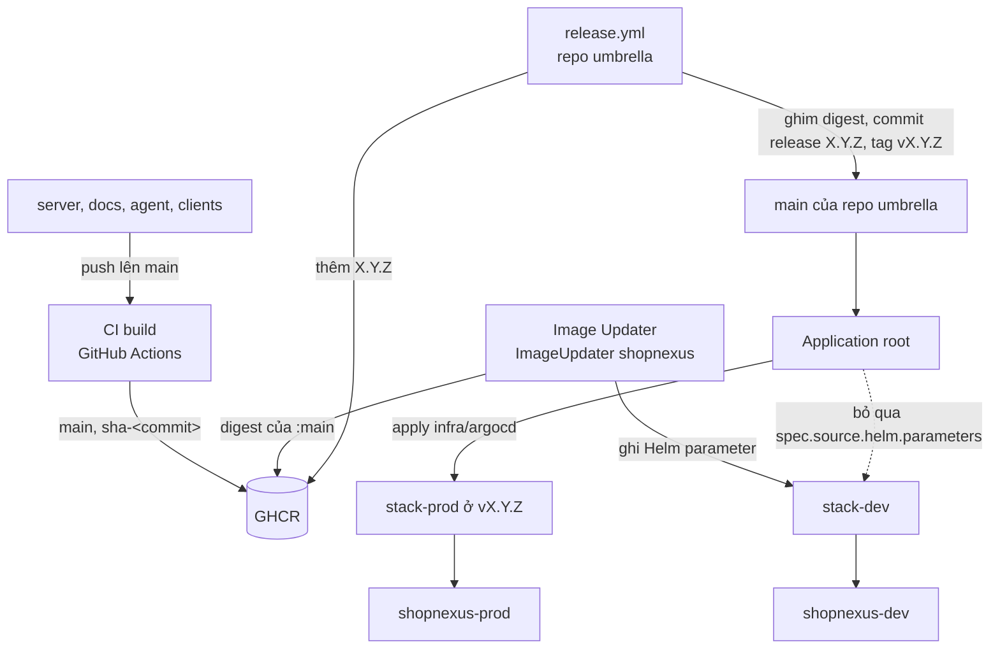

Chart của stack chạy năm image do bốn repo build: `server`, `docs`, repo của agent trên trang điều hành, và `clients`, repo build website và trang điều hành. Một lần push lên `main` sẽ tới dev: Argo CD Image Updater thấy digest mới của `:main` và ghi nó lên `stack-dev`. Prod chạy một bản phát hành của repo umbrella. Workflow Release (`.github/workflows/release.yml` trong `shopnexus/shopnexus`) tìm image mà CI đã build cho từng thành phần ở commit repo umbrella trỏ tới, gắn tag `X.Y.Z` cho nó, ghim digest của nó trong `infra/`, rồi gắn tag `vX.Y.Z` cho repo umbrella. Quy trình, hotfix và rollback cũng nằm trong `infra/RELEASING.md`.



## Image và tag

| Image | Build bởi | Khi nào |
|---|---|---|
| `ghcr.io/shopnexus/server` | `build.yml` trong `server` | mỗi lần push lên `main` |
| `ghcr.io/shopnexus/docs` | `build.yml` trong `docs` | mỗi lần push lên `main` |
| `ghcr.io/shopnexus/agent` | `build.yml` trong repo của agent trên trang điều hành | mỗi lần push lên `main` |
| `ghcr.io/shopnexus/clients/website` | `website.yml` trong `clients` | một lần push lên `main` có đổi `website/` hoặc `brand/web/` |
| `ghcr.io/shopnexus/clients/console` | `console.yml` trong `clients` | một lần push lên `main` có đổi `console/` |

Mỗi lần build chạy một lần và push hai tag, `main` và `sha-<sha đầy đủ của commit>`. Tag phiên bản `X.Y.Z` chỉ đến từ workflow Release của repo umbrella, workflow này thêm tag vào một image CI đã build, không build lại. Một tag trong repo thành phần không build gì và không tới prod. Các lần build của cùng một ref dùng chung một concurrency group, và lần push mới hơn hủy lần build đang chạy. Cluster pull image không cần credential, nên các package trên GHCR phải để public.

## Giữ image

Mỗi workflow build có một job `cleanup` chạy sau bước build, dùng `dataaxiom/ghcr-cleanup-action` v1.2.2. Nó giữ `main` và mọi tag `X.Y.Z`, giữ 10 image có tag khác mới nhất (các bản build `sha-<commit>`), và xóa image không có tag và image dở dang.

Mọi image prod từng chạy đều mang một tag `X.Y.Z`, nên cleanup không xóa nó. Một bản phát hành có đổi một image phải chọn một commit nằm trong 10 bản build mới nhất của image đó; với commit cũ hơn, image `sha-<commit>` đã bị xóa và workflow Release dừng lại. Image nào không đổi thì giữ digest mà prod đang chạy.

## Image Updater

`infra/argocd/stacks.yaml` chứa một resource `ImageUpdater` tên `shopnexus` trong namespace `argocd`. Nó chỉ có mục cho `stack-dev`; prod không có mục nào. Chart Image Updater là 1.4.0, do Application `image-updater` cài.

| Application | Image được theo dõi | `updateStrategy` | Helm parameter được ghi |
|---|---|---|---|
| `stack-dev` | tag `:main` của năm image ở trên | `digest` | `images.<thành phần>.repository`, `images.<thành phần>.tag` |

Nó đổi khi digest đằng sau `:main` thay đổi và ghi tag dưới dạng `main@sha256:…`. Các image khác trong `values.yaml` (Postgres, Restate, RustFS, Bifrost, imgproxy, Grafana và các image còn lại) được ghim ở đó và chỉ đổi qua commit.

## Parameter và Application root

Argo CD ưu tiên Helm parameter hơn file values. Trên `stack-dev`, khi Image Updater đã ghi `images.server.tag`, các dòng `images.*.tag` trong các file values không còn quyết định cái gì chạy. Prod không có parameter, nên các digest trong `values-prod.yaml` ở tag phát hành quyết định `stack-prod` chạy gì.

Bản thân các Application của stack là resource của app-of-apps `root` (`infra/argocd/root.yaml`), vốn đồng bộ `infra/platform` và `infra/argocd` từ `main` của repo umbrella với `selfHeal: true`. Self-heal sẽ đưa mỗi Application về đúng định nghĩa trong git và xóa các parameter trên `stack-dev`. Hai thiết lập trong `root` giữ chúng lại:

```yaml title="infra/argocd/root.yaml"
ignoreDifferences:
  - group: argoproj.io
    kind: Application
    jsonPointers: [/spec/source/helm/parameters]
syncPolicy:
  automated: { prune: true, selfHeal: true }
  syncOptions: [RespectIgnoreDifferences=true]
```

`ignoreDifferences` làm `root` không báo lệch ở đường dẫn đó. `RespectIgnoreDifferences=true` làm một lần sync để nguyên đường dẫn đó như trong cluster. Nếu chỉ có thiết lập đầu, lần sync tiếp theo của `root` vẫn ghi đè các parameter.

## Thiết lập Argo CD

| Thiết lập | Ở đâu | Tác dụng |
|---|---|---|
| `automated: { prune: true, selfHeal: true }` | mọi Application | commit được apply mà không cần bấm, resource bị xóa khỏi git thì bị xóa khỏi cluster, và sửa tay trong cluster bị hoàn lại |
| `retry: { limit: -1, refresh: true, backoff: { duration: 30s, factor: 2, maxDuration: 5m } }` | mọi Application | lần sync lỗi được thử lại mãi, lúc đầu cách 30 giây, tối đa cách 5 phút, mỗi lần trên commit mới nhất, nên bản sửa đẩy lên sau lần lỗi vẫn được áp dụng |
| sync wave | Application platform ở wave 0; `stack-dev`, `stack-prod` và `ImageUpdater` ở wave 1 | các stack khởi động sau các operator |
| health check Lua cho `argoproj.io/Application` | `infra/cluster/argocd.yaml` | wave 1 của `root` chờ các Application platform Healthy |
| health check Lua cho `RestateDeployment` | `infra/cluster/argocd.yaml` | wave 3 của một stack chờ các pod của phiên bản server mới sẵn sàng |

`ImageUpdater` mang `SkipDryRunOnMissingResource=true`, vì CRD của nó đến cùng Application `image-updater` trong cùng lần sync. Bên trong một stack, mỗi lần sync chạy lại các wave của chart, kể cả các Job Sync hook `migrate`, `objectstore-init` và `objectstore-init-snapshots` (wave 1). Vì thế một image server mới chạy migration của nó trước khi các pod server mới khởi động; bảng đầy đủ các wave nằm ở trang [Postgres, Restate và RustFS](/vi/operations/cluster/data#sync-wave-và-job).

## Đưa lên dev

<Steps>
<Step title="Push lên main">
Merge hoặc push lên `main` trong repo thành phần, ví dụ `server`. CI build image và push `:main` cùng `:sha-<sha>`.

```bash title="Terminal"
gh run watch --repo shopnexus/server
```
</Step>

<Step title="Chờ Image Updater">
Mặc định Image Updater kiểm tra registry hai phút một lần. Khi digest đằng sau `:main` đã đổi, nó ghi `images.server.tag` lên `stack-dev` dưới dạng `main@sha256:…`.

```bash title="Terminal"
kubectl -n argocd get application stack-dev \
  -o jsonpath='{range .spec.source.helm.parameters[*]}{.name}={.value}{"\n"}{end}'
```
</Step>

<Step title="Theo dõi rollout">
Argo CD đồng bộ `stack-dev`. `migrate` chạy với image mới, rồi restate-operator khởi động một phiên bản server mới bên cạnh phiên bản cũ. Khi các pod của nó sẵn sàng, `server-api` chuyển sang nó, còn phiên bản cũ chạy tiếp cho tới khi các invocation Restate của nó xong. Website, tài liệu và trang điều hành là Deployment thường và thay từng pod một.

```bash title="Terminal"
kubectl -n shopnexus-dev get rs -l app.kubernetes.io/name=server
```

Bạn sẽ thấy một ReplicaSet mới có pod ready, và ReplicaSet cũ về 0 khi các invocation của nó xong.
</Step>
</Steps>

## Phát hành lên prod

Một bản phát hành là một phiên bản `X.Y.Z` cho mọi thứ trên cluster, không có `v`, cao hơn tag `vX.Y.Z` cao nhất của repo umbrella. Bản minor đưa ra những gì `main` đang có, bản patch là hotfix, còn bản major đánh dấu một cột mốc hoặc một thay đổi mà các phiên bản ứng dụng cũ không theo được.

<Steps>
<Step title="Nâng các submodule">
Trong repo umbrella, chuyển các submodule tới các commit dev đã chạy, tức là đầu nhánh `main` của chúng khi từng lần build đã xong. Commit và push lên `main` của repo umbrella.

```bash title="Terminal"
git switch main && git pull
git submodule update --remote
git commit -am "bump the components for 0.2.0"
git push origin main
```
</Step>

<Step title="Đọc kế hoạch">
`infra/release-plan.sh` in ra, với từng image, commit prod đang chạy và commit mà bản phát hành sẽ chạy. Server, tài liệu và agent ở commit của submodule tương ứng; website và trang điều hành ở commit `clients` gần nhất có đổi thư mục của chúng.

```text
| image   | prod now | this release |                   |
| server  | 13aa05d9 | 13aa05d9     | unchanged         |
| website | 991ff690 | f9cc614f     | rolls (2 commits) |
```

Nếu nó hiện thứ bạn không định đưa ra, hãy dừng lại và sửa `main` trước.
</Step>

<Step title="Chạy workflow Release">
Chạy nó từ terminal, hoặc từ tab Actions của repo umbrella: <UI>Release</UI>, rồi <UI>Run workflow</UI> với phiên bản.

```bash title="Terminal"
gh workflow run release.yml -R shopnexus/shopnexus -f version=0.2.0
gh run watch -R shopnexus/shopnexus
```

Workflow kiểm tra phiên bản, rồi chạy kế hoạch và tìm digest của từng image trên GHCR. Thiếu một image là bản phát hành dừng trước khi gắn tag cho bất cứ thứ gì. Nó gắn tag `0.2.0` cho mọi image, ghi bản phát hành vào hai file, commit `release 0.2.0` trên `main`, gắn tag `v0.2.0` cho commit đó và push cả hai.

| File | Workflow ghi gì |
|---|---|
| `infra/stack/values-prod.yaml` | `tag: <digest>, commit: <sha>` cho từng image trong năm image |
| `infra/argocd/stacks.yaml` | `targetRevision: v0.2.0` trên `stack-prod` |

Chạy `git pull` trong bản checkout repo umbrella của bạn sau đó, vì workflow đã commit lên `main`.
</Step>

<Step title="Theo dõi stack-prod sync">
`root` apply `stacks.yaml` mới từ `main`. Sau đó `stack-prod` render `infra/stack` ở tag `v0.2.0`, nên chart và `values-prod.yaml` là của bản phát hành. Image nào có digest không đổi thì render ra cùng manifest, và các pod của nó tiếp tục chạy.

```bash title="Terminal"
kubectl -n argocd annotate application root argocd.argoproj.io/refresh=normal
kubectl -n argocd get application stack-prod \
  -o custom-columns='NAME:.metadata.name,REVISION:.spec.source.targetRevision,SYNC:.status.sync.status,HEALTH:.status.health.status'
```
</Step>

<Step title="Kiểm tra phiên bản mới">
```bash title="Terminal"
kubectl -n shopnexus-prod get rs -l app.kubernetes.io/name=server
hurl --test --continue-on-error --variable domain=shopnexus.id.vn infra/smoke.hurl
```

Prod chạy ba pod server cho mỗi phiên bản. Bạn sẽ thấy ReplicaSet mới ở 3/3 và Hurl báo smoke test thành công.
</Step>
</Steps>

Một bản phát hành cũng đưa ra mọi thay đổi ở `infra/` đã vào `main` kể từ bản trước, vì `stack-prod` chuyển sang tag mới của repo umbrella, cùng một lần chạy mới của các job migration.

<Callout type="warning" title="Migration chạy trước">
Job `migrate` áp các migration của phiên bản mới trong lúc các pod server cũ vẫn phục vụ request, và rollback không hoàn tác chúng. Một migration phải chạy được với phiên bản đứng trước nó, và API giữ tương thích ngược: thêm field hoặc endpoint trước, chuyển các client sang dùng nó, rồi gỡ cái cũ ở một bản phát hành sau.
</Callout>

<Callout type="note" title="Bản phát hành đầu tiên">
Trước bản phát hành đầu tiên, `values-prod.yaml` ghi `0.1.0` cho mọi image và `stack-prod` ghi tag `v0.1.0`, tag này chưa tồn tại, nên `stack-prod` không render được. Hãy seal secret của prod (`go -C infra run ./cmd/seal prod`) trước lần chạy đầu của workflow Release.
</Callout>

### Hotfix

Sửa bug trên `main` của thành phần, kiểm tra trên dev, nâng submodule đó trong repo umbrella rồi push. `infra/release-plan.sh` chỉ nên hiện image đó được thay. Phát hành phiên bản patch kế tiếp.

## Rollback prod

Revert commit phát hành trên `main` của repo umbrella rồi push. Bản revert đưa `values-prod.yaml` và `stacks.yaml` về bản phát hành trước, nên `stack-prod` quay về `vX.Y.Z` trước đó cùng các digest của nó. Các image đó vẫn còn trên GHCR, vì cleanup giữ mọi tag phiên bản.

```bash title="Terminal"
git switch main && git pull
git log --oneline --grep '^release ' -2
git revert <commit của release 0.2.0>
infra/check.sh
git push origin main
```

Bản revert giữ nguyên con trỏ submodule và tag `v0.2.0`. Bản phát hành tiếp theo phải cao hơn `0.2.0`, vì workflow so phiên bản với tag `vX.Y.Z` cao nhất.

## Đổi một giá trị cấu hình

Thiết lập không bí mật nằm trong `infra/stack/values.yaml`, hai file của từng stack và các file dùng chung `infra/stack/env/*.env`. Secret đi qua lệnh seal ([Secret](/vi/operations/cluster/secrets)).

`stack-dev` render `infra/stack` ở `main` của repo umbrella, nên dev nhận thay đổi khi push. `stack-prod` render nó ở tag phát hành, nên một thay đổi ở chart hoặc values của nó chỉ tới prod cùng bản phát hành tiếp theo. Định nghĩa các Application trong `infra/argocd` đến từ `main` qua `root` và tới cả hai stack khi push.

<Steps>
<Step title="Sửa file values">
Đổi giá trị trong `values-dev.yaml` hoặc `values-prod.yaml`, ví dụ `server.logLevel` hoặc `replicas.server`. Một giá trị trong `values.yaml` áp cho cả hai stack, trừ khi file của stack đặt giá trị khác.
</Step>

<Step title="Kiểm tra chart">
```bash title="Terminal"
infra/check.sh
```

Script render chart cho cả hai stack và kiểm tra kết quả. Nó cần `helm`, `yq` và `kubeconform`, và CI chạy nó cho mọi thay đổi trong `infra/`.
</Step>

<Step title="Push lên repo umbrella">
Commit và push lên `main`. Argo CD đọc repo hai tới ba phút một lần. Để đồng bộ ngay:

```bash title="Terminal"
kubectl -n argocd annotate application stack-dev argocd.argoproj.io/refresh=normal
```

Với prod, [chạy một bản phát hành](#phát-hành-lên-prod) khi thay đổi đã nằm trên `main`.
</Step>

<Step title="Theo dõi rollout">
Template pod của server mang `checksum/env`, một mã băm của ConfigMap `server-env`, nên một thiết lập của server khởi động một phiên bản server mới. Deployment của Bifrost mang `checksum/config` cho `config.json`, `start.sh` và `env/bifrost.env`, và `checksum/secrets` cho các secret đã seal của stack, nên đổi một trong hai sẽ khởi động lại nó.
</Step>
</Steps>

Một lần `kubectl edit` trên resource của stack chỉ giữ tới lần self-heal tiếp theo, lúc đó resource được đưa về như trong git.

## Xem phiên bản đang chạy

<Tabs labels={["kubectl", "Giao diện Argo CD"]}>
<Tab>
Bản phát hành `stack-prod` đang chạy:

```bash title="Terminal"
kubectl -n argocd get application stack-prod -o jsonpath='{.spec.source.targetRevision}{"\n"}'
```

Digest và commit của từng image trong bản phát hành đó, đọc từ git:

```bash title="Terminal"
git show v0.2.0:infra/stack/values-prod.yaml | yq '.images'
```

Image và digest mà từng pod chạy:

```bash title="Terminal"
kubectl -n shopnexus-prod get pods \
  -o custom-columns='POD:.metadata.name,IMAGE:.spec.containers[0].image,DIGEST:.status.containerStatuses[0].imageID'
```
</Tab>
<Tab>
Mở `https://argocd.<tên miền prod>`, nằm sau bước đăng nhập của trang điều hành, hoặc forward cổng của nó bằng `kubectl -n argocd port-forward svc/argocd-server 8080:80` rồi mở `http://localhost:8080`. Mở Application `stack-prod`, rồi <UI>App Details</UI>, nơi hiện target revision `vX.Y.Z`. Cây resource hiện từng ReplicaSet cùng các pod và image của chúng.
</Tab>
</Tabs>

<KeyRules>
- Dev đi theo `:main` bằng digest. Prod chạy một bản phát hành của repo umbrella, `vX.Y.Z`, với mọi image được ghim theo digest và gắn tag `X.Y.Z`.
- `main` luôn phát hành được: những gì đã merge đều đã chạy trên dev và đưa ra được.
- Đọc `infra/release-plan.sh` trước khi chạy workflow Release.
- Các dòng prod trong `values-prod.yaml` và `stacks.yaml` chỉ đổi qua một bản phát hành hoặc qua việc revert một bản.
- Mọi migration chạy được với phiên bản server đứng trước nó.
- Mọi thay đổi cho cluster đi qua git. Sửa tay bị self-heal hoàn lại.
</KeyRules>

## Xử lý sự cố

<AccordionGroup>
<Accordion title="Workflow Release lỗi vì một image không tồn tại">
Kế hoạch nêu một commit chưa có image `sha-<commit>` trên GHCR. Hoặc CI chưa build commit đó, hoặc cleanup đã xóa image vì nó cũ hơn 10 bản build mới nhất. Chờ lần build, hoặc nâng submodule tới một commit mới hơn, push, rồi chạy lại workflow. Lúc đó chưa image nào bị gắn tag.
</Accordion>

<Accordion title="Workflow Release không gắn tag được cho image">
`GITHUB_TOKEN` của workflow chỉ ghi được một package khi package đó cấp quyền ghi cho repo umbrella. Đây là bước làm một lần trên giao diện GitHub cho từng package trong năm package: mở phần cài đặt của package, rồi <UI>Manage Actions access</UI>, thêm `shopnexus/shopnexus` và cho nó vai trò Write. Workflow cũng đọc repo riêng tư `clients` bằng deploy key trong secret `CLIENTS_DEPLOY_KEY`.
</Accordion>

<Accordion title="Workflow Release từ chối phiên bản">
Phiên bản phải có dạng `X.Y.Z` không có `v`, tag `vX.Y.Z` của nó chưa tồn tại, và nó phải cao hơn tag `vX.Y.Z` cao nhất của repo umbrella, kể cả một bản phát hành đã bị revert.
</Accordion>

<Accordion title="Prod chạy tag khác với values-prod.yaml">
Kiểm tra `stack-prod` có Helm parameter không, vì parameter thắng file values, và xóa chúng:

```bash title="Terminal"
kubectl -n argocd patch application stack-prod --type json \
  -p '[{"op":"remove","path":"/spec/source/helm/parameters"}]'
```
</Accordion>

<Accordion title="Parameter biến mất sau một lần sync của root">
`root.yaml` phải giữ cả mục `ignoreDifferences` cho `/spec/source/helm/parameters` lẫn `RespectIgnoreDifferences=true`. `infra/check.sh` báo lỗi khi thiếu mục đầu.
</Accordion>

<Accordion title="Application của stack đứng ở OutOfSync hoặc Unknown">
Đọc condition bằng `kubectl -n argocd get application stack-prod -o jsonpath='{.status.conditions}'`. Một ComparisonError có nhắc `./cmd/seal` nghĩa là `infra/stack/secrets/<stack>/` chưa có SealedSecret nào. Trước bản phát hành đầu tiên, `stack-prod` không tìm được `v0.1.0`. Các lỗi khác đến từ chart; tái hiện chúng bằng `infra/check.sh`. Argo CD thử sync lại với backoff tối đa 5 phút, nên bản sửa trong git được nhận mà không cần bấm.
</Accordion>
</AccordionGroup>
