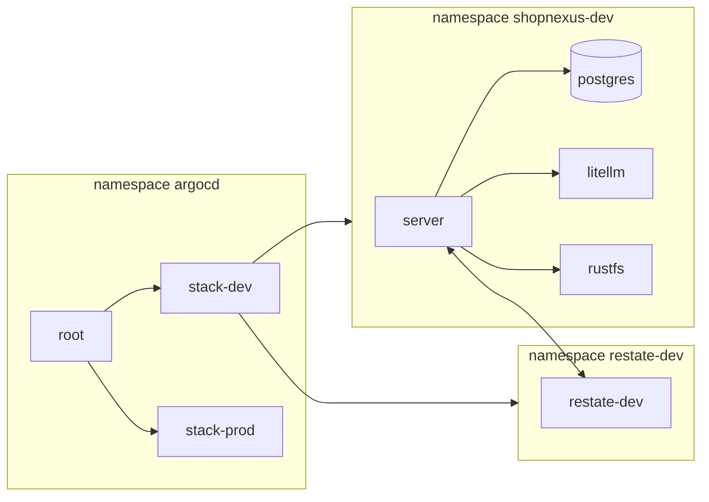

Chạy các lệnh trên máy mà `kubectl` đang trỏ vào cluster k3d `shopnexus`, từ thư mục gốc của bản checkout repo umbrella. Trên server của tác giả, đó chính là server, vào qua SSH. Ví dụ dùng dev; với prod, thay `dev` bằng `prod` trong tên namespace.

| | dev | prod |
|---|---|---|
| Application của Argo CD | `stack-dev` | `stack-prod` |
| Namespace của stack | `shopnexus-dev` | `shopnexus-prod` |
| Namespace và cluster Restate | `restate-dev` | `restate-prod` |
| Domain | `dev.shopnexus.id.vn` | `shopnexus.id.vn` |
| Pod server | 1 | 3 |
| Instance Postgres | 1 | 2 |
| Node Restate | 1 | 3 |



## Trạng thái

```bash
kubectl -n argocd get applications
kubectl -n shopnexus-dev get pods -o wide
kubectl -n restate-dev get pods -o wide
kubectl -n shopnexus-dev get cluster postgres
kubectl -n shopnexus-dev get rs
```

Mọi Application phải ở trạng thái `Synced` và `Healthy`. `kubectl get rs` cho thấy mỗi phiên bản server một ReplicaSet: restate-operator giữ phiên bản cũ cho tới khi các invocation của nó chạy xong. Argo CD báo một server đang crash-loop là Healthy vì nó không có health check cho `RestateDeployment`, nên hãy xem trực tiếp các pod.

Sau khi push, Argo CD tự poll repo theo chu kỳ. Để nó đọc `main` ngay:

```bash
kubectl -n argocd annotate application stack-dev argocd.argoproj.io/refresh=hard --overwrite
```

Kiểm tra mọi host công khai của một stack:

```bash
infra/smoke.sh dev.shopnexus.id.vn
```

Mọi dòng đều bắt đầu bằng `ok`. Thêm `-k` trong lúc chứng chỉ còn lấy từ môi trường staging của Let's Encrypt.

## Log

```bash
kubectl -n shopnexus-dev logs -l app.kubernetes.io/name=server --prefix --tail=200
kubectl -n shopnexus-dev logs deploy/litellm --tail=200
kubectl -n shopnexus-dev logs job/litellm-key
kubectl -n shopnexus-dev logs job/migrate
kubectl -n restate-dev logs restate-dev-0 --tail=200
kubectl -n shopnexus-dev logs postgres-1 --tail=200
```

Server ghi log dạng JSON. CNPG đặt tên pod Postgres là `postgres-1`, `postgres-2`; primary hiện tại nằm ở `kubectl -n shopnexus-dev get cluster postgres -o jsonpath='{.status.currentPrimary}'`. Các Job Sync hook `migrate`, `objectstore-init`, `objectstore-init-snapshots` và `litellm-key` được giữ lại cho tới khi lần sync sau thay chúng.

## Port-forward

Không cái nào dưới đây có Ingress. Mỗi lệnh chiếm terminal; mở địa chỉ bằng trình duyệt hoặc bằng `curl` từ một terminal khác.

<Tabs labels={["Argo CD", "Restate admin", "LiteLLM"]}>
<Tab>
```bash
kubectl -n argocd get secret argocd-initial-admin-secret -o jsonpath='{.data.password}' | base64 -d; echo
kubectl -n argocd port-forward svc/argocd-server 8080:443
```

Mở `https://localhost:8080`, chấp nhận chứng chỉ tự ký, rồi đăng nhập với user `admin` và mật khẩu vừa in ra.
</Tab>
<Tab>
```bash
kubectl -n restate-dev port-forward svc/restate 9070:9070
curl -s http://localhost:9070/deployments
```

Cổng 9070 là admin API của Restate, có UI ở `http://localhost:9070/ui`. Bên trong pod Restate, CLI dùng chính API đó: `kubectl -n restate-dev exec restate-dev-0 -- restate deployments list`.
</Tab>
<Tab>
```bash
kubectl -n shopnexus-dev get secret litellm-secrets -o jsonpath='{.data.LITELLM_MASTER_KEY}' | base64 -d; echo
kubectl -n shopnexus-dev port-forward svc/litellm 4000:4000
```

Mở `http://localhost:4000/ui` và đăng nhập với user `admin`, mật khẩu là master key. [Cổng mô hình ngôn ngữ](/vi/operations/cluster/llm-gateway) chỉ cách đọc mức chi.
</Tab>
</Tabs>

## Tài khoản admin

Admin chỉ tồn tại qua lệnh `staff` (`server/cmd/staff`). API và console tạo và quản lý moderator, và từ chối thao tác lên một admin. Image server có sẵn lệnh này ở `/staff`, và lệnh đọc database cùng `STAFF_KEY` từ môi trường của pod, nên hãy chạy nó trong một pod server của stack:

```bash
kubectl -n shopnexus-prod exec -it $(kubectl -n shopnexus-prod get pod -l app.kubernetes.io/name=server -o name | head -1) -- /staff create-admin --email <email> --name <name>
```

| Lệnh | Dùng khi |
|---|---|
| `create-admin --email <email> --name <name>` | cluster mới chưa có admin, hoặc cần thêm một admin. Lệnh in ra mật khẩu tạm, và console bắt đổi nó ở lần đăng nhập đầu. |
| `unlock --email <email>` | một admin bị khóa. Năm lần sai mật khẩu khóa một email trong 15 phút, và ai biết email cũng gây ra được việc đó. |
| `reset-password --email <email>` | một admin quên mật khẩu. Lệnh in ra mật khẩu tạm mới và kết thúc các phiên của admin đó. |
| `reset-totp --email <email>` | một admin mất ứng dụng xác thực. Lần đăng nhập sau sẽ đăng ký ứng dụng mới. |
| `disable --email <email>` | một admin rời đi. Lệnh kết thúc mọi phiên của người đó. |
| `enable --email <email>` | một admin đã bị vô hiệu hóa quay lại. Các phiên cũ vẫn đã kết thúc. |

Mọi lệnh trừ `create-admin` cũng dùng được cho moderator, và mỗi thay đổi được ghi vào `staff_actions` với CLI là người thực hiện. Dùng `shopnexus-dev` cho stack dev.

## Diễn tập failover

Các bài diễn tập lấy từ Task 17 của plan và chưa chạy trên server của tác giả. Ghi lại mỗi lần chạy (ngày, lệnh, điều quan sát được) vào `infra/drills.md`. Bài Postgres và bài agent chạy trên prod, bài cô lập thử kết nối từ dev sang prod, còn bài release và bài upload dùng dev.

<Steps>
<Step title="Primary của Postgres">
```bash
p=$(kubectl -n shopnexus-prod get cluster postgres -o jsonpath='{.status.currentPrimary}')
kubectl -n shopnexus-prod delete pod "$p"
for i in $(seq 30); do kubectl -n shopnexus-prod get cluster postgres -o jsonpath='{.status.currentPrimary} {.status.phase}{"\n"}'; sleep 2; done
infra/smoke.sh shopnexus.id.vn
```

Mong đợi: `currentPrimary` chuyển sang instance còn lại trong vòng một phút, và smoke test qua.
</Step>
<Step title="Một agent dừng">
```bash
docker stop k3d-shopnexus-agent-1
sleep 90
kubectl -n shopnexus-prod get pods -o wide
kubectl -n restate-prod get pods -o wide
infra/smoke.sh shopnexus.id.vn
docker start k3d-shopnexus-agent-1
```

Mong đợi: sau thời gian eviction của node, các pod server trên agent-1 chạy lại ở node khác. Hai pod Restate vẫn Running và Restate vẫn phục vụ, nên `https://api.shopnexus.id.vn/readyz` trả 200 và smoke test qua.
</Step>
<Step title="Release trong lúc một invocation đang chạy">
Bắt đầu một flow durable chạy lâu trên dev, ví dụ đăng một tin có ảnh từ app. Trong cùng phút đó, push một commit lên `main` của repo `server`. Khi CI đã build xong image:

```bash
kubectl -n shopnexus-dev get rs
kubectl -n restate-dev exec restate-dev-0 -- restate deployments list
```

Mong đợi: có hai ReplicaSet server và hai deployment Restate trong lúc flow chạy. Flow chạy xong, sau đó ReplicaSet cũ scale về 0.
</Step>
<Step title="Dev không vào được prod">
```bash
kubectl -n shopnexus-dev run probe --rm -i --restart=Never --image=busybox:stable -- sh -c "nc -zv -w 3 postgres-rw.shopnexus-prod 5432; nc -zv -w 3 postgres-rw.shopnexus-dev 5432"
```

Mong đợi: kết nối tới dev thành công, còn kết nối tới prod hết thời gian chờ vì NetworkPolicy của `shopnexus-prod` chặn nó.
</Step>
<Step title="Upload presigned qua cả hai proxy">
```bash
mkdir -p tmp
grep -E "^OBJECT_STORE_(ACCESS|SECRET)_KEY=" infra/stack/secrets/dev.env > tmp/s3.env
echo smoke > tmp/smoke.txt
docker run --rm --env-file <(sed -e 's/^OBJECT_STORE_ACCESS_KEY=/AWS_ACCESS_KEY_ID=/' -e 's/^OBJECT_STORE_SECRET_KEY=/AWS_SECRET_ACCESS_KEY=/' tmp/s3.env) \
  -e AWS_REGION=us-east-1 -v "$PWD/tmp:/w" amazon/aws-cli \
  s3 cp /w/smoke.txt s3://shopnexus/media/smoke.txt --endpoint-url https://media.dev.shopnexus.id.vn
curl -fsS https://media.dev.shopnexus.id.vn/shopnexus/media/smoke.txt
rm tmp/s3.env
```

Chạy bằng bash: `<(...)` là process substitution của bash. Mong đợi: upload thành công, tức là chữ ký trên `media.dev.shopnexus.id.vn` đi qua được Caddy và Traefik, và `curl` in ra `smoke` vì tiền tố `media/` cho đọc công khai.
</Step>
<Step title="Bộ nhớ">
```bash
free -g | sed -n 2p
docker stats --no-stream --format "{{.Name}} {{.MemUsage}}" | grep k3d-shopnexus
```

Ghi bộ nhớ còn trống và mức dùng của từng node k3d vào `infra/drills.md`. Spec ước tính hai stack cần 6 đến 8 GB, và bài này đo con số thật.
</Step>
</Steps>

## Lỗi đã biết

<AccordionGroup>
<Accordion title="stack-dev báo ComparisonError và đòi chạy seal.sh" open>
Application ở trạng thái `Unknown` với thông báo `infra/stack/secrets/dev/ holds no sealed secrets: run infra/cluster/seal.sh dev, commit and push`. Chart từ chối render một stack chưa có SealedSecret, và ngay sau `up.sh` thì chưa có cái nào. Chạy `infra/cluster/seal.sh dev`, commit `infra/stack/secrets/dev/*.yaml` rồi push. Application tự thử lại, lúc đầu mỗi 30 giây và thưa nhất là mỗi 5 phút.
</Accordion>
<Accordion title="Traefik chạy cấu hình mặc định và bỏ qua cấu hình edge">
Ở chế độ direct không có chuyển hướng HTTP sang HTTPS và không có chứng chỉ Let's Encrypt, hoặc khi đứng sau proxy thì `X-Forwarded-For` không được tin. k3s cài Traefik qua Helm controller của nó, và khi `HelmChartConfig` trong `infra/cluster/edge-*.yaml` không qua được schema của chart Traefik, k3s chạy Traefik với giá trị mặc định của chart và chỉ báo điều đó trong log của job cài đặt. Đọc log bằng `kubectl -n kube-system logs job/helm-install-traefik`. Các file edge viết cho chart Traefik 41.4.0, và `infra/check.sh` render cả hai file với chart đó; chạy nó sau mỗi lần sửa file edge.
</Accordion>
<Accordion title="Pod Postgres lỗi vì image hoặc quyền file">
CNPG đọc major version của Postgres từ tag image, và tag của ParadeDB như `0.26.4-pg18` không parse được. Chart xử lý bằng một `ImageCatalog` ghi rõ major 18, nên hãy giữ `major: 18` trong `postgres.yaml` khớp với tag trong `images.postgres`. CNPG còn mặc định uid 26, user trong image của chính nó, trong khi image ParadeDB chạy Postgres bằng uid 999; chart đặt `postgresUID: 999` và `postgresGID: 999`. Lỗi quyền trên thư mục dữ liệu sau khi đổi image nghĩa là image mới dùng uid khác: đọc uid bằng `docker run --rm --entrypoint id paradedb/paradedb:0.26.4-pg18`, thay bằng tag mới.
</Accordion>
<Accordion title="Server không bao giờ ready">
`/readyz` trả 503 và server log `not ready` kèm `check restate: ...`. Readiness ping Postgres và admin API của Restate tại `http://restate.restate-dev:9070`. restate-operator chỉ cho traffic vào cổng ingress và admin của Restate từ các peer trong `spec.security.networkPeers` của `RestateCluster`, và chart đặt peer là các pod server trong namespace của stack. Kiểm tra pod Restate có chạy không (`kubectl -n restate-dev get pods`) và policy của operator có nhắc tới server không (`kubectl -n restate-dev get networkpolicy -o yaml`). Restate chỉ gọi ngược được các pod có nhãn `allow.restate.dev/restate-dev: "true"`, và pod template của server có nhãn này.
</Accordion>
<Accordion title="seal.sh dừng vì thiếu restate.pem, hoặc lời gọi của Restate bị từ chối">
`seal.sh` giữ khóa ký của Restate trong `infra/stack/secrets/<stack>.restate.pem` và nửa công khai của nó trong `RESTATE_IDENTITY_KEY` ở `<stack>.env`. Khi `.env` có khóa công khai mà file `.pem` đã mất, `seal.sh` dừng với `restore dev.restate.pem from the backup`. Khôi phục file từ bản sao lưu. Một cặp khóa mới sẽ khiến Restate ký request bằng khóa mà server đang chạy không biết: server từ chối các request đó, và các flow durable đứng lại trong lúc Restate thử lại. Đổi khóa có chủ đích thì xóa cả dòng lẫn file `.pem`, rồi khởi động lại các pod Restate; trang [Secret](/vi/operations/cluster/secrets#khóa-restate) có các bước.
</Accordion>
<Accordion title="Server crash-loop vì LLM_* hoặc biến khác chưa được đặt">
Server không có giá trị mặc định. Khi khởi động, nó thoát và in một dòng cho mỗi biến bị thiếu hoặc để trống, ví dụ `LLM_API_KEY is not set`. `LLM_BASE_URL` và `LLM_MODEL` lấy từ ConfigMap `server-env`; `LLM_API_KEY` và các khóa khác lấy từ `server-secrets` đã seal. Thiếu một khóa trong `server-secrets` nghĩa là SealedSecret được tạo trước khi `seal.sh` biết tới khóa đó: chạy lại `infra/cluster/seal.sh dev` (nó giữ các khóa cũ và thêm khóa mới), commit rồi push. `litellm.model` hay `litellm.apiBase` để trống thì không tới được server: chart render lỗi với `litellm.model is required`, và Argo CD hiện nó thành ComparisonError.
</Accordion>
<Accordion title="dev.shopnexus.id.vn không phân giải được">
`api.dev.shopnexus.id.vn` phân giải được nhưng `dev.shopnexus.id.vn` thì không. Bản ghi `*` không còn phủ `dev` khi đã có bản ghi `*.dev`, nên zone cần một bản ghi `dev` riêng bên cạnh `@`, `*` và `*.dev`. Kiểm tra bằng `dig +short dev.shopnexus.id.vn`.
</Accordion>
<Accordion title="Let's Encrypt từ chối cấp chứng chỉ">
Ở chế độ direct, log của Traefik có lỗi ACME về rate limit. Endpoint production của Let's Encrypt giới hạn số chứng chỉ một domain nhận được mỗi tuần, và dựng lại nhiều lần sẽ dùng hết hạn mức. Vì vậy `up.sh` mặc định `ACME_SERVER` là endpoint staging. Dùng staging cho tới khi `infra/smoke.sh <domain> -k` qua, rồi đặt `ACME_SERVER=https://acme-v02.api.letsencrypt.org/directory` khi chạy `up.sh`. Khi đứng sau proxy, proxy giữ chứng chỉ và lỗi này không xảy ra.
</Accordion>
<Accordion title="Host hết bộ nhớ">
Pod bị `OOMKilled` hoặc `Pending`, hoặc host phải swap. Spec ước tính hai stack cần 6 đến 8 GB, và server của tác giả đã dùng 17 trên 19 GB từ trước. Khi không dùng dev, scale dev về 0: trong `infra/stack/values-dev.yaml`, đặt `replicas.server`, `replicas.website`, `replicas.docs` và `replicas.console` bằng 0, giữ `postgres.instances: 1` và `restate.replicas: 1`, rồi commit và push. `kubectl scale` không giữ được lâu vì self-heal của Argo CD đặt lại số replica theo git. Spec còn một phương án dự phòng khác là cluster chỉ có hai agent.
</Accordion>
<Accordion title="Pod không pull được image ghcr.io/shopnexus">
Pod ở trạng thái `ImagePullBackOff` và `kubectl describe pod` cho thấy lỗi unauthorized hoặc denied từ `ghcr.io`. Cluster pull image không dùng thông tin đăng nhập, nên mọi package nó dùng phải công khai: `server`, `website`, `docs` và `console` dưới `ghcr.io/shopnexus`. Trên GitHub, mở package, chọn <UI>Package settings</UI>, rồi <UI>Change visibility</UI>. Một bản fork push image lên owner khác cũng phải đổi tên image trong `infra/stack/values.yaml` và `infra/argocd/stacks.yaml`.
</Accordion>
</AccordionGroup>
