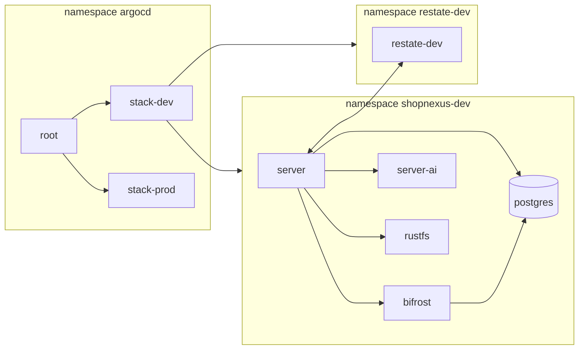

Chạy các lệnh trên máy mà `kubectl` đang trỏ vào cluster k3d `shopnexus`, từ thư mục gốc của bản checkout repo umbrella. Trên server của tác giả, đó chính là server, vào qua SSH. Ví dụ dùng dev; với prod, thay `dev` bằng `prod` trong tên namespace.

| | dev | prod |
|---|---|---|
| Application của Argo CD | `stack-dev` | `stack-prod` |
| Namespace của stack | `shopnexus-dev` | `shopnexus-prod` |
| Namespace và cluster Restate | `restate-dev` | `restate-prod` |
| Domain | `dev.shopnexus.id.vn` | `shopnexus.id.vn` |
| Pod server | 1 | 3 |
| Instance Postgres | 1 | 2 |
| Node Restate | 1 | 3 |



## Trạng thái

```bash
kubectl -n argocd get applications
kubectl -n shopnexus-dev get pods -o wide
kubectl -n restate-dev get pods -o wide
kubectl -n shopnexus-dev get cluster postgres
kubectl -n shopnexus-dev get rs
```

Mọi Application phải ở trạng thái `Synced` và `Healthy`. `kubectl get rs` cho thấy mỗi phiên bản server một ReplicaSet: restate-operator giữ phiên bản cũ cho tới khi các invocation của nó chạy xong. Một lần sync bị treo ở wave 2 thường là đang chờ một phiên bản server có pod không bao giờ sẵn sàng, nên hãy xem trực tiếp các pod.

Sau khi push, Argo CD tự poll repo theo chu kỳ. Để nó đọc `main` ngay:

```bash
kubectl -n argocd annotate application stack-dev argocd.argoproj.io/refresh=hard --overwrite
```

Kiểm tra mọi host công khai của một stack:

```bash
hurl --test --continue-on-error --variable domain=dev.shopnexus.id.vn infra/smoke.hurl
```

Hurl báo file thành công và thoát với mã 0. Thêm `--insecure` nếu chứng chỉ lấy từ môi trường staging của Let's Encrypt.

## Log

```bash
kubectl -n shopnexus-dev logs -l app.kubernetes.io/name=server --prefix --tail=200
kubectl -n shopnexus-dev logs deploy/bifrost --tail=200
kubectl -n shopnexus-dev logs -l app.kubernetes.io/name=server-ai --tail=200
kubectl -n shopnexus-dev logs job/migrate
kubectl -n restate-dev logs restate-dev-0 --tail=200
kubectl -n shopnexus-dev logs postgres-1 --tail=200
```

Server ghi log dạng JSON. CNPG đặt tên pod Postgres là `postgres-1`, `postgres-2`; primary hiện tại nằm ở `kubectl -n shopnexus-dev get cluster postgres -o jsonpath='{.status.currentPrimary}'`. Các Job Sync hook `migrate`, `objectstore-init` và `objectstore-init-snapshots` được giữ lại cho tới khi lần sync sau thay chúng.

## Dashboard và port-forward

Grafana, giao diện admin của Restate, Bifrost, web console của RustFS và pgweb có host riêng trong mỗi stack (`grafana.`, `restate.`, `bifrost.`, `s3.` và `db.<domain>`), còn Argo CD có `argocd.<tên miền prod>`. Tất cả nằm sau bước đăng nhập của trang điều hành ([Giám sát](/vi/operations/monitoring)). Khi trang điều hành hoặc server ngừng chạy, hãy forward một cổng thay vào đó. Mỗi lệnh chiếm terminal; mở địa chỉ bằng trình duyệt hoặc bằng `curl` từ một terminal khác.

<Tabs labels={["Argo CD", "Restate admin", "Bifrost"]}>
<Tab>
```bash
kubectl -n argocd port-forward svc/argocd-server 8080:80
```

Mở `http://localhost:8080`. Argo CD không có bước đăng nhập riêng, vì chỉ cổng chặn của trang điều hành và port-forward tới được nó.
</Tab>
<Tab>
```bash
kubectl -n restate-dev port-forward svc/restate 9070:9070
curl -s http://localhost:9070/deployments
```

Cổng 9070 là admin API của Restate, có UI ở `http://localhost:9070/ui`. Bên trong pod Restate, CLI dùng chính API đó: `kubectl -n restate-dev exec restate-dev-0 -- restate deployments list`.
</Tab>
<Tab>
```bash
kubectl -n shopnexus-dev get secret bifrost-secrets -o jsonpath='{.data.BIFROST_ADMIN_PASSWORD}' | base64 -d; echo
kubectl -n shopnexus-dev port-forward svc/bifrost 8080:8080
```

Mở `http://localhost:8080` và đăng nhập với user `admin` và mật khẩu vừa in ra. Host dashboard `bifrost.<domain>` dẫn tới cùng UI đó, sau bước đăng nhập của trang điều hành; [Cổng Bifrost](/vi/operations/cluster/llm-gateway#dashboard) nói nên dùng nó vào việc gì.
</Tab>
</Tabs>

## Bifrost

### Sau khi chuyển sang Bifrost

Một stack từng chạy LiteLLM trước Bifrost vẫn giữ database và role `litellm`, vì CNPG không bao giờ xóa thứ mà chart thôi khai báo. Hãy xóa chúng một lần, sau khi `bifrost` đã sẵn sàng:

```bash
kubectl -n shopnexus-dev rollout status deploy/bifrost
primary=$(kubectl -n shopnexus-dev get cluster postgres -o jsonpath='{.status.currentPrimary}')
kubectl -n shopnexus-dev exec "$primary" -c postgres -- psql -c 'DROP DATABASE IF EXISTS litellm WITH (FORCE)' -c 'DROP ROLE IF EXISTS litellm'
```

Lịch sử mức chi của LiteLLM mất theo database. Sau đó kiểm tra server đã đối soát Bifrost: dashboard liệt kê mỗi agent một team.

### Khóa mã hóa của Bifrost

`BIFROST_ENCRYPTION_KEY` mã hóa những gì Bifrost lưu. Một khóa mới khiến dữ liệu đó không đọc được nữa, nên khóa không bao giờ đổi khi stack đã có dữ liệu. Trước khi chạy lệnh seal từ một bản checkout khác với bản đã seal stack đó, hãy chép chúng từ cluster vào `infra/stack/secrets/<stack>.env` của bạn:

```bash
for k in BIFROST_ENCRYPTION_KEY BIFROST_ADMIN_PASSWORD; do
  printf '%s=%s\n' "$k" "$(kubectl -n shopnexus-<stack> get secret bifrost-secrets -o jsonpath="{.data.$k}" | base64 -d)"
done
printf 'BIFROST_DB_PASSWORD=%s\n' "$(kubectl -n shopnexus-<stack> get secret bifrost-db -o jsonpath='{.data.password}' | base64 -d)"
```

Thay các dòng đó trong file `.env` của stack đó bằng kết quả in ra. Một mật khẩu database mới không gây hại, nhưng chép nó giúp role giữ nguyên. Lệnh seal giữ mọi giá trị đã có trong `<stack>.env`, nên lần seal lại vẫn để dữ liệu của Bifrost đọc được.

## Tài khoản admin

Quản trị viên chỉ tồn tại qua lệnh `console` (`server/cmd/console`). API và trang điều hành tạo và quản lý điều phối viên, và từ chối thao tác lên một quản trị viên. Image server có sẵn lệnh này ở `/console`, và lệnh đọc database cùng `CONSOLE_KEY` từ môi trường của pod, nên hãy chạy nó trong một pod server của stack:

```bash
kubectl -n shopnexus-prod exec -it $(kubectl -n shopnexus-prod get pod -l app.kubernetes.io/name=server -o name | head -1) -- /console create-admin --email <email> --name <name>
```

| Lệnh | Dùng khi |
|---|---|
| `create-admin --email <email> --name <name>` | cluster mới chưa có quản trị viên, hoặc cần thêm một quản trị viên. Lệnh in ra mật khẩu tạm, và trang điều hành bắt đổi nó ở lần đăng nhập đầu. |
| `unlock --email <email>` | một quản trị viên bị khóa. Năm lần sai mật khẩu khóa một email trong 15 phút, và ai biết email cũng gây ra được việc đó. |
| `reset-password --email <email>` | một quản trị viên quên mật khẩu. Lệnh in ra mật khẩu tạm mới và kết thúc các phiên của người đó. |
| `reset-totp --email <email>` | một quản trị viên mất ứng dụng xác thực. Lần đăng nhập sau sẽ đăng ký ứng dụng mới. |
| `disable --email <email>` | một quản trị viên rời đi. Lệnh kết thúc mọi phiên của người đó. |
| `enable --email <email>` | một quản trị viên đã bị vô hiệu hóa quay lại. Các phiên cũ vẫn đã kết thúc. |

Mọi lệnh trừ `create-admin` cũng dùng được cho điều phối viên, và mỗi thay đổi được ghi vào `console_actions` với CLI là người thực hiện. Dùng `shopnexus-dev` cho stack dev.

## Diễn tập failover

Chạy các bài diễn tập sau mỗi lần dựng cluster và sau mỗi thay đổi ở biên hoặc ở các dịch vụ dữ liệu. Bài Postgres và bài agent chạy trên prod, bài cô lập thử kết nối từ dev sang prod, còn bài release và bài upload dùng dev.

<Steps>
<Step title="Primary của Postgres">
```bash
p=$(kubectl -n shopnexus-prod get cluster postgres -o jsonpath='{.status.currentPrimary}')
kubectl -n shopnexus-prod delete pod "$p"
for i in $(seq 30); do kubectl -n shopnexus-prod get cluster postgres -o jsonpath='{.status.currentPrimary} {.status.phase}{"\n"}'; sleep 2; done
hurl --test --continue-on-error --variable domain=shopnexus.id.vn infra/smoke.hurl
```

Mong đợi: `currentPrimary` chuyển sang instance còn lại trong vòng một phút, và smoke test qua.
</Step>
<Step title="Một agent dừng">
```bash
docker stop k3d-shopnexus-agent-1
sleep 90
kubectl -n shopnexus-prod get pods -o wide
kubectl -n restate-prod get pods -o wide
hurl --test --continue-on-error --variable domain=shopnexus.id.vn infra/smoke.hurl
docker start k3d-shopnexus-agent-1
```

Mong đợi: sau thời gian eviction của node, các pod server trên agent-1 chạy lại ở node khác. Hai pod Restate vẫn Running và Restate vẫn phục vụ, nên `https://api.shopnexus.id.vn/readyz` trả 200 và smoke test qua.
</Step>
<Step title="Release trong lúc một invocation đang chạy">
Bắt đầu một flow durable chạy lâu trên dev, ví dụ đăng một tin có ảnh từ ứng dụng. Trong cùng phút đó, push một commit lên `main` của repo `server`. Khi CI đã build xong image:

```bash
kubectl -n shopnexus-dev get rs
kubectl -n restate-dev exec restate-dev-0 -- restate deployments list
```

Mong đợi: có hai ReplicaSet server và hai deployment Restate trong lúc flow chạy. Flow chạy xong, sau đó ReplicaSet cũ scale về 0.
</Step>
<Step title="Dev không vào được prod">
```bash
kubectl -n shopnexus-dev run probe --rm -i --restart=Never --image=busybox:stable -- sh -c "nc -zv -w 3 postgres-rw.shopnexus-prod 5432; nc -zv -w 3 postgres-rw.shopnexus-dev 5432"
```

Mong đợi: kết nối tới dev thành công, còn kết nối tới prod hết thời gian chờ vì NetworkPolicy của `shopnexus-prod` chặn nó.
</Step>
<Step title="Upload presigned qua cả hai proxy">
```bash
mkdir -p tmp
grep -E "^OBJECT_STORE_(ACCESS|SECRET)_KEY=" infra/stack/secrets/dev.env > tmp/s3.env
echo smoke > tmp/smoke.txt
docker run --rm --env-file <(sed -e 's/^OBJECT_STORE_ACCESS_KEY=/AWS_ACCESS_KEY_ID=/' -e 's/^OBJECT_STORE_SECRET_KEY=/AWS_SECRET_ACCESS_KEY=/' tmp/s3.env) \
  -e AWS_REGION=us-east-1 -v "$PWD/tmp:/w" amazon/aws-cli \
  s3 cp /w/smoke.txt s3://shopnexus/media/smoke.txt --endpoint-url https://media.dev.shopnexus.id.vn
curl -fsS https://media.dev.shopnexus.id.vn/shopnexus/media/smoke.txt
rm tmp/s3.env
```

Chạy bằng bash: `<(...)` là process substitution của bash. Mong đợi: upload thành công, tức là chữ ký trên `media.dev.shopnexus.id.vn` đi qua được Caddy và Traefik, và `curl` in ra `smoke` vì tiền tố `media/` cho đọc công khai.
</Step>
<Step title="Bộ nhớ">
```bash
free -g | sed -n 2p
docker stats --no-stream --format "{{.Name}} {{.MemUsage}}" | grep k3d-shopnexus
```

So bộ nhớ còn trống và mức dùng của từng node k3d với lần chạy trước.
</Step>
</Steps>

## Lỗi đã biết

<AccordionGroup>
<Accordion title="stack-dev báo ComparisonError và đòi chạy lệnh seal" open>
Application ở trạng thái `Unknown` với thông báo `infra/stack/secrets/dev/ holds no sealed secrets: run go -C infra run ./cmd/seal dev, commit and push`. Chart từ chối render một stack chưa có SealedSecret, và ngay sau khi tạo cluster thì chưa có cái nào. Chạy `go -C infra run ./cmd/seal dev`, commit `infra/stack/secrets/dev/*.yaml` rồi push. Application tự thử lại, lúc đầu mỗi 30 giây và thưa nhất là mỗi 5 phút.
</Accordion>
<Accordion title="Traefik chạy cấu hình mặc định và bỏ qua cấu hình edge">
Ở chế độ direct không có chuyển hướng HTTP sang HTTPS và không có chứng chỉ Let's Encrypt, hoặc khi đứng sau proxy thì `X-Forwarded-For` không được tin. k3s cài Traefik qua Helm controller của nó, và khi `HelmChartConfig` trong file cấu hình k3d (`infra/cluster/k3d-*.yaml`) không qua được schema của chart Traefik, k3s chạy Traefik với giá trị mặc định của chart và chỉ báo điều đó trong log của job cài đặt. Đọc log bằng `kubectl -n kube-system logs job/helm-install-traefik`. Các cấu hình Traefik viết cho chart Traefik 41.4.0, và `infra/check.sh` render cả hai với chart đó; chạy nó sau mỗi lần sửa một file cấu hình k3d.
</Accordion>
<Accordion title="Pod Postgres lỗi vì image hoặc quyền file">
CNPG đọc major version của Postgres từ tag image, và tag của ParadeDB như `0.26.4-pg18` không parse được. Chart xử lý bằng một `ImageCatalog` ghi rõ major 18, nên hãy giữ `major: 18` trong `postgres.yaml` khớp với tag trong `images.postgres`. CNPG còn mặc định uid 26, user trong image của chính nó, trong khi image ParadeDB chạy Postgres bằng uid 999; chart đặt `postgresUID: 999` và `postgresGID: 999`. Lỗi quyền trên thư mục dữ liệu sau khi đổi image nghĩa là image mới dùng uid khác: đọc uid bằng `docker run --rm --entrypoint id paradedb/paradedb:0.26.4-pg18`, thay bằng tag mới.
</Accordion>
<Accordion title="Server không bao giờ ready">
`/readyz` trả 503 và server log `not ready` kèm `check restate: ...`. Readiness ping Postgres và admin API của Restate tại `http://restate.restate-dev:9070`. restate-operator chỉ cho traffic vào cổng ingress và admin của Restate từ các peer trong `spec.security.networkPeers` của `RestateCluster`, và chart đặt peer là các pod server và `server-ai` trong namespace của stack. Kiểm tra pod Restate có chạy không (`kubectl -n restate-dev get pods`) và policy của operator có nhắc tới server không (`kubectl -n restate-dev get networkpolicy -o yaml`). Restate chỉ gọi ngược được các pod có nhãn `allow.restate.dev/restate-dev: "true"`, và pod template của server có nhãn này.
</Accordion>
<Accordion title="Lệnh seal dừng vì thiếu restate.pem, hoặc lời gọi của Restate bị từ chối">
Lệnh seal giữ khóa ký của Restate trong `infra/stack/secrets/<stack>.restate.pem` và nửa công khai của nó trong `RESTATE_IDENTITY_KEY` ở `<stack>.env`. Khi `.env` có khóa công khai mà file `.pem` đã mất, lệnh seal dừng với `restore dev.restate.pem from the backup`. Khôi phục file từ bản sao lưu. Một cặp khóa mới sẽ khiến Restate ký request bằng khóa mà server đang chạy không biết: server từ chối các request đó, và các flow durable đứng lại trong lúc Restate thử lại. Đổi khóa có chủ đích thì xóa cả dòng lẫn file `.pem`, rồi khởi động lại các pod Restate; trang [Secret](/vi/operations/cluster/secrets#khóa-restate) có các bước.
</Accordion>
<Accordion title="Server crash-loop vì GATEWAY_* hoặc biến khác chưa được đặt">
Server không có giá trị mặc định. Khi khởi động, nó thoát và in một dòng cho mỗi biến bị thiếu hoặc để trống, ví dụ `GATEWAY_ADMIN_PASSWORD is not set`. `GATEWAY_URL` và `GATEWAY_ADMIN_USERNAME` lấy từ ConfigMap `server-env`; `GATEWAY_ADMIN_PASSWORD` lấy từ `bifrost-secrets`, còn các khóa khác lấy từ `server-secrets` đã seal. Thiếu một khóa nghĩa là SealedSecret được tạo trước khi lệnh seal biết tới khóa đó: chạy lại `go -C infra run ./cmd/seal dev` (nó giữ các khóa cũ và thêm khóa mới), commit rồi push. Hãy chép các khóa của Bifrost vào `dev.env` trước ([Khóa mã hóa của Bifrost](#khóa-mã-hóa-của-bifrost)).
</Accordion>
<Accordion title="dev.shopnexus.id.vn không phân giải được">
`api.dev.shopnexus.id.vn` phân giải được nhưng `dev.shopnexus.id.vn` thì không. Bản ghi `*` không còn phủ `dev` khi đã có bản ghi `*.dev`, nên zone cần một bản ghi `dev` riêng bên cạnh `@`, `*` và `*.dev`. Kiểm tra bằng `dig +short dev.shopnexus.id.vn`.
</Accordion>
<Accordion title="Let's Encrypt từ chối cấp chứng chỉ">
Ở chế độ direct, log của Traefik có lỗi ACME về rate limit. Endpoint production của Let's Encrypt giới hạn số chứng chỉ một domain nhận được mỗi tuần, và dựng lại nhiều lần sẽ dùng hết hạn mức. Traefik mặc định dùng endpoint production. Khi dựng thử nhiều lần, thêm `caServer: https://acme-staging-v02.api.letsencrypt.org/directory` dưới `acme` trong `infra/cluster/k3d-direct.yaml` trước khi tạo cluster, và chạy smoke test với `--insecure`. Khi đứng sau proxy, proxy giữ chứng chỉ và lỗi này không xảy ra.
</Accordion>
<Accordion title="Host hết bộ nhớ">
Pod bị `OOMKilled` hoặc `Pending`, hoặc host phải swap. `server-ai` là pod lớn nhất, xin 6Gi ở prod. Khi không dùng dev, thu nhỏ dev: trong `infra/stack/values-dev.yaml`, đặt `replicas.server`, `replicas.website`, `replicas.docs`, `replicas.console` và `replicas.agent` bằng 0, rồi commit và push. `server-ai`, Bifrost, imgproxy, Grafana, pgweb và các dịch vụ dữ liệu giữ mỗi thứ một pod. `kubectl scale` không giữ được lâu vì self-heal của Argo CD đặt lại số replica theo git. Một phương án dự phòng khác là cluster chỉ có hai agent.
</Accordion>
<Accordion title="Pod không pull được image ghcr.io/shopnexus">
Pod ở trạng thái `ImagePullBackOff` và `kubectl describe pod` cho thấy lỗi unauthorized hoặc denied từ `ghcr.io`. Cluster pull image không dùng thông tin đăng nhập, nên mọi package nó dùng phải công khai: `ghcr.io/shopnexus/server`, `docs` và `agent`, cùng `ghcr.io/shopnexus/clients/website` và `clients/console`. Trên GitHub, mở package, chọn <UI>Package settings</UI>, rồi <UI>Change visibility</UI>. Một bản fork push image lên owner khác cũng phải đổi tên image trong các file values và `infra/argocd/stacks.yaml`.
</Accordion>
</AccordionGroup>
