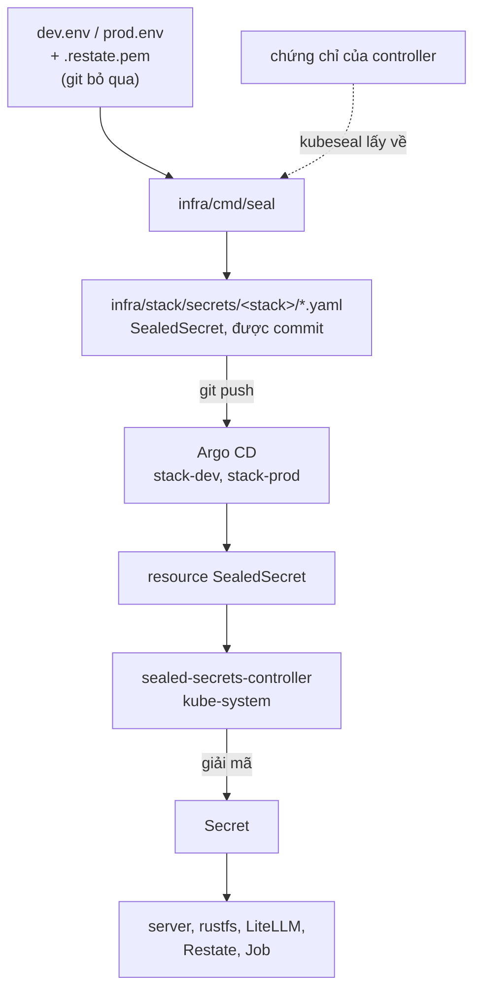

Khóa của một stack nằm trong hai file bị git bỏ qua, trên máy chạy lệnh seal: `infra/stack/secrets/<stack>.env` và `infra/stack/secrets/<stack>.restate.pem`. Lệnh seal, `infra/cmd/seal`, mã hóa chúng bằng chứng chỉ công khai của controller Sealed Secrets và ghi kết quả thành các SealedSecret vào `infra/stack/secrets/<stack>/`, thư mục được commit. Chỉ controller, bên trong cluster, mới biến chúng trở lại thành Secret.



## Mô hình Sealed Secrets

Application `sealed-secrets` (`infra/platform/sealed-secrets.yaml`, chart 2.22.0) chạy controller trong `kube-system` với tên `sealed-secrets-controller`, là tên mà `kubeseal` tìm. Lần khởi động đầu, controller tạo một cặp khóa và giữ nó trong một Secret gắn nhãn `sealedsecrets.bitnami.com/sealed-secrets-key`. `kubeseal` mã hóa bằng nửa công khai; nửa bí mật không bao giờ rời cluster.

Lệnh seal gọi `kubeseal` không có `--scope`, nên mỗi SealedSecret dùng scope mặc định strict: nó chỉ giải mã được dưới đúng tên và namespace của nó. Một SealedSecret chép sang stack kia sẽ không mở được ở đó.

Chart lấy mọi file trong `infra/stack/secrets/<stack>/`. Khi thư mục rỗng, việc render thất bại với `infra/stack/secrets/<stack>/ holds no sealed secrets: run go -C infra run ./cmd/seal <stack>, commit and push`, và Application của stack hiện lỗi đó cho tới khi các file tới.

## Lệnh seal làm gì

Chạy lệnh từ thư mục gốc của umbrella:

```bash title="Terminal"
go -C infra run ./cmd/seal dev|prod [-dry-run]
```

`-C infra` đặt `infra/` làm thư mục làm việc, nên các đường dẫn mặc định tính từ đó. `-dir` đặt thư mục secret (mặc định `stack/secrets`), `-example` đặt file mẫu (mặc định `stack/secrets/example.env`) và `-image` đặt image server chạy `/envgen` (mặc định `ghcr.io/shopnexus/server:main`). Cờ có thể đứng trước hoặc sau tên stack. Thêm một đối số thừa thì lệnh in cách dùng và thoát với mã 2.

<Steps>
<Step title="Tạo file .env">
Ở lần chạy đầu, `/envgen` chép `infra/stack/secrets/example.env` thành `<stack>.env` với mode 600. Ở các lần sau, nó thêm những biến `example.env` có mà `<stack>.env` thiếu, với giá trị trong example.
</Step>

<Step title="Sinh các khóa còn thiếu">
Với mỗi khóa tự sinh chưa có giá trị trong `<stack>.env`, lệnh tạo một khóa. Khóa JWT, khóa staff và khóa Restate đến từ `/envgen` trong image server (`-image`), chạy trong Docker. Các khóa còn lại là byte ngẫu nhiên từ `crypto/rand` của Go, mã hóa hex. Cả hai cách đều điền vào dòng `KEY=` rỗng tại chỗ và nối thêm dòng còn thiếu.
</Step>

<Step title="Kiểm tra giá trị của người vận hành">
Lệnh dừng với `seal: .../<stack>.env: set LLM_UPSTREAM_API_KEY` khi giá trị đó còn rỗng. Với prod, lệnh dừng khi `FCM_CREDENTIALS` còn rỗng, kèm `prod needs FCM_CREDENTIALS (APP_ENV=prod refuses to only log pushes)`.
</Step>

<Step title="Seal bốn Secret">
Lệnh tự dựng từng Secret, chuyển qua `kubeseal --format yaml`, và ghi `server-secrets.yaml`, `restate-secrets.yaml`, `litellm-secrets.yaml` cùng `litellm-db.yaml` vào `infra/stack/secrets/<stack>/`. `kubeseal` lấy chứng chỉ từ cluster mà kubectl đang trỏ tới. Lệnh kết thúc bằng `sealed into .../infra/stack/secrets/<stack>; commit and push`.
</Step>
</Steps>

Lần chạy thứ hai thấy mọi khóa đã có và seal đúng các giá trị cũ. `kubeseal` mã hóa với một session key ngẫu nhiên mới mỗi lần, nên các file đã seal vẫn thay đổi.

## Các khóa

| Khóa | Do ai tạo | Secret | Ai đọc |
|---|---|---|---|
| `JWT_KEY_ID` | `/envgen`: `k` và giờ UTC, ví dụ `k20261104120000` | `server-secrets` | server |
| `JWT_PRIVATE_KEY` | `/envgen`: base64 của một seed Ed25519 32 byte | `server-secrets` | server, dùng để ký access token |
| `STAFF_KEY` | `/envgen`: base64 của 32 byte ngẫu nhiên | `server-secrets` | server, suy ra từ nó khóa niêm phong TOTP và khóa HMAC dùng khi khóa đăng nhập |
| `RESTATE_IDENTITY_KEY` | `/envgen`: khóa công khai, `publickeyv1_…` | `server-secrets` | server, từ chối request của Restate không ký bằng khóa bí mật tương ứng |
| `<stack>.restate.pem` | `/envgen`: khóa bí mật Ed25519 | `restate-secrets` dưới tên `private.pem` | Restate (`requestSigningPrivateKey`) |
| `OBJECT_STORE_ACCESS_KEY` | 12 byte ngẫu nhiên, hex | `server-secrets`; `restate-secrets` dưới tên `AWS_ACCESS_KEY_ID` | server, RustFS (`RUSTFS_ACCESS_KEY`), snapshot của Restate |
| `OBJECT_STORE_SECRET_KEY` | 24 byte ngẫu nhiên, hex | `server-secrets`; `restate-secrets` dưới tên `AWS_SECRET_ACCESS_KEY` | server, RustFS (`RUSTFS_SECRET_KEY`), snapshot của Restate |
| `LLM_API_KEY` | `sk-` và 24 byte ngẫu nhiên, hex | `server-secrets` | server; Job `litellm-key` đăng ký nó làm virtual key của server |
| `LITELLM_MASTER_KEY` | `sk-` và 24 byte ngẫu nhiên, hex | `litellm-secrets` | LiteLLM, Job `litellm-key` |
| `LITELLM_DB_PASSWORD` | 24 byte ngẫu nhiên, hex | `litellm-db` dưới tên `password`, với `username: litellm` | CloudNativePG (managed role `litellm`), LiteLLM |
| `LLM_UPSTREAM_API_KEY` | bạn | `litellm-secrets` | LiteLLM, để gọi `litellm.apiBase` (hôm nay là một trong các `access.api-keys` của cli-proxy-api) |
| `FCM_CREDENTIALS` | bạn: JSON của một service account Firebase, mã hóa base64 | `server-secrets` | server, để gửi push |

`FCM_CREDENTIALS` có thể để rỗng trên dev, nơi server ghi push ra log thay vì gửi. `APP_ENV=prod` từ chối giá trị rỗng, nên lệnh seal cho prod cũng vậy. `LLM_UPSTREAM_API_KEY` bắt buộc trên cả hai stack.

`server-secrets`, `litellm-secrets` và `litellm-db` nằm trong `shopnexus-<stack>`. `restate-secrets` nằm trong `restate-<stack>`, namespace của `RestateCluster`. Các Job `migrate`, `objectstore-init` và `objectstore-init-snapshots` chạy image server với cùng môi trường, nên cũng nhận mọi khóa của `server-secrets`.

CloudNativePG tạo thêm một Secret, `postgres-app`, có `uri` là `DATABASE_URL` của server. `JWT_PREVIOUS_KEY_ID` và `JWT_PREVIOUS_PUBLIC_KEY` là chuỗi rỗng trong ConfigMap `server-env` (`infra/stack/templates/_server-env.tpl`).

## Các file cần sao lưu

| File | Chứa gì | Mất nó thì |
|---|---|---|
| `infra/stack/secrets/dev.env`, `prod.env` | mọi khóa trong bảng trên, ở dạng rõ | một lần seal lại sinh khóa mới. `STAFF_KEY` mới làm mọi TOTP secret đã lưu không đọc được nữa; khóa JWT mới từ chối các access token phát ra trước nó, trong tối đa 15 phút sống của chúng |
| `infra/stack/secrets/dev.restate.pem`, `prod.restate.pem` | khóa ký bí mật của Restate | `/envgen` dừng, và lệnh seal in thông báo của nó sau `envgen in <image>`: `<stack>.env has RESTATE_IDENTITY_KEY but <stack>.restate.pem is missing: restore <stack>.restate.pem from the backup` |
| khóa của controller | khóa bí mật mở được mọi SealedSecret trong git | các SealedSecret đã commit không mở được trên cluster mới; bạn seal lại từ các file `.env` và `.pem` |

Xuất khóa của controller bằng:

```bash title="Terminal"
kubectl -n kube-system get secret -l sealedsecrets.bitnami.com/sealed-secrets-key -o yaml > sealed-secrets-key.yaml
```

Giữ năm file trong một trình quản lý mật khẩu hoặc một chỗ lưu khác không nằm trên máy này.

Khi cluster còn chạy, các giá trị đã giải mã cũng nằm trong Secret của nó, ví dụ `kubectl -n shopnexus-prod get secret server-secrets -o yaml` và `kubectl -n restate-prod get secret restate-secrets -o yaml`. Từ đó có thể dựng lại một file `.env` bị mất trước khi cluster mất theo.

<Callout type="danger" title="Một ổ đĩa">
Trên k3d, khóa của controller, cả hai stack và các file `.env` thường nằm trên cùng một ổ đĩa của máy chủ. Một bản sao lưu trên ổ đó sẽ mất cùng nó.
</Callout>

## Quyền file

`/envgen` tạo `<stack>.env` và `<stack>.restate.pem` với mode 600, chạy trong Docker bằng uid và gid của bạn, nên các file thuộc về bạn. Sau đó lệnh seal đặt `<stack>.env` về mode 600 ở mỗi lần chạy, việc này cũng sửa một file cũ còn ở 644, và ghi file lại với mode đó. Người dùng khác trên máy không đọc được hai file này. `.helmignore` của chart loại `secrets/*.env` và `secrets/*.pem` khỏi chart, và `.gitignore` của umbrella bỏ qua chúng; chỉ `example.env` được theo dõi.

## Chạy thử

`-dry-run` in bốn Secret ở dạng rõ, dưới dạng JSON, ra stdout thay vì seal. Nó không cần cluster và không cần `kubeseal`, nên cho thấy lệnh seal sẽ seal gì trước khi controller tồn tại.

Nó vẫn cần Docker, vẫn tạo `<stack>.env`, sinh các khóa còn thiếu và dừng khi `LLM_UPSTREAM_API_KEY` rỗng, như một lần chạy thật. Đầu ra chứa mọi khóa ở dạng rõ; đừng dán nó vào ticket hay khung chat.

## Đổi một khóa

<Steps>
<Step title="Xóa dòng">
Xóa cả dòng của khóa trong `<stack>.env`, kể cả tên. Một dòng `KEY=` rỗng cũng được: lệnh seal ghi giá trị mới vào chính dòng đó. Với khóa JWT, xóa cả `JWT_KEY_ID` lẫn `JWT_PRIVATE_KEY`: `/envgen` ghi cả cặp khi thiếu một trong hai.
</Step>

<Step title="Seal lại và push">
```bash title="Terminal"
go -C infra run ./cmd/seal prod
git add infra/stack/secrets/prod
git commit -m "infra: rotate <key> in prod"
git push
```
</Step>

<Step title="Khởi động lại pod Restate nếu cần">
Argo CD apply các SealedSecret mới, controller cập nhật các Secret, và các workload trong bảng dưới khởi động lại tự động hoặc bằng tay, như bảng ghi.
</Step>
</Steps>

| Workload | Khi seal lại |
|---|---|
| server (`RestateDeployment`) | một phiên bản mới khởi động, vì template pod mang `checksum/secrets`, mã băm của mọi file trong `infra/stack/secrets/<stack>/` |
| RustFS (StatefulSet) | khởi động lại, qua cùng `checksum/secrets` |
| LiteLLM (Deployment) | khởi động lại, qua cùng `checksum/secrets` |
| `migrate`, `objectstore-init`, `objectstore-init-snapshots`, `litellm-key` | vốn chạy ở mỗi lần sync |
| pod Restate (`RestateCluster`) | giữ giá trị cũ cho tới khi khởi động lại; chart không gắn checksum lên chúng |

Mỗi khóa có tác dụng riêng:

- `LLM_API_KEY` mới làm `litellm-key` cập nhật khóa cũ thất bại rồi tạo khóa mới. Virtual key cũ vẫn nằm trong database của LiteLLM cho tới khi bạn xóa nó ở đó.
- `LITELLM_DB_PASSWORD` mới được CloudNativePG đặt cho role `litellm`, và LiteLLM khởi động lại với nó.
- Cặp khóa object store mới tới RustFS và server qua checksum, nhưng chỉ tới bộ ghi snapshot của Restate khi các pod Restate khởi động lại. Việc đổi chúng trên một volume RustFS đã có dữ liệu chưa được thử.
- `STAFF_KEY` không đổi được mà không mất dữ liệu. Server không có thiết lập khóa trước cho nó, và các TOTP secret trong Postgres được niêm phong bằng một khóa suy ra từ nó.

### Khóa Restate

Khóa bí mật trong `restate-secrets` và khóa công khai trong `server-secrets` phải khớp nhau. Một pod server từ chối mọi request ký bằng khóa khác. Trong lúc đổi khóa, hai khóa đổi vào hai thời điểm khác nhau: phiên bản server mới khởi động với khóa công khai mới qua checksum, còn các pod Restate ký bằng khóa bí mật cũ cho tới khi khởi động lại. Request từ Restate tới phiên bản mới thất bại trong khoảng đó, và phiên bản server cũ, đang được rút, từ chối khóa mới sau khi Restate khởi động lại.

Lệnh seal từ chối một `.env` có `RESTATE_IDENTITY_KEY` trong khi thiếu file `.pem`. Không có kiểm tra này, một lần khôi phục quên file `.pem` sẽ sinh cặp khóa mới và đổi khóa ngoài ý muốn. Để đổi có chủ đích, xóa dòng `RESTATE_IDENTITY_KEY` và file `.pem`, chạy lệnh seal, push, rồi khởi động lại từng pod Restate một:

```bash title="Terminal"
kubectl -n restate-prod get pods -l app.kubernetes.io/name=restate
kubectl -n restate-prod delete pod <một pod>
```

Chỉ xóa dòng thì vẫn giữ khóa cũ: `/envgen` dùng lại file `.pem` đang có và ghi lại khóa công khai của nó. Việc đổi khóa Restate có chủ đích chưa được thử trên cluster.

### Khóa JWT

Server kiểm access token bằng `JWT_KEY_ID`, và trong lúc đổi khóa còn bằng `JWT_PREVIOUS_KEY_ID` với `JWT_PREVIOUS_PUBLIC_KEY`. Hai biến khóa trước được đặt cùng nhau hoặc không đặt, và ID trước phải khác ID hiện tại. Access token sống 15 phút, nên khóa trước phải ở lại ít nhất 15 phút sau khi khóa mới có hiệu lực.

Trong cluster, chart cố định cả hai biến khóa trước là chuỗi rỗng trong `server-env`, và lệnh seal không seal chúng. Vì vậy muốn đổi mà không mất phiên thì phải sửa trước: thêm `JWT_PREVIOUS_KEY_ID` và `JWT_PREVIOUS_PUBLIC_KEY` vào danh sách khóa của `server-secrets` trong `infra/cmd/seal/main.go`. Pod đọc `server-secrets` sau `server-env`, và Kubernetes ưu tiên nguồn `envFrom` đứng sau, nên giá trị đã seal ghi đè giá trị rỗng. Để lấy khóa công khai cũ từ seed cũ trong `<stack>.env`:

```bash title="Terminal"
seed=$(grep -m1 '^JWT_PRIVATE_KEY=' infra/stack/secrets/prod.env | cut -d= -f2-)
{ printf '302e020100300506032b657004220420' | xxd -r -p; base64 -d <<<"$seed"; } \
  | openssl pkey -inform DER -pubout -outform DER | tail -c 32 | base64
```

Ghi ID cũ và khóa công khai đó thành `JWT_PREVIOUS_KEY_ID` và `JWT_PREVIOUS_PUBLIC_KEY`, xóa hai dòng `JWT_KEY_ID` và `JWT_PRIVATE_KEY` cũ, seal lại và push. Sau 15 phút, xóa hai dòng khóa trước và seal lại lần nữa.

## Khôi phục trên cluster mới

<Tabs labels={["Có khóa của controller", "Chỉ có các file .env"]}>
<Tab>
Các SealedSecret trong git mở lại được khi controller mới có khóa cũ.

<Steps>
<Step title="Tạo cluster">
Chạy `k3d cluster create` với `infra/cluster/k3d-direct.yaml` hoặc `infra/cluster/k3d-behind-proxy.yaml` như trong [Dựng một cluster](/vi/operations/cluster/bootstrap), và chờ `sealed-secrets` Synced và Healthy.
</Step>

<Step title="Apply khóa cũ">
Bỏ các trường mà cluster cũ đặt, rồi apply:

```bash title="Terminal"
yq 'del(.items[].metadata.resourceVersion, .items[].metadata.uid, .items[].metadata.creationTimestamp)' \
  sealed-secrets-key.yaml | kubectl apply -f -
```
</Step>

<Step title="Khởi động lại controller">
Controller nạp khóa lúc khởi động.

```bash title="Terminal"
kubectl -n kube-system rollout restart deployment sealed-secrets-controller
```

Giờ nó mở được SealedSecret làm bằng khóa cũ và bằng khóa nó tạo ở lần khởi động đầu.
</Step>

<Step title="Khôi phục các file dạng rõ">
Chép `dev.env`, `prod.env`, `dev.restate.pem` và `prod.restate.pem` trở lại `infra/stack/secrets/` và chạy `chmod 600` trên chúng, để lần seal sau giữ nguyên khóa.
</Step>
</Steps>
</Tab>
<Tab>
Không có khóa của controller thì seal lại với controller mới.

<Steps>
<Step title="Tạo cluster">
Tạo cluster bằng `k3d cluster create` và chờ `sealed-secrets` Healthy.
</Step>

<Step title="Khôi phục các file dạng rõ">
Chép bốn file trở lại `infra/stack/secrets/` với mode 600. Khôi phục mỗi file `.pem` cùng file `.env` của nó; lệnh seal dừng nếu thiếu một file.
</Step>

<Step title="Seal lại và push">
```bash title="Terminal"
go -C infra run ./cmd/seal dev
go -C infra run ./cmd/seal prod
git add infra/stack/secrets/dev infra/stack/secrets/prod
git commit -m "infra: reseal for the new cluster"
git push
```

Lệnh seal dùng lại mọi khóa trong các file `.env`, nên các stack nhận đúng các khóa cũ dưới bản mã mới.
</Step>
</Steps>
</Tab>
</Tabs>

Sau khi seal lại theo tab thứ hai, hãy sao lưu khóa của controller mới, vì các SealedSecret trong git giờ được seal bằng nó.

<KeyRules>
- `<stack>.env` và `<stack>.restate.pem` không bao giờ được commit. Chỉ YAML đã seal trong `infra/stack/secrets/<stack>/` được commit.
- `<stack>.env`, `<stack>.restate.pem` và khóa của controller được sao lưu ra ngoài máy chủ sau mỗi lần thay đổi.
- `STAFF_KEY` cố định suốt đời database của một stack.
- File `.pem` được khôi phục cùng file `.env` của nó. Khóa Restate chỉ được đổi có chủ đích, bằng cách xóa cả dòng lẫn file.
- Khóa JWT được đổi với khóa cũ nằm trong `JWT_PREVIOUS_KEY_ID` và `JWT_PREVIOUS_PUBLIC_KEY` ít nhất 15 phút.
- Khóa được đổi trong `<stack>.env` rồi seal lại. Secret sửa tay trong cluster bị ghi đè ở lần seal lại tiếp theo.
</KeyRules>

## Xử lý sự cố

<AccordionGroup>
<Accordion title="kubeseal: error: cannot fetch certificate">
`kubeseal` tới controller qua kubectl context hiện tại. Kiểm tra `kubectl config current-context` trỏ tới cluster k3d và `kubectl -n kube-system get deploy sealed-secrets-controller` đã ready.
</Accordion>

<Accordion title="SealedSecret không thành Secret">
Đọc status của nó và log của controller:

```bash title="Terminal"
kubectl -n shopnexus-prod get sealedsecret server-secrets -o jsonpath='{.status.conditions}'
kubectl -n kube-system logs deploy/sealed-secrets-controller --tail=50
```

`no key could decrypt secret` nghĩa là các file được seal cho controller của một cluster khác. Khôi phục khóa của controller đó, hoặc seal lại với controller này.
</Accordion>

<Accordion title="Server báo thiếu hoặc sai một biến">
Lúc khởi động, server nêu tên mọi biến nó thiếu. Kiểm tra khóa có trong danh sách khóa của `server-secrets` trong `infra/cmd/seal/main.go` và có giá trị trong `<stack>.env`, rồi seal lại. `RESTATE_IDENTITY_KEY` phải bắt đầu bằng `publickeyv1_`.
</Accordion>
</AccordionGroup>
