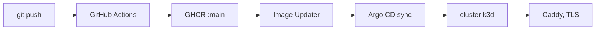

Hiện server mới chỉ chạy trên máy dev. CI, image container và bản triển khai production cho server nằm trong phần việc để sau, chưa làm. App Android được build và cài bằng Gradle.

## Hệ thống GitOps

Repo tổng có sẵn một bộ GitOps trong `deploy/`. Một cluster k3d chạy Argo CD, giữ cluster khớp với các manifest Kubernetes trong `deploy/k8s`. Repo của từng thành phần có workflow GitHub Actions build image rồi đẩy lên GHCR với tag `:main` và `:sha-<commit>`. Argo CD Image Updater theo dõi digest của `:main`, digest đổi thì kích hoạt sync. CI không bao giờ chạm vào cluster, vì cluster tự kéo bản cập nhật về.

Caddy trên host lo TLS và chuyển tiếp vào Traefik ingress của cluster. Tên miền public chỉ được cấu hình trong Caddy.

<Callout type="warning">
Phần lớn manifest trong `deploy/k8s` là của hệ thống cũ: API gateway, NATS, Redis và storefront Next.js. Chúng không dùng được cho server mới, vốn cần Postgres với ParadeDB, Restate và RustFS.
</Callout>

## Tài liệu

Hiện tài liệu đi đúng con đường trên. `docs/Dockerfile` build trang Astro bằng Bun rồi phục vụ bản tĩnh bằng nginx. Có hai build argument: `DOCS_BASE` cho tiền tố đường dẫn và `DOCS_INTERNAL` để bật tab Developers nội bộ. Cluster phục vụ image này trên subdomain `docs.` riêng.

## Server cần gì khi lên production

Server đã từ chối khởi động ở production nếu còn để các lối tắt dành cho dev. `APP_ENV=prod` bắt buộc có identity key của Restate, có credential push thật và tắt số test của PNV. Ở đó log nên để dạng JSON (`LOG_FORMAT=json`).
