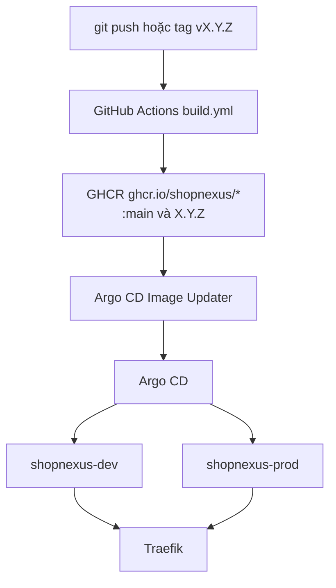

Server, website, tài liệu và staff console chạy trên một cluster k3d, chia thành hai stack là dev và prod. Mỗi stack có namespace riêng và có Postgres, Restate, RustFS, LiteLLM của riêng nó. Mọi thứ cluster cần đều nằm trong `infra/` ở repo tổng. App Android được build và cài bằng Gradle, không thuộc cluster.

| Stack | Tên miền | Namespace | Theo dõi |
|---|---|---|---|
| dev | `dev.shopnexus.id.vn` | `shopnexus-dev` | `:main`, theo digest |
| prod | `shopnexus.id.vn` | `shopnexus-prod` | tag `X.Y.Z` mới nhất |

Mỗi stack phục vụ website trên tên miền của nó và bốn host bên dưới: `api.` cho server, `media.` cho object store, `docs.` cho tài liệu và `console.` cho staff console.

Hệ thống đã được build và kiểm tra trên một cluster k3d chạy cục bộ. Việc dựng nó trên server của tác giả và chạy các bài diễn tập failover là bước tiếp theo, nên các host public ở trên chưa hoạt động.

## Từ git push tới pod

Repo của từng thành phần (`server`, `website`, `docs`, `console`) có một file `.github/workflows/build.yml`. Mỗi lần push lên `main`, workflow build image rồi đẩy lên GHCR với hai tag `main` và `sha-<commit>`. Một tag `vX.Y.Z` đẩy tag `X.Y.Z`. Các package để public, vì cluster kéo image về mà không có credential.

Argo CD Image Updater theo dõi GHCR. Với `stack-dev`, nó theo digest của `:main`; với `stack-prod`, nó theo tag `X.Y.Z` mới nhất bằng semver. Nó ghi tag mới thành một tham số Helm trên Application Argo CD của stack, rồi Argo CD sync chart trong `infra/stack` vào namespace của stack đó. CI không bao giờ kết nối tới cluster. Traefik, đi kèm k3s, định tuyến mỗi request theo header `Host` tới các Service của stack.

## Cluster

<Cards cols={2}>
  <Card title="Tổng quan cluster" href="/vi/operations/cluster" icon="ri:node-tree">Các node, hai stack, từng thành phần và số replica của nó.</Card>
  <Card title="Dựng một cluster" href="/vi/operations/cluster/bootstrap" icon="ri:rocket-line">Fork, đặt tên miền, tạo cluster bằng k3d, seal secret, push.</Card>
  <Card title="Biên và mạng" href="/vi/operations/cluster/networking" icon="ri:global-line">Hai chế độ biên, TLS, các host và NetworkPolicy.</Card>
  <Card title="Postgres, Restate và RustFS" href="/vi/operations/cluster/data" icon="ri:database-2-line">Các workload có trạng thái, operator và storage của chúng.</Card>
  <Card title="Phát hành" href="/vi/operations/cluster/releases" icon="ri:price-tag-3-line">dev theo main và prod theo tag phiên bản thế nào.</Card>
  <Card title="Secret" href="/vi/operations/cluster/secrets" icon="ri:key-2-line">Sealed Secrets, lệnh seal và khóa cần sao lưu.</Card>
  <Card title="Cổng mô hình ngôn ngữ" href="/vi/operations/cluster/llm-gateway" icon="ri:robot-2-line">LiteLLM trong mỗi stack, alias search và ngân sách theo ngày.</Card>
  <Card title="Runbook và xử lý sự cố" href="/vi/operations/cluster/runbook" icon="ri:first-aid-kit-line">Lệnh hằng ngày, bài diễn tập và cách sửa các lỗi đã biết.</Card>
</Cards>

## Tài liệu trên GitHub Pages

Tài liệu có thêm một bản triển khai bên ngoài cluster. Mỗi lần push lên `main` của repo docs, `.github/workflows/pages.yml` build trang Astro bằng Bun và xuất bản trên GitHub Pages tại https://shopnexus.github.io/docs/. Bản build đó đặt `DOCS_BASE` theo tiền tố đường dẫn của Pages và bỏ tab Developers nội bộ. Image trong mỗi stack được build với `DOCS_BASE=/` và phục vụ trang ở gốc của `docs.<domain>`.

## Server kiểm tra gì ở production

Server từ chối khởi động với `APP_ENV=prod` khi:

- `RESTATE_IDENTITY_KEY` để trống;
- `FCM_CREDENTIALS` để trống, khi đó push chỉ được ghi log;
- `PNV_TEST_NUMBERS=true`, khi đó số test của PNV đăng nhập được.

Ở mọi môi trường, server cũng từ chối khởi động khi còn migration chưa chạy, vì vậy Job `migrate` chạy trước server trong mỗi stack. Chart đặt `APP_ENV` theo `appEnv` trong file values, đặt `PNV_TEST_NUMBERS=false` trong `values-prod.yaml` và `LOG_FORMAT=json` ở cả hai stack; các biến khác của server nằm ở trang [Cấu hình](/vi/operations/configuration).
