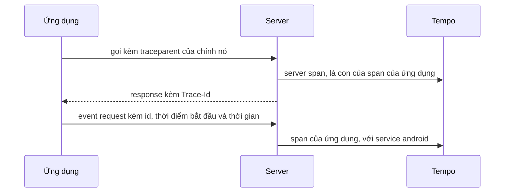
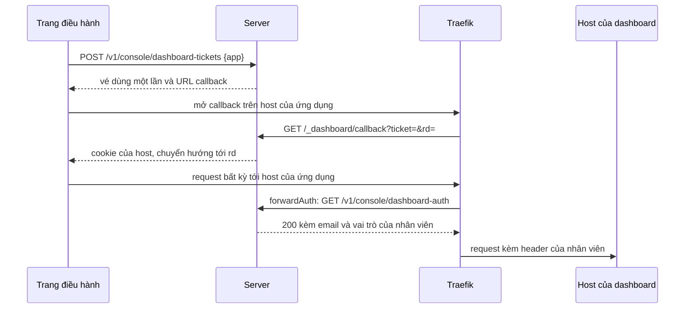

Mỗi stack có một Grafana, phía sau là Loki, Tempo và Prometheus, dùng image `otel-lgtm`. Server gửi log, trace và metric tới đó qua <Term id="otlp">OTLP</Term>/HTTP. Website và ứng dụng gửi số đo của riêng chúng tới server, và server cũng biến chúng thành metric và dòng log. Phần này đáp ứng <Req id="NFR-OBS-01" />.

## Từ một lần gọi lỗi tới log của nó

Response nào cũng có header `Trace-Id`, và body lỗi lặp lại nó ở `trace_id`. Tìm id đó trong Grafana là thấy trace của request trong Tempo và các dòng log của nó trong Loki.

Nếu `OTEL_EXPORTER_OTLP_ENDPOINT` để trống thì không có gì ra khỏi process. Span vẫn có id, nên header, body lỗi và dòng log vẫn khớp nhau.

## Log

- Log ghi ra stdout và gửi qua OTLP cùng lúc. Log ở dạng text khi dev và JSON trên cluster (`LOG_FORMAT`).
- Dòng log ghi trong lúc xử lý một request có `trace_id` và `span_id`.
- Mật khẩu, mã OTP và token không bao giờ bị ghi log. Số điện thoại và địa chỉ email được che bớt.
- Mỗi request kết thúc bằng một dòng truy cập, `request`: method, route pattern, status và thời gian xử lý, cùng ứng dụng client, quốc gia và một id người truy cập. Id người truy cập là tài khoản hoặc nhân viên; với khách, đó là hash của địa chỉ và ngày, nên không theo dấu được khách qua nhiều ngày. Health probe và các lần gọi website tự thực hiện cho chính nó thì không có người truy cập. Bot được đánh dấu là client `bot`, và User-Agent của nó được giữ lại, cắt ngắn.

## Trace

- Mỗi request HTTP mở một server span đặt tên theo route pattern, không bao giờ theo đường dẫn thô. Mỗi câu SQL mở một span con.
- Mỗi lần server gọi sang service khác mở một client span đặt tên theo method và host, và gửi tiếp `traceparent`. Kể cả các lần gọi tới ingress của Restate, nên handler của một durable flow nhập vào trace của request đã khởi động nó.
- Mỗi lần thử của một handler Restate mở một server span tên `Service/Handler`. Handler được thử lại hoặc bị tạm dừng thì có một span cho mỗi lần thử.
- Thời gian ứng dụng tự đo cho một lần gọi trở thành root span trong trace của lần gọi đó; xem [event của client](#event-của-client).
- Mọi request đều được lấy mẫu.

## Metric

Metric được export mỗi 10 giây. Mỗi process export dưới instance id riêng, nên hai replica không bao giờ gộp thành một series. Thời gian xử lý là histogram tính bằng giây, các bucket từ 5 ms tới 10 s.

| Metric | Đo gì |
|---|---|
| `http.server.request.duration` | request tới API, theo route pattern, method, status và ứng dụng client |
| `http.client.request.duration` | các lần server gọi ra ngoài, theo host, method và status, hoặc theo lỗi khi không có câu trả lời |
| `restate.invocation.duration` | các lần thử của handler Restate, theo service và handler |
| `db.client.connection.*` | pool của database: đang dùng, rảnh, tối đa và số lần chờ |
| runtime và container | CPU và bộ nhớ so với giới hạn của container, goroutine, heap và thời gian chờ scheduler |
| bộ đếm nghiệp vụ | số lần đăng nhập theo kết quả, số mã OTP đã gửi, refresh token bị dùng lại, event đã giao cho Restate |
| gauge tồn kho | những gì sàn đang có lúc này; xem bên dưới |
| `client.*` | những gì website và ứng dụng đo được; xem [event của client](#event-của-client) |

### Gauge tồn kho

Các module account, catalog, deal, chat, trust và support mỗi module export gauge cho số dòng nó đang giữ. Mỗi module đếm bảng của chính nó, nên process chỉ chạy vai trò AI thì không có gauge nào.

| Gauge | Chia theo |
|---|---|
| `account.accounts` | status: active, suspended. Bỏ qua tài khoản đã xóa và tài khoản của chính ShopNexus. |
| `account.accounts.phone_verified` | không chia |
| `catalog.listings` | status: processing, active, hidden, rejected, reserved, sold |
| `catalog.listing_drafts` | không chia; các bản nháp chưa hết hạn |
| `deal.deals` | status: negotiating, agreed, sold |
| `deal.orders` | status: pending, shipped, completed, failed, cancelled |
| `chat.conversations` | kind: pair, support |
| `trust.reports.open`, `trust.report_cases.open` | không chia |
| `trust.reviews` | role: seller, buyer; bỏ qua đánh giá đã xóa |
| `support.tickets.open` | không chia |

Mỗi gauge chạy truy vấn nhiều nhất một lần mỗi phút và lặp lại câu trả lời gần nhất trong khoảng giữa. Truy vấn lỗi thì giữ câu trả lời cũ và ghi một cảnh báo vào log cho tới khi truy vấn thành công trở lại. Gauge có chia luôn có một series cho mỗi giá trị, kể cả 0. Mọi process API export cùng các con số, nên panel lấy `max` qua các instance. Toàn bộ truy vấn mất khoảng 100 ms trên 110.000 tin đăng của dữ liệu dev.

Không có gauge cho tin nhắn gần đây, vì tin nhắn không có index trên thời điểm tạo.

## Event của client

`POST /v1/client-events` nhận một lô tối đa 50 event từ website hoặc ứng dụng Android. Ai cũng gọi được. Nó không lưu dòng nào: mỗi event trở thành một metric và đôi khi một dòng log. Bậc rate limit của nó, `telemetry`, cho một địa chỉ client gửi 2 lô mỗi giây, cho phép dồn tới 60. Server của website chuyển tiếp địa chỉ của người mua, nên các lô của nó được tính theo từng người mua.

| Event | Metric | Dòng log |
|---|---|---|
| `error`, lỗi script website không bắt được | `client.errors` theo ứng dụng | `client error`, kèm trang, thông điệp và stack |
| `vital`, một Core Web Vital | `client.web_vital.duration` cho LCP, INP, FCP và TTFB, `client.web_vital.cls` cho CLS, theo ứng dụng và tên | không có |
| `request`, một lần gọi API theo thời gian client đo | `client.request.duration` theo ứng dụng, route, method, status và mạng | `client request`, cho lần gọi không có câu trả lời, lỗi 5xx hoặc mất từ 3 s trở lên |
| `search_impression`, `search_click` | `client.search.impressions` và `client.search.clicks` theo ứng dụng và dải vị trí (1, 2, 3, 4–5, 6–10, 11–20, 21+) | mỗi event một dòng, kèm `search_id` |

Trang không bao giờ là nhãn. Server tự đọc route của request từ đường dẫn, nên client không tự bịa được giá trị nhãn; đường dẫn không route nào phục vụ được tính là `other`.

Còn crash của ứng dụng thì gửi lên Crashlytics, vì bản release của ứng dụng đã được minify và Crashlytics map ngược được stack.

### Thời gian mạng của ứng dụng trong trace

Ứng dụng không export span nào, và Tempo không nhận span từ bên ngoài. Server export span của ứng dụng thay cho nó, nên một lần gọi chậm cho thấy thời gian đã đi đâu.

Dòng log `client request` mang `Trace-Id` của response, nên một lần gọi chậm hoặc lỗi trên điện thoại dẫn thẳng tới phần xử lý của nó trên server.

### Nối một lượt bấm với lần tìm kiếm của nó

Mỗi response của `GET /v1/search` mang một `search_id` mới, và dòng log `search terms` của server ghi nó cạnh câu truy vấn. Impression và lượt bấm mang cùng id đó, nên Loki nối được một lượt bấm với câu truy vấn đã hiện kết quả.

## Dashboard

Các dashboard và luật cảnh báo là một bộ file trong `infra/stack/grafana`. Chart và các stack compose ở local đều nạp chúng. Pods và Platform đọc Prometheus riêng của cluster, nên chỉ có trên cluster.

| Dashboard | Trả lời câu hỏi gì |
|---|---|
| Server | Server có gần giới hạn CPU, bộ nhớ hay pool không? Route, host gọi ra, handler Restate và câu SQL nào chậm hoặc lỗi? Đăng nhập, mã OTP và event đang thế nào, và các cảnh báo mới nhất là gì? |
| Marketplace | Có bao nhiêu tin đang bán, đã bán và được đăng trong khoảng thời gian, bao nhiêu đơn đang giao, và bao nhiêu người đi từ tìm kiếm tới mua? Nó đọc các gauge tồn kho. |
| Users | Ai đang online lúc này, đã đăng nhập hay chưa, từ ứng dụng và quốc gia nào, và bao nhiêu traffic là bot? Nó đếm từ các dòng truy cập trong Loki. |
| Clients | Trang website tải nhanh cỡ nào (LCP, INP, CLS), lỗi script nào xảy ra, lần gọi từ ứng dụng mất bao lâu theo mạng, và vị trí kết quả nào được bấm? |
| Platform | Các host public có chạy và chứng chỉ còn hợp lệ không? Traefik, Postgres, Restate và Bifrost thế nào, và các agent tiêu bao nhiêu cho mô hình? |
| Pods | Pod nào chạy, khởi động lại hoặc dùng nhiều CPU, bộ nhớ và ổ đĩa nhất, và các node đầy tới đâu? |

## Cảnh báo

Grafana đánh giá các luật cảnh báo ở mọi stack. Stack dev gửi cảnh báo tới một nhóm Telegram.

| Cảnh báo | Kích hoạt khi |
|---|---|
| API 5xx | hơn 2% request API lỗi 5xx trong 5 phút |
| API slow | p95 của API trên 2 s trong 10 phút |
| Server silent | không process server nào gửi metric trong 5 phút |
| External calls failing | hơn 20% lần gọi tới một host lỗi trong 5 phút |
| Many failed sign-ins | hơn 30 lần đăng nhập thất bại trong 15 phút |
| Refresh token reused | bất kỳ refresh token đã xoay vòng nào được dùng lại |
| Website script errors | hơn 20 lỗi script trong 15 phút |

Cluster thêm các luật từ Prometheus riêng của nó: một host public ngừng chạy, chứng chỉ TLS sắp hết hạn, pod khởi động lại hoặc chưa sẵn sàng, ổ đĩa hoặc bộ nhớ của node gần đầy, Postgres ngừng chạy, thiếu connection hoặc giữ một transaction lâu, và các cảnh báo [Bifrost](/vi/operations/cluster/llm-gateway) về lần gọi mô hình bị lỗi, key nhà cung cấp bị lỗi và agent hết ngân sách tháng.

## Mở các dashboard vận hành

Grafana, giao diện của Restate, giao diện của Bifrost, console của RustFS, pgweb trên database của stack và, ở stack prod, Argo CD mỗi thứ nằm trên một host riêng: `grafana.`, `restate.`, `bifrost.`, `s3.`, `db.` và `argocd.` dưới tên miền của stack. Không ai đăng nhập thẳng vào chúng. Nhân viên mở chúng từ trang điều hành, và Traefik hỏi server trước mỗi request.

Mỗi ứng dụng có một mức sàn, là vai trò thấp nhất trên trang điều hành được mở nó. Grafana bắt đầu từ điều phối viên, các ứng dụng khác từ quản trị viên. Quản trị viên đổi mức sàn trong phần cài đặt của trang điều hành, và mỗi lần đổi là một thao tác `dashboard.floor` trên trang điều hành. Thanh bên của trang điều hành chỉ hiện các dashboard mà vai trò của nhân viên đó với tới.

1. Trang điều hành xin vé cho một ứng dụng. Vé mở ứng dụng đó một lần, trong vòng 60 giây.
2. Trình duyệt mở callback trên host của ứng dụng. Một câu lệnh đánh dấu vé đã dùng và tạo một phiên dashboard, nên callback thứ hai với cùng vé bị từ chối. Cookie chỉ dành cho host đó và kéo dài bằng thời gian còn lại của phiên trang điều hành.
3. Bước chuyển hướng chỉ theo `rd` khi nó là một đường dẫn thường trên cùng host; mọi giá trị khác đi về `/`.
4. Ở mỗi request sau đó, forwardAuth của Traefik hỏi server. Server trả 200 kèm email và vai trò của nhân viên, Grafana đọc chúng để đăng nhập nhân viên với quyền `Admin` (quản trị viên) hoặc `Viewer` (điều phối viên). Một GET chưa có phiên được chuyển tới `/dashboards/open` của trang điều hành để lấy vé; method khác nhận 401. Vai trò dưới mức sàn, hoặc host mà server không biết, nhận 403.

Phiên dashboard không có thời điểm kết thúc riêng. Nó sống đúng bằng phiên trang điều hành của nó, nên đăng xuất khỏi trang điều hành hoặc bị gỡ khỏi danh sách nhân viên sẽ kết thúc mọi dashboard ở request kế tiếp. Mức sàn cũng được đọc ở mỗi request, nên khi quản trị viên nâng mức sàn, điều phối viên đang mở dashboard sẽ bị chặn ngay.

`DASHBOARD_HOSTS` ánh xạ mỗi ứng dụng tới host của nó. Biến này phải được đặt, và khi nó rỗng thì mọi dashboard đều bị từ chối. Các stack compose ở local chạy đúng như vậy: ở đó Caddy định tuyến các host và tự đăng nhập Grafana với quyền admin.
